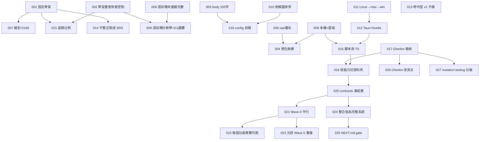

# Decision Map

所有有取捨的決定,ADR 格式,只增不刪。被推翻的標 `superseded`,不刪除——
決策地圖的價值就在於看得到「當初為什麼這樣想、後來為什麼改」。

新增用 `/decide`。

## 怎麼讀

- **Status**:`accepted` 生效 / `superseded by ADR-XXX` 被推翻 / `proposed` 待確認
- **Context** 當時的情況與限制 · **Decision** 決定了什麼 · **Alternatives** 沒選的
- **Consequences** 好處與代價 · **Related** 相關 ADR 與 feature

## 依賴圖



---

## ADR-001 · 排程用固定骨架,不用自適應演算法

- **Status**: accepted · 2026-09-02
- **Context**: 使用者要求考「昨天、一週前、一個月前」,要可預期。FSRS 效果更好但間隔由模型決定,使用者無法預知今天考什麼。
- **Decision**: D1 / D7 / D30 為骨架,答錯退回 D1,連錯觸發重教。排程層為純函式獨立模組。
- **Alternatives**: FSRS 自適應;純固定無回退。
- **Consequences**: 可預期、零依賴、實作簡單。記憶效率略低於 FSRS。排程層可替換。
- **Related**: ADR-007, 014, 015, features/04-scheduler

## ADR-002 · 每日學習量由使用者控制

- **Status**: accepted · 2026-09-02
- **Context**: 原提案每天固定 N 個。使用者要主動權與三個按鈕。
- **Decision**: 教學卡是拉式,無每日上限。只顯示「今天已學 N,明天約 M 題」。
- **Alternatives**: 固定 N=1/2/3。
- **Consequences**: 考試量不可預測,因此需要每日題數上限(015)與週目標護欄(009)。
- **Related**: ADR-009, 015, features/07-teach-card

## ADR-003 · body 上限 100 字,範例圍欄不計

- **Status**: accepted · 2026-09-02
- **Context**: 使用者要「不要讓大腦學太多」,但範例需要空間。
- **Decision**: body ≤ 100(CJK 每字 1、非 CJK 連續序列 1、標點 0)。example 圍欄不計不限,可放圖。程式硬檢查。
- **Alternatives**: 200 / 300 字;範例也計。
- **Consequences**: 生成需重試機制;渲染需自訂 fence 插件。
- **Related**: contracts §2, features/01, 02, 07

## ADR-004 · 深入內容:預生 level 0–1,level 2+ 即時

- **Status**: accepted · 2026-09-02
- **Decision**: ingest 時產 level 0 與 1。level 2+ 按了才生,線上雲端、離線本機並標 provisional。
- **Alternatives**: 全預生;全即時。
- **Consequences**: 九成使用離線可用;需要 provisional 機制。
- **Related**: ADR-005, 006, features/07 phase-3

## ADR-005 · 內容來源 raw 優先,無 raw 才 LLM

- **Status**: accepted · 2026-09-02
- **Context**: 只用 raw 覆蓋率不足;只用 LLM 可信度不足,尤其資安。
- **Decision**: 有 raw 從 raw 產生並帶 source_ref;無 raw 由 LLM 依主題。每張卡帶 source。類別級 `require_raw` 可強制寧缺勿假。
- **Related**: ADR-019, features/02 phase-3

## ADR-006 · LLM 本機與雲端都要,依任務路由

- **Status**: accepted · 2026-09-02
- **Decision**: 單一 `call(task, prompt)` 介面,路由表決定 provider。生成類離線即拒絕;審核與深入可降級並標 provisional。
- **Related**: ADR-004, 016, contracts §7, features/03

## ADR-007 · D30 後繼續 D90、D180,再歸檔

- **Status**: accepted · 2026-09-02
- **Decision**: 五個檢查點,通過 D180 歸檔。
- **Consequences**: 穩態每日題數 ≈ 每日新學 × 5。配合上限 10,長期節奏約每天 2 個新概念。
- **Related**: ADR-001, 015

## ADR-008 · 遊戲化用週目標,不用連續天數

- **Status**: accepted · 2026-09-02
- **Context**: 連續天數有「斷一天就放棄」的已知失敗模式。
- **Decision**: 每週目標,達標即可,週一歸零,無懲罰。
- **Related**: ADR-009, features/08

## ADR-009 · 週目標計新學數,但須通過 D1

- **Status**: accepted · 2026-09-02
- **Context**: 使用者選新學數。設計者指出風險:猛按二十張、隔天考不完、下週歸零。
- **Decision**: 計數以「本週通過 D1 的卡片數」為準。滑過不算。
- **Consequences**: 護欄是設計者加的,使用者可拿掉。計數延後一天反映。
- **Related**: ADR-002, 008

## ADR-010 · 教學順序依 LLM 建立的依賴圖拓樸排序

- **Status**: accepted · 2026-09-02
- **Decision**: ingest 時標 prereqs、建圖、拓樸排序。軟性順序,不阻擋跳學,只顯示先備提示。
- **Consequences**: 需循環偵測;LLM 判斷可能出錯,lint 要能查。
- **Related**: ADR-019, features/01 phase-3, features/07 phase-2

## ADR-011 · 平台順序 Linux → macOS → Windows

- **Status**: accepted · 2026-09-02
- **Consequences**: Wayland 置頂限制需偵測並提示。
- **Related**: ADR-012, features/10

## ADR-012 · 桌面框架用 Tauri 2 + Svelte 5

- **Status**: accepted · 2026-09-02
- **Context**: 需要輕量常駐視窗、系統列、跨平台。使用者授權設計者決定。
- **Alternatives**: Electron。
- **Consequences**: 需 Rust toolchain;體積小、記憶體低;跨平台成本低。
- **Related**: ADR-011, 016

## ADR-013 · 時令型內容 v1 不做

- **Status**: accepted · 2026-09-02
- **Context**: 桃樹管理等季節驅動知識不符合間隔重複模型。
- **Decision**: v1 只做記憶型。時令型留 v2,需要日曆驅動的卡片型別。

## ADR-014 · 不整合現成 SRS 專案,只借概念

- **Status**: accepted · 2026-09-02
- **Context**: 使用者原想把多個開源專案放同一資料夾接線。Anki / SiYuan / Logseq 資料模型與執行環境各異,整合等於重寫。
- **Decision**: 自建。因選固定骨架(001),連 FSRS 函式庫也不需要。
- **Related**: ADR-001

## ADR-015 · 每日上限 10 題,優先序用逾期比例

- **Status**: accepted · 2026-09-02
- **Context**: 原提案「先考到期最久的」被設計者自我修正:D1 晚一天是逾期 100%,D180 晚一天是 0.5%。
- **Decision**: 每日 ≤ 10(可調);優先序 = 逾期天數 ÷ 該 stage 間隔。
- **Related**: ADR-001, 002, 007

## ADR-016 · 腳本改用 TypeScript

- **Status**: accepted · 2026-09-02 · 修正 00-design.md §8
- **Context**: 設計文件寫 Python。但 llm-router 桌面端是 TS,腳本用 Python 就要兩份路由。
- **Decision**: 所有非 Rust 程式碼用 TypeScript,核心放 `packages/core` 共用,腳本用 tsx。
- **Consequences**: 單一語言、單一路由、單一型別。放棄 Python 生態,改用 zod。
- **Related**: ADR-006, 012, 018

## ADR-017 · 用 Gherkin 當驗收規格與測試

- **Status**: accepted · 2026-09-02
- **Decision**: 每個 phase 一個 `.feature`,cucumber 執行。`@manual` 由人確認。沒有 gherkin 不開工。
- **Related**: ADR-018, 026, 027

## ADR-018 · features/ 按能力切,不按里程碑切

- **Status**: accepted · 2026-09-02
- **Context**: 一個能力橫跨多個階段;按階段切會讓同一能力的 gherkin 散落。
- **Decision**: 一個能力一個資料夾,內含多個 phase。roadmap 負責對應到 wave / integration。
- **Related**: ADR-016, 017, 020

## ADR-019 · 新增 config/ 目錄

- **Status**: accepted · 2026-09-02 · 補充 00-design.md §3.1
- **Decision**: `config/categories.yaml` 與 `config/settings.yaml`。
- **Related**: ADR-005, 009, 015

## ADR-020 · 新增 contracts/ 凍結層

- **Status**: accepted · 2026-09-02
- **Context**: 使用者要求「一開始各個資料夾第一階段完全能平行實做」。平行的唯一障礙是「A 需要 B 的型別才能動」。
- **Decision**: 抽出 `contracts/`:所有跨模組型別、檔案格式、函式簽章、路由表、fixture 規範。Wave 0 開始後凍結,修改需 ADR 並列出要重驗的 phase。
- **Alternatives**: 讓 01-data-layer 先做完當前置(那樣就沒有平行);每個模組自己定義介面,整合時協調(整合會撞成一團)。
- **Consequences**: 多一層要維護。改契約成本高——這是刻意的。換來十個資料夾真正平行。
- **Related**: ADR-018, 021, contracts/

## ADR-021 · Wave 0:十個 phase-1 完全平行,禁止跨資料夾 import

- **Status**: accepted · 2026-09-02
- **Context**: 使用者要求第一階段完全平行。
- **Decision**: 每個資料夾的 phase-1 只能 import `contracts/` 與自己的目錄。需要別人的能力就用 contract 介面 + 自己的 stub。這條由 `/phase-done` 檢查。
- **Alternatives**: 允許依賴但排順序(那不是平行);只讓部分資料夾平行(複雜度不減、好處減半)。
- **Consequences**: 十個資料夾可同時開工。代價是 Wave 0 有重複(見 023)。
- **Related**: ADR-020, 022, 023

## ADR-022 · 每個功能必須能單獨執行,整合後仍然要能

- **Status**: accepted · 2026-09-02
- **Context**: 使用者要求「每個資料夾內的功能也能單獨運行」。
- **Decision**: 每個 `FEATURE.md` 有「單獨執行」段落,寫一行可複製的指令。`/phase-done` 實際執行它。整合後仍須能跑——這是刻意的耦合約束。
- **Alternatives**: 只在 Wave 0 要求(那整合後模組會慢慢黏死)。
- **Consequences**: 每個模組要有 CLI 或 dev server 入口,是額外工作。換來的是模組永遠可以單獨 debug,以及一個永遠有效的耦合檢測器。
- **Related**: ADR-021

## ADR-023 · 接受 Wave 0 的重複,整合時移除

- **Status**: accepted · 2026-09-02
- **Context**: 平行的代價是幾份 FakeLlmRouter、幾個最小驗證器。
- **Decision**: 接受。每個 `FEATURE.md` 有「Wave 0 的重複」表,列出東西、位置、在哪個整合點移除。`/integrate` 逐一檢查。
- **Alternatives**: 為了避免重複而排順序(等於放棄平行)。
- **Consequences**: 一點重複遠比一個依賴鏈便宜。額外好處:09-lint 的獨立驗證器與 01 的驗證器可以互相對照,結論不同就代表契約有歧義——這是只有在有兩份獨立實作時才做得到的檢查。
- **Related**: ADR-021, features/09 NEXT.md

## ADR-024 · 每個整合點都必須是完整可用的系統

- **Status**: accepted · 2026-09-02
- **Context**: 使用者要求「每一次整合就是一個完整可用的系統」。
- **Decision**: 八個整合點,每個的驗收 gherkin 都必須有至少一個 `@e2e` 場景描述「一個人從頭到尾做完一件有意義的事」。寫不出來就代表切錯了,重切。每個整合檔另有 `@regression` 場景驗證前一個整合點沒被弄壞。
- **Alternatives**: 按技術層次整合(先全部後端再全部前端)——那樣中間好幾個月沒有可用的東西。
- **Consequences**: I2 之後系統就有價值。專案在任何整合點停下來,手上都有能用的東西。代價是整合點的切法受限,不能純粹按技術方便切。
- **Related**: ADR-025, docs/integration/

## ADR-025 · 每個資料夾用 NEXT.md 管理 gate

- **Status**: accepted · 2026-09-02
- **Context**: 使用者要求「每個資料夾內也要有文檔指揮 AI 何時進行下一步的 gherkin 開發」。
- **Decision**: 每個資料夾一個 `NEXT.md`:目前狀態、下一個 phase 的 gate(自身 / 整合 / 契約三類)、gate 未滿足時該做什麼、完成後解鎖什麼。`/sprint` 讀它決定 ready,不手動改狀態。
- **Alternatives**: 只在 roadmap 集中管理(AI 在資料夾內工作時看不到);只靠 FEATURE.md 的依賴表(說得出「等什麼」但說不出「現在該做什麼」)。
- **Consequences**: 「gate 未滿足時該做什麼」是最有價值的段落——它防止 AI 在等待時瞎猜介面、寫出要重寫的程式。
- **Related**: ADR-024

## ADR-026 · Gherkin 用英文,文件用中文

- **Status**: accepted · 2026-09-02 · 修正 ADR-017 的語言選擇
- **Context**: 使用者要求 gherkin 全英文。
- **Decision**: 所有 `.feature` 用英文(cucumber 預設語言,無需 language 標頭)。`docs/`、`FEATURE.md`、`NEXT.md`、commands、skill 用繁體中文。
- **Alternatives**: 全中文(zh-TW,cucumber 原生支援);混用。
- **Consequences**: 步驟定義的字串是英文,與程式碼一致。中文的說明性文件保留在需要細膩表達的地方。
- **Related**: ADR-017

## ADR-027 · 導入 mutation testing 並分三級門檻

- **Status**: accepted · 2026-09-02
- **Context**: 使用者要求加入 mutation testing。這個專案的核心是排程邏輯,算錯要幾週後才發現,行覆蓋率抓不到。
- **Decision**: 用 Stryker。三級門檻:嚴格 95%(scheduler、grading 前兩層、字數與驗證器、weekly 計數、路徑防護)、標準 80%(ingest、lint、路由決策)、寬鬆不強制(adapter、CLI、UI 元件)。`/phase-done` 前必跑。技能檔 `.claude/skills/mutation-testing/`。
- **Alternatives**: 只用行覆蓋率(抓不到「執行到但沒驗證」);全專案統一門檻(UI 追高分沒有意義,會浪費時間)。
- **Consequences**: 驗收變慢。換來排程與審核邏輯的信心。明確禁止「為衝分數寫斷言」——那會在重構時變成阻力。
- **Related**: ADR-017, .claude/skills/mutation-testing/

## ADR-028 · 組合層不參與 Wave 0

- **Status**: accepted · 2026-09-02
- **Context**: v2 漏了一個交付物:整合 gherkin 到處寫 "the review command",但沒有任何 feature 資料夾產出它。04 是純函式、05 是審核、06 是 UI,沒有人負責把它們串起來。
- **Decision**: 新增 `11-review-cli`,phase-1 在 I2。它**不參與 Wave 0**——組合層在被組合的東西存在之前無法獨立,硬造一個吃 stub 的版本等於寫兩次。這是 ADR-021 的明確例外。
- **Alternatives**: 把 CLI 塞進 04 或 05(職責不對);讓它有一個吃 stub 的 Wave 0 版本(重工)。
- **Consequences**: Wave 0 是十一個 phase 不是十二個。`11-review-cli` 同時是 `06-test-card` 的行為規格來源——CLI 先定案,UI 只是換皮。
- **Related**: ADR-021, features/11-review-cli

## ADR-029 · 契約分硬約定與軟約定

- **Status**: accepted · 2026-09-02 · 修正 ADR-020
- **Context**: v1.0 把整份契約都凍死。但 TypeScript 型別改了編譯器會抓、測試會抓,走 ADR 是儀式不是保護。使用者也反映「不要約束太緊」。
- **Decision**: **硬約定**(磁碟格式 §2 §3 §4 §8–§12,加 §7 的 `LlmTask` 與路由表)改動需 ADR。**軟約定**(記憶體介面 §5 §6 §13、§7 的函式簽章)改了跑測試、更新文件、commit 說明理由即可。
- **Alternatives**: 全凍(太重);全不凍(AI 跨 session 會漂移)。
- **Consequences**: 改函式簽章不再是一場儀式。磁碟格式仍然受保護,因為改了會讓已產生的資料失效。契約升版至 1.1.0。
- **Related**: ADR-020, contracts/README.md

## ADR-030 · 只有嚴格級的變異門檻是硬性的

- **Status**: accepted · 2026-09-02 · 修正 ADR-027
- **Context**: v2 讓 `/phase-done` 在任何門檻未達時都擋住。對 UI 與 adapter 來說這是浪費時間。
- **Decision**: **嚴格級(95%)未達 → 擋住**,因為那些模組算錯的代價是延遲數週才顯現。**標準級(80%)未達 → 回報但不擋**,由你決定要不要處理。**寬鬆級 → 不跑。**
- **Alternatives**: 全部硬性(拖慢);全部軟性(排程邏輯會鬆掉)。
- **Consequences**: 驗收變快。代價是標準級模組的測試品質靠自律。這個取捨是刻意的:嚴格級涵蓋了所有「錯了會靜默」的地方。
- **Related**: ADR-027

## ADR-031 · 流程分核心與選配,可以只用核心

- **Status**: accepted · 2026-09-02
- **Context**: 一百多個檔案的流程對一個人來說偏重。使用者要求「不要約束太緊」。
- **Decision**: 明確區分**核心**(契約、gherkin、`/phase-done` 的測試與單獨執行檢查)與**選配**(sprint 檔、`/integrate` 的完整清單、decision map 的 mermaid 圖、變異測試的標準級)。`03-agile-workflow.md` 新增「最小模式」段落說明只用核心怎麼跑。
- **Alternatives**: 全部必做(會被放棄);刪掉選配的部分(專案長大時會後悔)。
- **Consequences**: 流程是為了保護你不犯已知的錯,不是為了被遵守而存在。用不到就關掉,需要時再開。
- **Related**: ADR-025, docs/03-agile-workflow.md

## ADR-032 · prompt 改動需要 golden run

- **Status**: accepted · 2026-09-02
- **Context**: `packages/core/prompts/` 決定卡片、考題、審核的品質,但它不是程式,型別檢查與單元測試都抓不到。LLM 產品最常見的靜默退化就是改了 prompt、品質下降、幾週後才發現。
- **Decision**: 新增 `12-prompt-quality`。每個 prompt 任務有固定的 golden 輸入;改 prompt 要跑一次 live golden run 並與基準比對;人打分數(兩個維度各 1–5)。工具**不判斷品質**,只讓變化被看見。另有結構性自動檢查(字數、JSON 合法、rubric 條數)。
- **Alternatives**: 不做(唯一會靜默毀掉品質的洞);用 LLM 自動評分(評分者跟被評者同源,信不過)。
- **Consequences**: 改 prompt 多一道手續。`CLAUDE.md` 加一條:改了 prompt 沒跑 golden 就 commit,是這個專案唯一會靜默毀掉品質的操作。
- **Related**: features/12-prompt-quality

## ADR-033 · cucumber 用 tsx 的 ESM loader 載入 TypeScript

- **Status**: accepted · 2026-09-02
- **Context**: `@cucumber/cucumber` 11 + `"type": "module"`,步驟檔是 TypeScript。載入方式有 ts-node、tsx、先編譯三種,而這件事擋住所有自動驗收。
- **Decision**: `package.json` 的三個 `accept*` 腳本前綴 `NODE_OPTIONS=--import=tsx`;`cucumber.js` 維持 `import: ['features/steps/**/*.ts']`。步驟檔之間互相 import 寫 `./_world.js`(ESM 慣例,tsx 對應到 `.ts`)。
- **Alternatives**: ts-node/esm(維護慢、ESM 支援不穩);先 `tsc` 再跑(多一步,而且 vitest 與 scripts 已經都走 tsx)。
- **Consequences**: 整個 repo 的 TypeScript 執行只有一條路(tsx)。Windows(I8)要把 `NODE_OPTIONS=` 前綴改成 `cross-env`,到時再處理。**注意 `cucumber.js` 本身的格式**:`export default` 本身就是 default profile 的內容,不能再包一層 `default: {...}`——包了會讓 `@cucumber/cucumber` 11 安靜退回內建預設,`import` 完全不會發生,所有 step 變成 undefined,看起來像「還沒實作」而不是設定錯了。Wave 0 scaffold 時埋了這個坑,多個 worker 各自撞見,詳見 ADR-036。
- **Related**: ADR-016, ADR-017, ADR-036, features/steps/README.md

## ADR-034 · 雲端 provider 用 OpenAI,模型名只從環境變數來

- **Status**: accepted · 2026-09-02
- **Context**: 待決表的「雲端 provider 與模型」擋著 03-llm-router/phase-1 的 `@llm` 場景。使用者決定用 OpenAI,金鑰在 `.env`(`OPENAI_API_KEY`,已 gitignore),模型名 `gpt-5.6-luna`(協調者已用 API 驗證存在)。
- **Decision**: provider 與模型名不寫死在程式碼。依契約 §11 從 `LLM_CLOUD_PROVIDER` / `LLM_CLOUD_MODEL` 讀,其次 `settings.llm`。`.env.example` 記錄變數名與目前值;只有 CLI 入口用 `process.loadEnvFile` 載入 `.env`,library 只讀 `process.env`。OpenAI adapter 用 `max_completion_tokens`(該模型不接受 `max_tokens`)。
- **Alternatives**: 寫死模型名(換模型要改程式);同時做 Anthropic adapter 的真呼叫(契約保留 `anthropic` 值,adapter 要有,但 Wave 0 只有 OpenAI 有金鑰,Anthropic 走 mock)。
- **Consequences**: 換模型只改 `.env`。`contracts/fixtures/learning-minimal/config/settings.yaml` 仍寫 anthropic 當範例,環境變數會覆蓋它。
- **Related**: ADR-006, contracts/types.md §7 §11, features/03-llm-router/FEATURE.md
- **refined by ADR-076(2026-10-17)**:「`.env` 只在入口讀」不變;側車這個長駐行程改成每次 `start` / `submit` 重讀 `.env`(仍只在 `scripts/_env.ts`),並新增缺金鑰時的樣板訊息。

## ADR-035 · Wave 0 平行開發的落點與共用檔歸屬

- **Status**: accepted · 2026-09-02
- **Context**: 使用者決定打破 WIP ≤ 2,十一個 phase-1 各開一個 git worktree 同時做。互踩只會發生在共用檔與同一個目錄,所以要在分叉前定好。
- **Decision**:
  1. 落點表在 `packages/core/README.md`,`scripts/check-boundaries.ts` 的 `OWNERS` 是同一份表的程式版。每個功能一個 `packages/core/src/<name>/`(含自己的 stub),UI 在 `apps/<name>/`。
  2. `packages/ui-shared/`(example 圍欄插件)Wave 0 由 07-teach-card 擁有;06-test-card 在 I3 前不 import 它。
  3. 共用檔只有協調者改:`package.json`、lock、`tsconfig.json`、`cucumber.js`、`standalone.json`、`features/steps/_world.ts`、`features/steps/common.steps.ts`、`docs/01-roadmap.md`、本檔。worker 把需求寫在自己 FEATURE.md 的「待協調」段。
  4. 出現在兩個以上資料夾的 gherkin 句子只在 `common.steps.ts` 定義一次;只用在 `@manual` 場景的句子不定義。
  5. 所有依賴一次裝在 root(workspaces hoisting),worktree 只跑 `npm ci`,不動 lock。
  6. 合併順序:01 先,再 04,其餘隨到隨合;每次合併後跑 `boundaries`、`test`、`accept:standalone`、`standalone`。
- **Alternatives**: 各 worktree 自己加依賴與 workspace(lock 必衝);允許 06 與 07 同時寫 ui-shared(同檔互踩)。
- **Consequences**: worker 的自由度小一點,但合併幾乎不會衝突。`CLAUDE.md` 的「WIP ≤ 2」在 Wave 0 暫時不適用,Wave 0 之後恢復。
- **Related**: ADR-021, ADR-022, ADR-023, ADR-071(第 2 點的例外:06、07 可以 import 14 的 `packages/ui-shared/src/hud/`), packages/core/README.md, scripts/check-boundaries.ts

## ADR-036 · cucumber.js 設定檔格式修正、standalone 指令的預期退出碼

- **Status**: accepted · 2026-09-02
- **Context**: Wave 0 十一個 phase-1 平行開發期間,四個獨立 worker(01、03、04、08,後續 09、10、12 也各自回報同一件事)分別發現 `cucumber.js` 的 `export default { default: {...} }` 巢狀寫法在 `@cucumber/cucumber` 11 + `package.json` `"type":"module"` 下不會被正確解析——ESM `await import()` 讀到的是 `{ default: <export default 的值> }`,程式只在該值是 function 時才展開,object 時直接當設定物件用,於是 `paths`/`import`/`tags` 全部讀不到,`npm run accept*` 對全 repo 每個功能都回報所有 step undefined。ADR-033 決定了 loader 機制(tsx + `--import`),但沒發現這個設定檔本身的格式錯誤,一路帶到 Wave 0 平行開發才被多個 worker 各自撞見。另外,09-lint 的單獨執行指令設計上就該回傳非 0(找到問題就是要失敗),但 `scripts/check-standalone.ts` 原本一律要求退出碼 0。
- **Decision**:
  1. `cucumber.js` 的 `export default` 直接就是 default profile 的內容,不再包一層 `default: {...}`;移除已棄用的 `publishQuiet`。額外 profile 要用具名 export(例如 `export const ci = {...}`),不要塞進這個物件。
  2. `standalone.json` 的每個項目可以加 `expectExit`(選填,預設 0),`scripts/check-standalone.ts` 用它比對退出碼而不是寫死要求 0。`09-lint` 設成 1。
- **Alternatives**: 針對 09-lint 在 `check-standalone.ts` 特殊判斷資料夾名稱(硬編碼例外,難維護);cucumber.js 改用具名 export 取代 `export default`(要同步改 `package.json` 的 `--profile` 參數,改動面更大)。
- **Consequences**: 這個 bug 存在期間,所有 worker 的 `npm run accept:standalone` 都是假失敗,只能用 `NODE_OPTIONS=--import=tsx npx cucumber-js --import 'features/steps/**/*.ts'` 繞過驗證——這件事後續被 phase-acceptance 拿來當「不要照抄範例設定檔,要跑得動才算數」的教訓。順帶在收尾複查時發現 `packages/core/src/llm/router.ts`(FEATURE.md 標嚴格 95%)合併時變異測試只有 52.54%,審核階段沒人針對它單獨重跑 Stryker——之後嚴格級模組的審核要明確在報告裡點名每一個「檔案級」嚴格門檻,不能只看整個目錄的總分。
- **Related**: ADR-033, ADR-035, packages/core/README.md, features/*/FEATURE.md 的「待協調」段

## ADR-037 · 本機模型延後,不是 v1 就要做

- **Status**: 部分 superseded by ADR-039 · 2026-09-04(gate「使用者決定裝本機模型」已解除:模型由另一台機器的 Ollama + JWT 閘道提供。「不在這台機器的 GTX 1650 上跑本機模型」這個理由仍然成立,契約 §7 的降級路徑也沒有改。)· 原 accepted · 2026-09-03
- **Context**: 待決表的「本機模型與硬體」擋著 03-llm-router/phase-2 的本機 adapter。機器實測:`ollama` 已安裝但沒在跑、`~/.ollama/models` 是空的(12K)、GPU 是 GTX 1650(**4GB VRAM**)、RAM 31GB。14B(Q4 約 9GB)塞不進 GPU 會大半跑 CPU、很慢;7B(約 4.7GB)部分 offload 可用但應用審核能力有限;3B 全進 GPU 快但更弱。使用者決定**先跳過本機模型,不是永久不做**——確認過契約 §7 的路由表本來就定義了「離線+無本機」這個分支(`ingest.*`、`deepen`、`grade.apply`、`reteach.short` 丟 `NO_MODEL`/`CLOUD_REQUIRED`,`grade.fill.llm` 丟 `NO_MODEL`),§5 的 `fallback-strict` grader 就是給填空第三層沒本機模型時走的,所以「跳過本機」等於系統長期停在 `probeLocal()` 回傳 `{ available: false, models: [] }` 這個契約已經定義好的狀態,不需要改硬約定。
- **Decision**: 本機模型延到 I6 或之後,gate 是「使用者決定要裝哪個模型、什麼時候裝」,不是技術上做不到。落實:
  1. `03-llm-router/phase-2` 範圍收斂成:路由表(契約 §7)+ 雲端 adapter(已在 phase-1 做完)+ 上線偵測 + `probeLocal` 固定回 `{ available: false, models: [] }`。這部分嚴格 95% 門檻不變,要測滿。
  2. 本機 adapter(真的呼叫 ollama HTTP API)與所有「本機模型可用」的場景,搬到 `03-llm-router` 的新 phase(phase-4,phase-3 保留給 ADR 之前規劃的 provisional 佇列,兩者都掛在「使用者決定裝本機模型」這個 gate 下)。FEATURE.md 標 `todo`,NEXT.md 契約 gate 寫清楚。
  3. `05-grading/phase-3`(離線審核)與 I6 涉及本機推論的那一半,gate 同上,一併延後。I1–I5 的其餘 phase 不受影響,照原計畫走。
- **Alternatives**: 現在就裝 7B 湊合用(使用者評估 4GB VRAM 效果不夠好,不值得為了湊 v1 而用一個體驗差的本機模型);永久砍掉本機模型只留雲端(使用者明確表示是延後不是砍,保留 §7 路由表與 fallback-strict 設計讓之後隨時能補)。
- **Consequences**: 離線時(no wifi/沒網路)應用審核與深入生成不可用、填空第三層固定走 fallback-strict,這是契約本來就設計好的降級路徑,不是新缺口。03-llm-router/phase-2 的契約 gate 解除,可以立刻跟 01-data-layer/phase-3 平行開工。I6(長期維護、provisional 複審)在使用者真的裝本機模型前,價值會打折扣,到時候再評估要不要調整範圍。
- **Related**: ADR-034, **ADR-039**, contracts/types.md §5 §7, features/03-llm-router/NEXT.md, features/03-llm-router/FEATURE.md

## ADR-039 · 本機模型透過閘道提供,解除 ADR-037 的 gate

- **Status**: accepted · 2026-09-04
- **Context**: ADR-037 把本機模型延後,gate 是「使用者決定要裝哪個模型、什麼時候裝」,理由是這台機器只有 GTX 1650 4GB VRAM,塞得進去的模型太弱。現在使用者提供了另一條路:**另一台機器**跑 Ollama(`qwen2.5:32b`、`deepseek-r1:70b`),前面一個 JWT 閘道,所以模型不在本機 GPU 上,但對這個專案來說就是契約 §7 的「本機」那一欄。閘道協定(使用者提供,已確認):
  - `POST {BASE}/auth/token/exchange`,header `Authorization: Bearer <明文 key>` → `{ access_token }`(短期 JWT)
  - `GET {BASE}/gateway/models`(Bearer token)→ `{ auto_match, models: { <name>: [...] } }`,`models` 的 key 就是可用模型名
  - `POST {BASE}/gateway/chat`,body `{ prompt, model, service }` → `{ content, provider: "ollama", model, tokens_used, ... }`
  - `/gateway/chat/stream` 是 SSE(這個 phase 不用,先只走非串流)
  - **`model` 只能填本機模型名**,填雲端模型名或 `"auto"` 會回 **403**
  - 免費(使用者自己的硬體),沒有 token 成本
  - 設定:`GATEWAY_BASE_URL`(先 `http://localhost:8787`,之後換成網域)、`GATEWAY_API_KEY`、`LLM_LOCAL_MODEL`(預設 `qwen2.5:32b`)

  同時要解決的是相反方向的問題:雲端(OpenAI)是唯一會花錢的一邊,目前沒有任何花費上限,一個跑掉的迴圈可以在無人看管時燒掉很多錢。閘道免費,所以「預算用完就改走閘道」是自然的煞車。

- **Decision**:
  1. **閘道就是契約 §7 的「本機」,不改契約。** 閘道 adapter 回傳的 `LlmResult.provider = 'ollama'`(閘道自己回報的就是這個值),`model` 是 `LLM_LOCAL_MODEL`。`probeLocal()` 的實作改成:換 token → `GET /gateway/models`,回 `{ available, models }`。token 快取到過期前重用(回應有 `expires_in` / `expires_at` 就用它,沒有就當 50 分鐘),過期才重換。401(key 錯)與連線失敗都回 `{ available: false, models: [] }`,**不 throw**——沿用 phase-2「本機模型不在不是錯誤」的行為。
  2. **路由:契約 §7 的表一格都不動**,只在「在線」這一欄之上多一層**備援規則**(規則本身記在 `features/03-llm-router/FEATURE.md`):
     - `grade.fill.llm` 一律走閘道——契約本來就寫 local,不是新規則,只是現在真的有 local 了。`provisional = false`(填空審核本來就該由本機做,不算暫定結果)。
     - `deepen` / `grade.apply` / `reteach.short`:在線走 OpenAI;**OpenAI 失敗(5xx / 逾時 / 截斷重試後仍失敗)或當日預算用完 → 改走閘道,`provisional = true`**,進 I6 的複審佇列(phase-3)。
     - `ingest.cards` / `ingest.questions` / `ingest.deps`:**只走 OpenAI,沒有備援**,失敗就 `CLOUD_REQUIRED`;預算用完就 `BUDGET_EXCEEDED`(拒絕開始,印「今日預算已用完」)。使用者明確選的:卡片品質還沒用本機模型驗過,不讓它產卡。
  3. **當日預算**:`LLM_DAILY_CAP_USD`(預設 1 美元)。花費從 `state/log.jsonl` 的 `llm_call` 事件算——只算 `provider === 'openai'` 且 `ts` 落在當日的事件,`tokens_in` / `tokens_out` 乘上 `LLM_PRICE_IN_PER_M` / `LLM_PRICE_OUT_PER_M`(每百萬 token 的美元價)。閘道的呼叫(`provider === 'ollama'`)不計入,因為免費。
  4. **「剛好等於上限」算已達上限**(`spent >= cap`,不是 `>`)。理由:(a) 上限是天花板,不是配額目標;下一次呼叫必然超過它。(b) log 算出來的數字本質上是**低估**——正在進行中、還沒寫 log 的那一次呼叫不在裡面,浮點乘法也可能少一點點。錢的方向上保守比較安全。(c) `>=` 是單一比較,沒有 off-by-one 的解讀空間,測試邊界只有一個點。這個判斷寫成 `spend.ts` 的 `isBudgetExhausted()`,兩邊(router 備援與 `scripts/llm-spend.ts` 的退出碼)共用同一個函式,不會各寫一份而不一致。
  5. **落點**:備援規則與預算計算**不放進 `routing.ts`**,各自獨立成 `packages/core/src/llm/fallback.ts` 與 `spend.ts`——比照 `token-limits.ts` 刻意不併進 `routing.ts` 的做法(ADR-036 的教訓),避免動到 `routing.ts` 既有的嚴格 95% 變異門檻。閘道客戶端在 `packages/core/src/llm/gateway.ts`,把三者串起來的 router 在 `router-gateway.ts`(組合既有的 `LlmRouterImpl`,不改它一行,跟 phase-2 包 phase-1 的做法一致)。另外新增 `scripts/llm-spend.ts --today`,印出今日金額與筆數,**退出碼 1 表示已達上限**,給 autopilot 在花錢前先問一句用。
  6. **閘道還沒起來**(8787 無回應、key 未進 `.env`),所以 phase-4 的 `@llm` 場景先用 mock 閘道(照 `features/steps/_fake-cloud.mjs` 的模式:只換掉 `globalThis.fetch`,router / adapter 全跑真的),真連線的場景標 `@manual`,等使用者起閘道再跑。

- **Alternatives**:
  - **閘道只當純備援,不做 `grade.fill.llm` 的填空審核** → 契約 §7 明寫 `grade.fill.llm` 走 local,而且填空審核量大、又是免費資源,不用等於浪費。
  - **`ingest.*` 也備援到閘道** → 使用者明確拒絕。卡片是幾個月要看的東西,本機模型產卡的品質還沒有 golden run 驗過,寧可失敗也不要靜默降級成品質未知的卡。
  - **把閘道當第四種 provider 值(例如 `'gateway'`)** → 要改契約 §7 的 `LlmResult.provider` 硬約定。沒必要:閘道回報的就是 `ollama`,而且對呼叫端來說「這是本機模型的結果」才是它要知道的事,不是「經過哪一台代理」。
  - **預算用完就整個停下來(連 `deepen` 也不做)** → 太粗暴。免費的閘道就在那裡,`provisional = true` + I6 複審佇列本來就是為了這種「先用著、之後再校對」的情況設計的。
  - **花費另外存一份 counter 檔** → `log.jsonl` 已經有 `llm_call` 事件帶 `tokens_in`/`tokens_out`(契約 §10),再存一份就有兩個真相來源,而且 counter 檔要處理原子寫入與跨日重置。從 log 算是純函式,好測。

- **Consequences**:
  - **ADR-037 的 gate 解除** → `03-llm-router/phase-3`(provisional 佇列)與 `phase-4` 的契約 gate 打勾;`05-grading/phase-3` 與 I6 的離線那一半也一併解開。ADR-037 標 **部分 superseded**:「使用者決定裝本機模型」這個 gate 沒了,但「不在這台機器的 GTX 1650 上跑本機模型」這個理由仍然成立——模型跑在另一台機器上。
  - `03-llm-router/phase-4` 的標題改成「**閘道本機 adapter + 預算備援**」,範圍比原本的「本機 adapter」大(多了預算與備援)。
  - 離線(連不到閘道也連不到 OpenAI)的行為完全不變,還是契約 §7 那張表——閘道只是讓「有 local」這一欄第一次真的會發生。
  - 多了三個環境變數要設(`GATEWAY_BASE_URL` / `GATEWAY_API_KEY` / `LLM_DAILY_CAP_USD` 那組價格),`.env.example` 已經記錄。價格是手填的,方案改價沒人會提醒——預算會算錯,但方向可控,而且 `scripts/llm-spend.ts` 印得出來可以對帳。
  - 閘道在另一台機器上,所以「本機」的可用性從此取決於網路與那台機器有沒有開,不是這台機器的 GPU。`probeLocal()` 的逾時要短(當可用性檢查用),不能用雲端那個 60 秒。

- **Related**: ADR-034, ADR-036, ADR-037, `contracts/types.md` §7 §11, `features/03-llm-router/FEATURE.md`, `features/03-llm-router/NEXT.md`

## ADR-038 · 依賴圖丟邊達上限時,移除該分類的過期圖資料

- **Status**: accepted · 2026-09-04
- **Context**: ADR 之前的一輪把「模型回應有循環」改成本地丟邊修復(見 `packages/core/src/ingest/deps.ts` 的 `removeCyclesLocally()`):丟邊丟到無環為止,丟邊次數達上限(`cards.length`)仍有循環就 **`graph/deps.json` 與 `graph/order-<category>.json` 都不寫**,維持契約 §8「要嘛都寫、要嘛都不寫」的不變量。但 early return 只保證「**這一次**不寫」。如果上一次成功的 run 已經寫過檔,舊的 entry 與舊的 order 檔還留在磁碟上,讀的人拿到的是**過期的圖卻完全看不出來**——這跟剛修掉的「考題生成靜默失敗」是同一類洞。查過 09-lint 目前有哪些檢查(`contracts/fixtures/learning-broken/EXPECTED.md` 與 `features/09-lint/phase-1.feature`),**沒有**「卡片不在 order 裡」這一條,零筆,所以「留著舊檔 + 標記讓讀的人自己判斷」在現階段等於沒有人會判斷。
- **Decision**: 丟邊達上限仍有循環時,除了原本就要記的那筆 `warning`(含殘留循環路徑)之外,**移除該分類的過期圖資料**。粒度是**分類**,不是整個檔:
  1. 契約 §8 的 `graph/deps.json` 型別是 `Record<CategoryId, Graph>`,**一個檔裝所有分類**。所以要讀進整個檔、**只刪掉該分類的 key**、整檔**原子重寫**(寫 `.tmp` → `fsync` → `rename`,比照契約 §11b;§11b 字面上規範 `state/`,但這裡是同樣的資料完整性需求,照做)。其他分類的 entry 一個都不能動。**絕對不是刪掉整個 `deps.json`**——那會毀掉其他分類的圖。
  2. 刪掉 `graph/order-<category>.json`(一類一檔,直接刪)。
  3. **移除後 `deps.json` 變成空物件 `{}` 時,檔案留著**。理由:`{}` 是 `Record<CategoryId, Graph>` 的合法值(契約 §8 沒有「至少一個分類」的要求);而且對消費者來說「檔在、key 不在」跟「檔不在」是同一個答案(這個分類沒有圖),留著空物件少一條程式路徑、也少一個「刪 key 成功但刪檔失敗」的中間失敗態。
  4. 所有邊界情況都不丟錯(`deps.json` 不存在、`deps.json` 沒有該分類的 key、`order-<category>.json` 不存在):呼叫端這時候已經在處理另一個錯誤(殘留循環),清理失敗不該把那筆 warning 蓋掉。
  落點:`packages/core/src/ingest/deps.ts` 的 `removeCategoryGraph(outDir, category)`,由 `analyzeDependencies()` 的 `unresolved` 分支呼叫。
- **Alternatives**:
  - **(b) 保留舊檔 + 寫一個 stale 標記**:多一個磁碟格式要進契約(標記放哪、什麼形狀、誰清掉),而且現階段**沒有任何消費者會讀那個標記**——07-teach-card 與 11-review 都直接讀 order 檔。等於付了契約的代價卻換不到任何偵測能力。
  - **(c) 保留舊檔,等 09-lint 抓**:09-lint 目前沒有「卡片不在 order 裡」這條檢查(查證過,零筆),所以等於靜默。要走這條得先擴充 09 的檢查表,把一個現在就能收斂的磁碟狀態問題推遲成另一個功能的待辦。
  - 兩者相對於 (a) 的成本差:圖是**衍生資料**,可以從卡片重生,失去上一次成果的代價只是一次 `ingest.deps` 呼叫。
- **Consequences**:
  1. **「沒有圖」是一個明確狀態**(檔不存在,或檔在但沒有這個分類的 key)。消費者(07-teach-card 的學習順序、11-review)遇到就**回報「這個分類沒有學習順序,請重跑 ingest」,不是當成空陣列**。空陣列會讓「沒有圖」跟「圖是空的」看起來一樣,那正是這個 ADR 要消滅的東西。本輪不改 07/11,但之後那些 phase 照這條做。
  2. 上一次成功的圖會被丟掉,要重跑一次 `ingest.deps` 才回得來。緩解方式已記在 `features/02-ingest-pipeline/NEXT.md` 的開放問題:之後給 `scripts/ingest.ts` 一個 `--deps-only` 入口,讓「只重生圖」不用整篇重 ingest。本輪不做。
  3. 這一輪只寫測試與本 ADR,`removeCategoryGraph()` 的函式體是 `throw new Error('not implemented')`,對應的測試是紅燈,由下一輪開發 agent 補上。
- **Related**: ADR-032, contracts/types.md §8 §11b, packages/core/src/ingest/deps.ts, features/02-ingest-pipeline/phase-2.feature


## ADR-043 · 機器指標抓字面重複,語意重複歸人打分

- **Status**: accepted · 2026-09-04
- **Context**: 12-prompt-quality/phase-2 的批次結構性檢查要加「重複率」——同一批卡兩兩比,body 字元 3-gram Jaccard >= 0.6 或標題正規化後相同就算一對。工單原本以 I1-REVIEW §8.1 人判的 4 對當基準,但實測(2026-09-04,`packages/core/src/prompt-quality/fixtures/i1-security-batch.ts`,I1 那次真實 ingest 的 25 張安全類卡)推翻了它:
  - 25 張兩兩共 **300 對全比,門檻 0.6 之下是 0 對**。
  - 人判定的那 4 對(`sec-0007`/`sec-0015`、`sec-0006`/`sec-0016`、`sec-0003`/`sec-0013`、`sec-0003`/`sec-0014`)實際分數只有 **0.132 / 0.082 / 0.057 / 0.019**。
  - 300 對裡最高的是 **0.357**(`sec-0019`/`sec-0021`),**而且不在人判定的名單裡**——排序上它壓在那 4 對之上。
  - 要含進最弱的那一對就得把門檻降到它的實際值 **0.0185**(顯示成 0.019 是四捨五入),那會抓到 **75 對**(300 對的 25%);門檻設在字面的 0.019 是 72 對,但那樣**連最弱的那一對都收不進來**。只比 prereq 相連的 **33 對**也一樣分不開(0.306、0.221、0.152 都排在那 4 對之上)。
  - 原因:那 4 對是**中文改寫式的語意重複**(「預檢請求」與「CORS 預檢請求」講同一件事、用字不同),字元 3-gram 抓的是**逐字**重複。沒有任何閾值能把它們挑出來而不誤報一堆。
- **Decision**: 演算法與 0.6 的門檻**不動**。機器指標的用途是**回歸偵測**——prompt 改動之後,同一批卡的逐字重複度有沒有跳動——**不是取代人判斷語意重複**。I1 這批在這個指標下的真實基準就是 **0 對**,golden 之後拿它比。這件事在 `packages/core/src/prompt-quality/batch-checks.test.ts` 有一個專門的測試釘住,免得之後有人看到 0 對就以為檢查壞了。
- **Alternatives**:
  - **降閾值到抓得到那 4 對**:得降到 0.0185,誤報 75 對(佔 300 對的 25%),清單長到沒人會看,不可用。
  - **改用 LLM 判斷語意重複**:直接違反 ADR-032「工具不判斷品質」——而且判斷者跟被判斷者是同一類模型,自己審自己。
- **Consequences**:
  1. golden 跑兩次之後可以依實際分佈調閾值。閾值與 n-gram 大小是 `structural-checks.ts` 的具名常數(`DUPLICATE_BODY_JACCARD_THRESHOLD`、`DUPLICATE_NGRAM_SIZE`),`checkDuplicates()` 也吃 `{ threshold }` 覆寫,調的就是它。
  2. **語意重複由人承擔**:`SCORES.md` 的「是一個概念嗎」維度與人眼。ADR-032「工具不判斷品質、人只打兩個分數」的原則不變,phase-2 **不加第三個人打的維度**;批次檢查的數字放在 SCORES.md 下方獨立的「機器檢查(不用填)」段。
  3. 這個指標的已知限制寫進 `features/12-prompt-quality/FEATURE.md`,之後看到 0 對的人先讀那一段再決定要不要調閾值。
- **Related**: ADR-032, features/12-prompt-quality/FEATURE.md, packages/core/src/prompt-quality/structural-checks.ts, docs/integration/I1-REVIEW.md §8.1


---

## ADR-040 · §11b 補齊:失敗清理與目錄 fsync

- **Status**: accepted · 2026-09-04
- **Context**: `atomicWriteJson()`(`packages/core/src/ingest/state.ts`,注意**不在** `schema/` 底下)是 `state/` 全部寫入共用的唯一入口,也被 `graph/deps.json` 借用(ADR-038)。它照契約 §11b 的字面做了三步:寫 `<name>.tmp` → `fsync(fd)` → `rename`。02-ingest-pipeline 的審核輪(`features/02-ingest-pipeline/REVIEW.md` §8.4 第 4 點)指出兩個洞,兩個都是 pre-existing,不是哪一輪引進的:
  1. **失敗時留 `.tmp` 殘檔**。`renameSync()` 丟錯時 tmp 檔還在磁碟上。下一次寫入會 `openSync(tmp, 'w')` 截掉它,所以不會累積,但期間磁碟上多一個沒有人負責的半成品檔;更糟的是 09-lint 之類「掃目錄看有什麼」的消費者會看到它。
  2. **`rename` 之後不 `fsync` 目錄**。`fsync(fd)` 只保證**檔案內容**落地,不保證**目錄項**落地。嚴格講,斷電時可以出現「新內容已經在磁碟上,但 rename 還在目錄的 page cache 裡」——整個 rename 丟掉,目標檔還是舊的、tmp 檔以新內容留著。這正是 §11b 想擋掉的那一類「幾個月的記憶資料寫壞一次就沒了」。
  兩個洞都**超出契約 §11b 的字面要求**,所以修它們不是「實作沒照契約做」,而是「契約當初寫得不夠完整」。
- **Decision**: §11b 從三步改成**四步**,並補上失敗清理:
  1. 寫 `<name>.tmp`
  2. `fsync(fd)`
  3. `rename`
  4. **`fsync(目標所在的目錄)`**
  加上:**任何一步失敗 → 先刪 tmp,再把錯誤丟出去**(`try`/`finally`,而不是每個步驟各包一次 catch)。清理用「刪不掉就算了」的形式(`rmSync(tmp, { force: true })` 之類),**清理過程自己丟的錯不可以遮蔽原本那個錯誤**——呼叫端要看到的是「為什麼寫失敗」,不是「為什麼清不掉」。
  第 4 步唯一的例外:目錄 `fsync` 回 **`EINVAL`** 視為成功。tmpfs 與部分 CI 的檔案系統不支援對目錄 fsync,那是「這個 fs 沒有這個概念」,不是資料完整性問題。**其他任何錯誤碼(`EIO` 等)一律往外丟,不吞**——吞掉 `EIO` 等於把「磁碟壞了」變成靜默成功,正是這個 ADR 要消滅的形狀。
  **tmp 檔名維持 `<name>.tmp`**,不加隨機後綴:這是單一程序的桌面程式,沒有兩個 writer 互相踩的場景;§11b 寫死的名字也是消費者(與既有測試)看得到的東西,不動它。
  **這是「把既有保證補齊」,不是「改磁碟格式」**——落地的檔案內容、檔名、目錄結構一個位元組都沒變,變的只有「怎麼把它安全放上去」。所以雖然 §11b 掛在硬約定底下,走這條小 ADR 即可,不需要完整的 decision-record 流程(技術顧問判定)。
  落點:`packages/core/src/ingest/state.ts` 的 `atomicWriteJson()`,行為規格見同目錄 `state.test.ts`。
- **Alternatives**:
  - **(b) 只補目錄 fsync,殘檔不管**:殘檔是兩個洞裡比較不痛的那個(下一次寫入會截掉),但同一個函式反正要動,分兩次改沒有省到任何東西,而且「失敗後磁碟是乾淨的」本來就該跟「寫入是原子的」寫在同一條保證裡。
  - **(c) tmp 檔名加隨機後綴(`<name>.<pid>.<rand>.tmp`)**:能容忍多個 writer 併發,但這個專案沒有那個場景;代價是殘檔清理從「刪一個固定名字」變成「掃目錄找 pattern」,而且 §11b 的檔名是契約寫死的,改它就真的是改磁碟格式(消費者看得到目錄裡多出什麼檔),要走完整流程。用不到的彈性換一條硬約定變更,不划算。
  - **(d) 目錄 fsync 的錯誤全吞**:實作最短,但把 `EIO` 也吞掉,等於「磁碟真的壞了」跟「這個 fs 不支援」看起來一樣。這正是 ADR-038 在圖資料上剛消滅過的形狀,不能在寫入層再造一個。
- **Consequences**:
  1. `atomicWriteJson()` 的呼叫端**行為不變**:成功路徑多兩個 syscall(開目錄 fd、fsync 它),回傳值與寫出的位元組完全一樣。目前的呼叫端是 `ingest.ts`(`needs-review.json`、`ingested.json`)與 `deps.ts`(`writeCategoryGraph()`、`removeCategoryGraph()`),都不用改。
  2. 失敗路徑的錯誤**型別與訊息不變**(丟出來的還是 fs 原本那個 `Error`,帶原本的 `code`),只是多了「磁碟上不會留 tmp」這條保證。既有測試不需要調整。
  3. 這一輪**只寫本 ADR + 測試**,`atomicWriteJson()` 的函式體維持現況(三步、不清理),對應的新測試是紅燈,由下一輪開發 agent 補上。
  4. 變異門檻:`atomicWriteJson()` 是 `state/` 全部寫入的單一入口,列**嚴格級 95%**(比照 01-data-layer 的門檻)。`stryker.config.json` 的 `mutate` 已經涵蓋 `packages/core/src/**/*.ts`,不用改設定。**注意**:這個函式住在 `packages/core/src/ingest/state.ts`,不在 `packages/core/src/schema/**`——01-data-layer 的 FEATURE.md 寫的變異範圍是後者,所以它**不在 01 的自動範圍內**,審核輪要手動指定 `--mutate` 跑。要不要把 `state.ts` 正式併進 01 的驗收範圍,留給協調者決定。
  5. **Windows 上目錄 fsync 會失敗,但不是原本以為的原因。** 開發輪提報「`openSync(dir,'r')` 在
     Windows 丟 `EISDIR`」,審核輪查證後**推翻**:libuv 開檔帶 `FILE_FLAG_BACKUP_SEMANTICS`,
     所以 `openSync(dir,'r')` 在 Windows **會成功**;真正失敗的是下一步 `FlushFileBuffers()`,
     它要求 `GENERIC_WRITE`,錯誤碼是 **`EACCES`**,不是 `EISDIR`。
     **所以把 `EISDIR` 加進吞掉清單並不會修好 Windows。**
     處理**延到 I8**(桌面端 Windows,需要一台 Windows 實機才驗得了):
     - 不選「把 `EACCES` 也吞掉」——那會把 Linux 上真正的權限錯誤一起吞掉,違反本 ADR 剛立的
       「其他一律往外丟」。
     - 候選解法是 `process.platform === 'win32'` 時跳過目錄 fsync,**但必須在真 Windows 上驗過再寫**;
       在沒有 Windows 環境的情況下寫平台分支,就是本 ADR 想避免的「憑推測寫沒法驗證的程式」。
     見 `features/10-desktop-shell/NEXT.md` 的 phase-5 待辦。

- **Related**: ADR-038, contracts/types.md §11b, packages/core/src/ingest/state.ts, features/02-ingest-pipeline/REVIEW.md §8.4


---

## ADR-041 · 損壞的 deps.json 要有自己的名字,不跟殘留循環搶同一筆 warning

- **Status**: accepted · 2026-09-04
- **Context**: ADR-038 讓 `analyzeDependencies()` 在「丟邊達上限仍有殘留循環」時呼叫 `removeCategoryGraph()` 移除該分類的過期圖,然後記一筆帶殘留循環路徑的 `warning`。02-ingest-pipeline 的審核輪(`features/02-ingest-pipeline/REVIEW.md` §8.4 第 3 點)指出:`removeCategoryGraph()` 讀 `graph/deps.json` 用的是裸的 `JSON.parse`,檔案**存在但內容不是合法 JSON** 時會直接丟出 `SyntaxError`,那筆 warning 就永遠寫不出去。ADR-038 只列了三個邊界(檔不存在、沒有該分類的 key、order 檔不存在),沒有這一個;`writeCategoryGraph()` 也是同樣的形狀(pre-existing)。審核輪照 CLAUDE.md 的「做決定時」規則沒有默默選一個,列著等決定。
- **Decision**: 這**不是**「warning 被蓋掉」要去補救的問題,而是**兩個不同的失敗要各自有名字**。圖檔整個讀不出來的時候,「殘留了哪一條循環」這筆 warning 在語意上根本到不了——連上一次的圖長什麼樣都不知道,報一條循環路徑並不描述現在磁碟上發生的事。所以:
  1. `removeCategoryGraph()` 的 `JSON.parse` 失敗包成 **`GraphFileCorruptError`**(`packages/core/src/ingest/errors.ts`),帶 **`path`**(哪一個檔)與 **`head`**(檔案開頭 **200 位元組**解成 UTF-8)。200 位元組夠分辨「空檔 / 被截斷 / 被別的東西覆寫」,又不會把整份圖倒進 log。
  2. `analyzeDependencies()` 記一筆 `reason: 'graph file corrupt'` 的 `warning`,**恰好一筆**——殘留循環那筆**不記**。
  3. **不覆寫、不刪那個檔**,order 檔也不動。損壞的內容是現場,留給人看;程式沒有任何理由相信自己能猜出使用者本來有什麼分類。
  4. 錯誤往外丟,**CLI 以非 0 退出碼結束**。連帶決定:`runIngestPipeline()` 目前那個「依賴圖分析失敗,已略過」的 catch-all **必須把 `GraphFileCorruptError` re-throw**,不能吞。吞掉的話 CLI 會以 0 退出,而且會多記一筆跟真正原因無關的 warning,兩條決定同時破功。
  落點:`packages/core/src/ingest/errors.ts`(新檔)、`deps.ts` 的 `removeCategoryGraph()`、`ingest.ts` 的 deps catch-all。
- **Alternatives**:
  - **(b) 用 try/catch 把 `JSON.parse` 的錯吞掉,當成「deps.json 不存在」處理**:程式最短,而且跟 ADR-038 那三個邊界一致(「清理失敗不該把 warning 蓋掉」)。但那三個邊界的共同點是**磁碟狀態本來就是對的**(沒有東西要刪);「檔在但讀不出來」不是,它是一個真的壞掉的檔。當成不存在會讓下一次 run 直接把它整個覆寫掉,使用者永遠不知道曾經壞過——正是 ADR-038 花整篇在消滅的「靜默」。
  - **(c) 把損壞的檔改名成 `deps.json.corrupt-<ts>` 再繼續**:保住現場也讓流程往下走。但它是一個**新的磁碟產物**,要進契約 §12(誰產生、誰清掉、09-lint 要不要當成違規),為了一個罕見錯誤付一次契約變更;而且「繼續走」意味著下一次 run 會寫出一個只含本次分類的新 `deps.json`,其他分類靜默消失——比留著壞檔更糟。
  - **(d) 直接沿用 `SyntaxError`,只在訊息裡補路徑**:不用新型別,但呼叫端沒辦法用 `instanceof` 區分「圖檔壞了」與「模型回應不是 JSON」(`fetchEdges()` 也在丟 parse 錯),而 (4) 的 re-throw 判斷正需要這個區分。
- **Consequences**:
  1. `GraphFileCorruptError` 是**唯一**會從 `analyzeDependencies()` 逃出去、且呼叫端該區別對待的錯誤型別。其他失敗(模型回應壞掉、寫檔失敗)維持原本的處理方式不變。
  2. `writeCategoryGraph()`(成功路徑)的同一個裸 `JSON.parse` **這一輪不動**。它不在「已經在處理另一個失敗」的位置上,裸丟出去就已經是可見的失敗、CLI 也已經非 0 退出,沒有被蓋掉的 warning。要不要為了型別一致也包起來,留給之後的一輪決定,不在這次範圍。
  3. 「圖檔損壞」在 `state/log.jsonl` 有穩定的機器可讀特徵(`type: 'warning'` + `reason: 'graph file corrupt'`),之後 09-lint 要加檢查時有東西可以接。
  4. 這一輪**只寫本 ADR + 測試**:`GraphFileCorruptError` 這個 class 本身寫好(測試要 import 它),但 `removeCategoryGraph()`、`analyzeDependencies()`、`runIngestPipeline()` 三個落點都只加 `TODO(ADR-041)` 註解、行為維持現況,對應的測試是紅燈,由下一輪開發 agent 補上。
- **Related**: ADR-038, ADR-040, contracts/types.md §8 §11b, features/02-ingest-pipeline/REVIEW.md §8.4, packages/core/src/ingest/errors.ts


---

## ADR-042 · learning/ 自成 git repo,snapshot 掛在複習結束,v1 不排程

- **Status**: accepted · 2026-09-04
- **Context**: 契約 §11b 前半(tmp → fsync → rename → fsync 目錄,ADR-040)擋的是「**一次寫入被撕成兩半**」。它完全不擋另一半:寫入本身好好的,但寫進去的是錯的東西,或是某個指令把 `cards/` 刪掉了。§11b 最後一段本來就寫了解法——「另外,`learning/` 建議是一個 git repo。`state/` 的變更每天自動 commit 一次(由 `scripts/snapshot.ts` 做,或你自己排程),這樣任何損毀都可以回溯」——但那一段從來沒有人實作:`learning/` 不是 git repo,`scripts/snapshot.ts` 不存在(`package.json` 裡的 `npm run snapshot` 指向一個不存在的檔),使用者幾個月的複習資料**沒有任何回溯能力**。主 repo 這邊剛剛才把 `learning/` 加進 `.gitignore`(commit 542f003,依 §11b 它該是自己的 repo),這條 ADR 是同一件事的另一半。
- **Decision**: 三件事。

  **(1) `cli.ts init <dir>` 建完目錄樹之後,把 `learning/` 變成它自己的 git repo。** 順序是 `git init` → 寫 `.gitignore` → 一個訊息為 `init` 的 commit。整段**冪等**:已經是它自己的 repo 就跳過,不重新 init、不再產生第二個 `init` commit、不覆寫使用者可能改過的 `.gitignore`。

  **「是不是它自己的 repo」不可以用 `git rev-parse --is-inside-work-tree` 判斷。** `learning/` 常常就放在主 repo 底下,那句話會因為找到**上層**的 repo 而回 true。要問的是「這個目錄的 repo 根就是它自己嗎」——比對 `rev-parse --show-toplevel` 與 dir 的真實路徑(或直接看 `<dir>/.git` 在不在)。搞錯的後果不是少做事,是**把使用者的卡片 commit 進錯的 repo**。

  **找不到 git 命令 → 印 warning,退出碼仍是 0。** §11b 說的是「**建議**」。把 git 變成 `init` 的必要條件,等於讓一個建議去擋掉整個產品在沒有 git 的機器上的可用性。目錄樹照建、檔案照寫,只是沒有歷史;裝好 git 之後再跑一次 `init` 就補上(冪等的另一個用處)。

  **身分**:該 repo 讀不到 `user.email` 時(全新的機器、CI 容器)才用 `-c user.name=learning-cards -c user.email=learning-cards@localhost` 帶一個退路身分進去。使用者自己設過的身分永遠優先——這是**他的** repo,不是我們的。

  **(2) `.gitignore` 的內容:除了最上層的 `assets/` 以外全部追蹤。**

  ```
  /assets/
  *.tmp
  ```

  `cards/`、`questions/`、`state/`、`graph/`、`config/` 全部進版控——它們才是「壞掉就沒了」的東西,而且全都是純文字,diff 看得懂。`assets/` 是圖片、音訊之類的素材:進版控會讓 repo 一直長大(git 對二進位檔沒有 delta,每改一次存一整份),而且它們是**可以重新取得**的東西,不是記憶資料。開頭那條斜線是有意義的:只擋契約 §12 的那一個最上層 `assets/`,不擋將來可能出現的 `cards/<category>/assets/`。`*.tmp` 擋的是原子寫入的殘留檔——`schema/atomic-write.ts` 用 `.<name>.<pid>.<ts>.tmp`、`ingest/state.ts` 用 `<name>.tmp`,兩種都以 `.tmp` 結尾;正常情況下 rename 完就不存在,但 snapshot 剛好跟一次寫入撞在一起時會看到,commit 進去就是半個檔案。

  **(3) 新增 `scripts/snapshot.ts [--dir learning]`**,做 `git -C <dir> add -A && git commit -m "snapshot <YYYY-MM-DD>"`。**沒有變更就不 commit**,退出 0——每天一個空 commit 會讓歷史裡真正有變化的那幾天找不到。**目錄不是它自己的 repo → 退出 1**,並印「請跑 `cli.ts init`」;目錄不存在、沒有 git 也是退出 1(各自有自己的指引文字)。日期用**當地**日曆日期,不是 UTC 那一瞬間——這是給人看的「哪一天的資料」,半夜跑的時候 UTC 會差一天。

  **(4) v1 不自動排程,改由 11-review-cli 每次複習結束時呼叫一次。** 見下面的 Alternatives。
- **Alternatives**(排程那一格):
  - **(b) cron / systemd timer / launchd**:真正的「每天一次」,而且使用者關掉 app 也會跑。代價是**三個平台三份設定**(cron、launchd plist、Windows 工作排程器),要處理安裝、移除、升級、權限,而且失敗是靜默的——排程沒跑成功,使用者要等到需要回溯的那一天才會發現。為了 v1 的一個備份動作養一整套跨平台排程,投資報酬率太差,而且 10-desktop-shell 的 I5 本來就要做「開機就在」,那時候有現成的地方掛。
  - **(c) 自己起一個 daemon**:v1 沒有常駐程序,而且加一個就要處理「它死了誰重啟」「兩份同時跑會不會互相踩」。為了備份加一個常駐程序,問題比解決的多。
  - **(d) 掛在 `cli.ts init` 或 ingest 結束**:init 一輩子只跑一次,ingest 是偶爾才跑的內容生成。兩個都不是「資料在變」的時刻。
  - **選 (a) 掛在複習結束的理由**:`state/reviews.json`、`state/weekly.json`、`state/log.jsonl` 幾乎只在複習的時候變。「複習完了」正好就是「今天的資料剛剛全部落地」的那一刻,而且**使用者每天都會做這件事**——這就是我們要的「每天一次」,不需要任何排程器。沒複習的那天沒有變更,snapshot 也剛好什麼都不做(見 (3) 的「沒有變更就不 commit」),兩條規則互相咬得剛好。
- **Consequences**:
  1. 呼叫點寫在 **`features/11-review-cli/FEATURE.md` 的範圍與 NEXT.md**,不寫進 `phase-2.feature`。理由:11/phase-2 目前是 `todo`,整份 feature 的步驟一個都還沒寫(`npm run accept:dry` 裡它的 8 個場景全部 undefined)。在那裡加場景,不是讓 undefined 數字再多一個(違反驗收條件),就是逼這一輪去定義一批 phase-2 worker 待會要用的步驟名字——那正是 `features/01-data-layer/FEATURE.md` 已經記過一次的 ambiguous step 陷阱。等 11/phase-2 開工時由該 worker 把場景寫進去。
  2. **落點在 `packages/core/src/schema/git-repo.ts`(01-data-layer)**,不是 11-review-cli:它是「learning 目錄的格式與生命週期」,跟 `init.ts` 同一層。`scripts/snapshot.ts` 的擁有者是 `infra`(`scripts/check-boundaries.ts` 的 OWNERS 表裡本來就有這一行),是膠水,可以直接 import。11-review-cli → 01-data-layer 的邊界例外**已經存在**於 `scripts/boundaries.allow.json`,所以之後接上呼叫點時不用新增例外。
  3. `initLearningDir()` **不動**。git 的部分放在 `cli.ts` 的 `runInit()` 呼叫,不塞進 `initLearningDir()`。原因很實際:`init.test.ts` 斷言 `readdirSync(dir).sort()` 恰好是七個目錄、`result.created` 恰好是那 12 筆——把 `.git/` 與 `.gitignore` 塞進那個函式會把既有的 1008 個測試撞紅一片,而且「建目錄樹」與「掛版本控制」本來就是兩件事。
  4. **不改 `contracts/types.md`**。§11b 那段「建議」的措辭本來就對:git 是建議,不是硬約定,實作也照這個語意做(沒有 git 只 warning)。這條 ADR 是把那個建議實作出來,不是把它升級成硬約定。
  5. `standalone.json` **這一輪不加 `01-data-layer-snapshot` 入口**(共用檔,而且 `npm run standalone` 會真的去跑,現在跑必紅)。建議實作完成後由協調者補一條,已記在 `features/01-data-layer/FEATURE.md` 的待協調。
  6. 這一輪**只寫本 ADR + 測試**:純函式(`LEARNING_GITIGNORE`、`snapshotMessage()`、幾個訊息常數)寫實的,因為測試要 import 它們;四個碰 IO 的函式(`isGitAvailable`、`isOwnGitRepo`、`initGitRepo`、`snapshotLearningDir`)是 `throw new Error('not implemented')`,`cli.ts` 的 `runInit()` 只加 `TODO(ADR-042)` 註解、行為維持現況。對應的測試是紅燈,由下一輪開發 agent 補上。
  7. 變異門檻:`packages/core/src/schema/**` 本來就是 01-data-layer 的**嚴格 95%** 範圍,`git-repo.ts` 自動落在裡面,`stryker.config.json` 不用改。
- **Related**: ADR-040, ADR-041, contracts/types.md §11b §12, packages/core/src/schema/git-repo.ts, scripts/snapshot.ts, features/01-data-layer/phase-4.feature, features/11-review-cli/FEATURE.md


---

## ADR-047 · 量尺自己不准腐爛:訊號目錄漂移是 FAIL,基準只在**量出來的** ran_all 為真時才比

- **Status**: accepted · 2026-09-05(測試輪先落紅測試與本條;實作輪跟進,見 Consequences 1–3)
- **Context**: ADR-044 的報告模式管的是「**哪些測試走了退化分支**」——只報告,不執法。但報告的兩條指標(「從未執行 0」、「未標記 152 只准降」)**完全建立在量尺本身是準的**,而量尺有兩處會**靜默**腐爛,而且都往「更好」的方向動:
  1. **訊號目錄漂了**。`findCallSites()` 掃原始碼反查 `witness('…')`,得出「訊號 目錄/呼叫點/觸發 30/30/30」。兩個方向的漂移都偵測得到,但**都不紅**:目錄有、程式碼找不到呼叫點 → 只在報告 §2 印「⚠ 沒有呼叫點(目錄漂了)」;程式碼有、目錄裡沒有 → 只收進 `unknown` 印一行 ⚠。`problems.push` 全檔只有三處(登記過期、未標記超過基準、結構性錯誤)。少一條訊號 = 少一批可能未標記的測試。
  2. **宣稱全套、實際沒跑完**。`scope` 純粹由 cmdline 推導(沒帶 vitest 參數 = full;`--in … --full` = full);vitest 退出碼非 0 只印一行 ⚠;唯一的守門是 `records.length === 0`。半路崩、只收到一半、`Ctrl-C` 中斷,**全部通過**,而且會印「未標記 N 低於基準 152:可以把 unmarkedBaseline 降到 N」。**那個提示比 FAIL 危險**:FAIL 擋住你,提示誘導你去改基準。`compareBaseline` 的閘門註解已經寫了這件事,但它只擋「部分跑」,沒擋「宣稱全套但沒跑完」。

  一般化(來源:nightmare-assault 2026-09-05):**cmdline 是「宣稱」,`ran / collected` 是「驗證」。鎖只需要宣稱(多鎖一次只是多等);指標需要驗證。**

  2026-09-05 用現況實測三條反向驗證(全部用 `--in <全套的 raw> --full`,不用重跑 vitest):目錄加一條假訊號 → `exit 0`、印 31/30/30 加一個 ⚠;程式碼加一個 `witness('假名')` → `exit 0`、報告 §2 多一行 ⚠;raw 目錄砍掉一半 JSONL 行(保留登記表那兩個檔)→ `exit 0`、「未標記 98 低於基準 152:可以把 unmarkedBaseline 降到 98」。三個洞都在。

- **Decision**: 兩半都升 FAIL(退出碼 1,跟登記過期同一個位置:報告寫完才判,報告要留著看)。
  1. **甲 · 目錄漂移 FAIL。** `unknown` 非空 → `訊號未登記:<名> @ <file:line>`(沒有正當理由,一定是打錯字或忘了登記);目錄裡任何一條沒有呼叫點 → `訊號無呼叫點:<名>,若該退化分支已刪除,請在同一個 commit 從目錄移除`。**目錄不容忍暫時的空**:刪分支的人就是該改目錄的人,同一個 commit——跟 ADR-045 鎖 2、ADR-046 登記過期同形。真有「暫時的空」的需求走目錄條目加 `retired: "<ADR/commit>"` 欄位,不是靜默容忍;**這輪不做**。
  2. **乙 · `ran_all` 是量出來的。** `degraded-report` 自己起 vitest 時加 `--reporter=default --reporter=json --outputFile=<raw>/vitest.json`(**是加不是換**,default reporter 留著),並把退出碼寫到 `<raw>/vitest-exit.json`。三個條件**全滿足**才算 `ran_all`:(1) 退出碼 ∈ {0, 1}(0 全過;1 有測試紅但套件跑完;崩潰 / 中斷是別的碼);(2) `vitest.json` 存在且可解析、有 `success` 欄位、`numTotalTests === passed + failed + pending + todo`;(3) witness JSONL 的 test-end 紀錄數 `=== numTotalTests − numPendingTests − numTodoTests`——**用我們自己的紀錄去對 vitest 的數,這就是 ran == collected**。
  3. **`scope === 'full' && ran_all` 才比基準。** 否則印 `讀不到(全套未跑完:退出碼 X,收到 N/M)`,**不印任何降基準的提示**,以退出碼 1 結束(標題就是「也要擋」)。`--in` 一份沒有那兩個證據檔的舊 raw 目錄加 `--full` 一律讀不到(退出碼 `?`,收到 N/`?`)。`Summary` 多一個 `ranAll` 欄位:`scope` 是宣稱,`ranAll` 是驗證,兩個都寫進 `.json`。沒有 `--full` 的 `--in`(部分跑)沒有宣稱,不判。
  4. **更正(2026-09-05,測試輪):** runtime `ctx.skip()` **寫一列** `status: 'skipped'`(正常列 `status: 'ran'`),`outside` 桶原封不動——不是原案寫的「不寫列、沖到 outside」(見 Consequences 2 的原始發現;那個處置已被否決)。`ran_all` 因此是**兩個等式**,不是一個:
     - 等式 (1) `ran(status ≠ skipped) === passed + failed`——抓「宣稱全套但沒跑完」。
     - 等式 (2) `skipped 列數 === vitest 的 numPendingTests`——抓「skip 突然變多」(`.env` 那一類坑的形狀:環境缺東西 → 整批被 `ctx.skip()` → 數字看起來很乾淨)。
     任一不等就假,`reason` 把兩邊的數字都印出來。**理由**:兩種來源的錯法不同(接線問題 vs 環境/前置條件),混一桶分不出來;而且 138 這個數會把 `outside` 的基準撐大,以後真的漏了幾條 `outside` 看不到。**陽性對照**(實作輪做的反向驗證,證明等式 (2) 不是裝飾):把登記表的 `unmarkedBaseline` 場景之外、拿全套的 raw 目錄把 vitest.json 的 `numPendingTests` 從 138 改成 300(模擬「skip 突然變多」)→ 等式 (1) 仍 2807/2807(綠,因為它只看 ran/passed/failed,跟 pending 無關)、**等式 (2) 變 138/300(紅)**、`ran_all` 假、退出碼 1。若只有壓成一個等式(`列數 = total − pending − todo`)的舊設計,這個場景兩邊會跟著一起變,量不出來、仍然是綠——這就是為什麼要拆成兩個等式。
     另外,静態 `it.skip` / `skipIf` / `-t` 篩掉的測試沒有 `afterEach`,由見證器的 `afterAll` 走一遍 `suite.tasks` 補一列 `status: 'skipped'`、`signals: {}`,等式 (2) 的左邊才跟 vitest 的 `numPendingTests` 同一個定義(不只算 runtime skip)。**已知做不到的一種**:整份檔案的測試全是靜態 skip 時,vitest 把 File 本身標成 skip、`afterAll` 不跑,那些 pending 沒有列可補——等式 (2) 會紅,reason 指名是這種情況;現況 repo 沒有這種檔(唯一的靜態 skip 是 `packages/core/src/prompt-quality/live-run.test.ts` 裡那條 `it.skipIf`,所在檔案有其他會跑的測試,`afterAll` 正常觸發)。
  5. 記成獨立的 ADR-047 而不是補進 ADR-046 的 Consequences:ADR-046 管的是**量尺讀出來的數字怎麼判**(登記表、基準只准降);這條管的是**量尺本身能不能讀**,是同一個東西的另一層。而且「宣稱 vs 驗證」是之後別的守門要引用的一般化原則,埋在別條的 Consequences 裡引用不到。

- **Alternatives**:
  - **(a) 目錄容忍暫時的空**(先印警告,下次再紅):否決。容忍一次就沒有機械理由擋第二次,而且「暫時」沒有到期日;要暫時就明寫 `retired` 欄位。
  - **(b) 乙只印「讀不到」不 FAIL**:否決。印了不擋,下一個人照樣看著 98 去改基準;「讀不到」要有退出碼撐著。
  - **(c) 乙用 vitest 退出碼就好,不對數**:否決。退出碼 1 分不出「有測試紅」與「worker 死了一半但 vitest 收尾成功」;對數(條件 3)才是驗證,退出碼只是第一道。
  - **(d) 乙的條件 3 改成對 `numTotalTests`(含 skipped)**:否決。那是把量尺改成遷就見證器目前多寫的列;setup 檔頭本來就寫「skipped 不進分母」,改見證器讓它說到做到,分母也跟著變準(見 Consequences 2)。
  - **(e) 寫進 ADR-046 的 Consequences**:否決,理由見 Decision 5。

- **Consequences**:
  1. **測試輪(本 commit)**:`scripts/degraded-report.test.ts` 新增 33 條紅測試(甲 12、乙 21),既有 51 條仍綠。紅的原因全是四個尚未存在的 export(`catalogDriftProblems` / `assessRunCompleteness` / `VITEST_JSON` / `VITEST_EXIT_JSON`)與見證器行為,不是既有行為壞掉。甲的子行程測試用 cwd 指到一個**假 git repo**(`_root.ts` 以 cwd 找 root),不改真 repo 的 `witness.ts` 就能讓兩個方向的漂移真的發生。
  2. **發現:乙的條件 3 在乾淨的全套上目前是假的。** 2026-09-05 全套實測:vitest `numTotalTests 2910 / passed 2772 / pending 138`,witness test-end 列數 **2910**,不是 2772。差的 138 全是 `scripts/zero-input-guard.test.ts` 裡測試本體的 `ctx.skip()`——vitest 4 對 runtime skip **照樣跑 afterEach**,見證器就多寫一列 `signals: {}`;`it.skip` / `it.todo` 才真的沒有 afterEach。報告分母那句「skipped 沒有 afterEach,不進分母」對 `ctx.skip()` 不成立,三份基準報告的「測試 N」都含了這些列(只影響分母,不影響未標記數——那些列沒有訊號)。**實作輪要改 `scripts/degraded-witness.setup.ts`**:`afterEach` 對 `ctx.task.result?.state === 'skip'`(或 `mode === 'skip'`)不寫列、tally 沖到 outside;改完全套的「測試」會從 2910 變 2772,那是分母變準,不是變差。
  3. **現況 30/30/30 乾淨**:`findCallSites(REPO_ROOT)` 的 `unknown` 是空的、30 條訊號全有呼叫點,所以甲上線後立刻綠(有一條測試釘住這件事:不綠就是發現,不放寬)。
  4. **已知缺口,這輪不補**:整檔 import 失敗的測試檔(`numFailedTestSuites`,0 個測試)三個條件都過——那個檔的測試沒被收集,`collected` 裡本來就沒有。vitest 會紅(退出碼 1)所以不會靜默,但從量尺的角度它是「少了一批可能未標記的測試」。要補的話看 `testResults[].status === 'failed' && assertionResults.length === 0`。
  5. 舊的 `reports/degraded/.raw/` 目錄(沒有 `vitest.json` / `vitest-exit.json`)從此不能拿來 `--full`,那是對的:它們產生時沒有證據。
  6. 反向驗證三條的實際輸出記在測試輪的 commit 說明;實作輪要再跑一次,期望全部變 `exit 1`,並且全套 `npx tsx scripts/degraded-report.ts` 印 30/30/30、`ranAll: true`。

- **Related**: ADR-044(量尺本體;本條是它的另一層,不改「報告模式」), ADR-045(鎖 2 同形:基準不准靜默腐爛), ADR-046(登記過期同形;Consequences 1 的 30/30/30), ADR-041(空的跟壞的要分得出來:「讀不到」不是「0」), scripts/degraded-report.ts, scripts/degraded-report.test.ts, scripts/degraded-witness.setup.ts

---


## ADR-046 · 退化報告的「刻意」桶用登記表,不上調基準、不做標記機制

- **Status**: accepted · 2026-09-05
- **Context**: ADR-044 的見證器報告有兩條指標:**「從未執行」的訊號要歸 0**(有退化分支卻沒有任何測試走過它,等於那條路沒被測過),以及**「未標記」只准降**(基準 152)。補完最後兩條從未執行的訊號(`spend-no-log-zero`、`attempt-fallback-first`)之後,**未標記從 152 升到 161**——多出來的 9 個經兩份報告 §3 名單比對,**正是那 9 個新測試,沒有任何移除**。

  也就是說:**為了讓「從未執行」歸 0 而補的測試,必然會讓「未標記」上升。** 在 opt-in 的標記機制存在之前,這兩條規則**必然衝突**——新測試走那條退化分支**是它存在的目的**,但它沒有任何標記可以聲明這件事。

  (順帶記一個事實錯誤:協調者在工單裡寫「`spend-no-log-zero` 可能會因 `five-zero-guards` 合併而自然消失」,技術顧問也這樣認為。worker **沒有照做,先用 witness 實測**,證明那支分支只動 `scripts/llm-spend.ts`、不碰 `router-gateway.ts`,不會消失。**兩個人推論一致仍然不等於事實**,見 `docs/paradigm/` 的 A3。)

- **Decision**: 走**登記表**,不動任何測試程式碼。
  1. `scripts/degraded-intended.json`,每條 `{file, test, signal, reason, since}`。**落點在 `scripts/` 不在 `reports/`**——它是彙總的**輸入**不是**產物**,跟 `zero-input-guard.baseline.json` 同一類。
  2. 報告加**第四桶「刻意」**,從「未標記」裡扣除。四桶是 **觸發 / 刻意 / 未標記 / 基準**。
  3. **登記表不准腐爛**(跟 ADR-045 鎖 2 同形):每條都必須對應一個**真實存在、且實際觸發該 signal** 的測試,不觸發 → FAIL「登記過期」。反向驗證兩種都要做:**(a)** 把 `test` 改成不存在的名字 → 紅;**(b)** 把登記的真實測試改成不再走那條分支(或 `it.skip`)→ 紅。**只做 (a) 不夠**,(a) 只證明「名字對得上」,**(b) 才證明「真的還在觸發」**。
  4. `reason` 必填(空白字串算沒填)。
  5. 「未標記」基準**維持 152,不上調**,「只准降」不破例。
  6. 「刻意」桶不設上限,但**每次新增要在 commit 說明**裡交代。
  7. **準入準則:「這個測試存在的目的就是走那條退化分支」**。不符合的**剔除並改 fixture**,不為守數字留例外。
  8. **部分跑不比基準**;登記的檔案沒跑到標「這次沒跑到」不判,**跑到了但測試不在**才算過期。少了這個區分,單檔跑會把 8 條登記全誤判成過期,守門第一天就會被當成雜訊關掉。

- **Alternatives**:
  - **(a) 現在就做最小的標記機制(只夠標這 9 個)**:要動測試程式碼,而標記語意還沒定。**在還不知道語意時先把形狀定死。** 登記表相反:不動測試碼,語意仍然延後,等語意定了整張表一次性遷移過去。
  - **(b) 基準上調到 161 並在報告寫明理由**:**上調一次就是先例**,下次有人說「這批也是刻意的」就**沒有機械理由擋**。等於用一段散文去擋下一次的散文,而**散文擋不住散文**。明確否決。
  - **(c) 登記表**(採用)。專案裡 known-defects 已經是同一個形狀(tag + 登記表 + 非空/過期守衛),有先例可照抄。

- **Consequences**:
  1. 四桶最終值:**觸發 160 / 刻意 8 / 未標記 152 / 基準 152**,30/30/30(從未執行 0),登記表 8/8 仍在觸發。
  2. **登記表從 9 條開始就剔掉了一條。** worker 自己舉報 9 條裡最弱的一條(「對照:有 `logPath`,第二次被 `DailyBudgetExceededError` 擋」)——它確實走了退化分支,但**存在的目的是驗對照組**,不合準入準則。改 fixture(給一個真實存在的零筆 log 檔),斷言一字未動,未標記回 152。**準則優先於數字**:留一條不合準則的條目守住 152,跟上調基準是同一種讓步,只是藏得比較深。
  3. 剔除後那條測試仍會借道 `llm.router-impl.local-prober-default`(`LlmRouterImpl` 每次 call 都先 `probeLocal`),所以 spend 那組 harness **明確注入 `localProber`**。技術顧問覆核時實測發現:把它翻成「本機可用」**不會變紅**,因為 harness 的 `onlineProber` 寫死 `true` 而 `decideRoute` 只在 offline 才看 local——**那個注入的唯一作用是不觸發訊號,它不守任何東西**。語意相同、不算放寬,但**要知道它不是斷言的前提**,fixture 註解要這樣寫。
  4. **登記表第 4 條(gateway-fallback 對照)也還借道 `log-unreadable-zero` 放行第一次,刻意不動。** 準入準則問的是「**登記的那條訊號**是不是它存在的目的」,不是「它有沒有順便走到別條」。若連順便走到都要清,那是另一條規則,而且會把 fixture 越搞越假。
  5. 標記語意定了之後,整張登記表遷移過去,**遷移本身是一次性的**。

- **Related**: ADR-044(見證器本體與 152 基準的來源), ADR-045(棘輪三道鎖,鎖 2 與本條規則 3 同形), ADR-041(空的跟壞的要分得出來), scripts/degraded-intended.json, scripts/degraded-report.ts, scripts/degraded-report.test.ts

---


## ADR-045 · 零輸入守門用棘輪基準合併,舊洞變成一個只准降的數字

- **Status**: accepted · 2026-09-05
- **Context**: P-44 升類的零輸入守門(`scripts/zero-input-guard.test.ts`,commit 0484937)第一次跑出 **89 個紅燈,全部是既有入口的洞**:裸 stack 44、退出碼 21、跟 healthy 基線長一樣 14、跟 quiet 基線長一樣 5、缺輸入沒指名路徑 5。那個測試檔**直接合併會讓 main 紅**,擋掉所有後續合併;但不合併,它最值錢的那一層保護——**新增一個入口或探針就立刻受檢**——要等舊債還完才生效,那是好幾天。使用者今天本來就會撞到這 89 個洞,合併不會讓它更糟,只是讓它被數起來。
- **Decision**: 走**棘輪基準**。既有的 89 條記進 `scripts/zero-input-guard.baseline.json`,每條 `{command, probe, category, since, reason}`,`category` 五選一(`裸stack` / `退出碼` / `同healthy` / `同quiet` / `沒指名路徑`)。測試檔加三道鎖,少一道就不准合:
  1. **鎖 1 · 不在基準裡的探針必須過。** 新入口、新探針立刻受保護。這是整張工單的價值所在。
  2. **鎖 2 · 在基準裡的探針必須仍然紅。** 變綠了 → FAIL,訊息寫「已修好,從基準移除」。基準不准靜默腐爛:每一次收緊都必須是一個明確的 commit,這就是「只准降」的機械形。
  3. **鎖 3 · 基準只准減不准增。** 條數 ≤ 檔內寫死的 `max`(現在 89),每還一批就把 `max` 改小。任何新增條目 → FAIL。
  另外兩條判準跟著定下來:
  - **裸 stack 的判定**:整行開頭是引擎話(`TypeError` / `ReferenceError` / `RangeError` / `Error:` / `ENOENT` / `EACCES` 等)算;**stack frame 的形狀 `^\s+at .+\(.+:\d+:\d+\)` 出現在任何一行**也算。regex 清單放測試檔頂端、每條附理由,並加一條反向測試:餵一段捏造的 stack,必須被判成裸 stack——沒有這條,那組 regex 自己就沒人守。
  - **`due` 的 `{}` 算正當的 `exit 0`**,但條件同 review 的三邊界:輸出要印基數(掃了 N 張、到期 0 張);**空 vault(N=0)與安靜日(N>0、到期 0)兩種輸出不得相同**;測試各餵一次並斷言不同(探針的 `cardinality` 欄位)。現況兩種輸出都是「<日期> 沒有到期的卡片」,所以這條在基準裡。
- **Alternatives**:
  - **(a) 不合併,當 backlog 慢慢還**:最值錢的保護(新入口必須進清單)延後好幾天,期間新加的入口照樣可以帶著同型的洞進 main。
  - **(b) 整檔 `.skip` 先合併**:那正是「看起來有守其實沒守」——測試在、數字是綠的、什麼都沒擋。明確否決。
  - **(c) 基準只記條數、不記是哪幾條**:條數不變但內容換血(修好一個、新增一個)會被放過;要逐條記才擋得住。
- **Consequences**:
  1. **新入口立刻受保護**:磁碟上新增 `scripts/*.ts` 或 `packages/core/src/**/cli.ts` 沒進清單就紅;新探針不在基準裡就照常判。
  2. **舊債變成一個只准降的數字**:`max` 只能往下改。修好一個洞,對應的基準條目**必須**在同一個 commit 拿掉(鎖 2 會逼),`max` 跟著降(鎖 3 的緊度靠它)。
  3. **44 條裸 stack 在還債期間仍會發生。** 那是現況,不是新增的風險;合併只是讓它被數起來。
  4. **還債順序**:第一批 **裸 stack 44 條**(使用者最常撞到、也最難看),第二批 **退出碼 21 條**(腳本串接時靜默成功最危險),之後 同healthy 14、同quiet 5、沒指名路徑 5。每批合併時 `max` 跟著降。
  5. 基準檔本身有四條自檢:欄位齊、`category` 五選一、沒有重複、每條指到清單裡真的存在的命令與探針且被某個檢查用到——探針改名或刪掉,基準那條要一起拿掉,不會變成死條目。
  6. **這個守門第一次在 main 上執行,就抓到一個在它開發期間新增、且未達標的入口。** 合併到 main 的第一次 `npm test`,鎖 1 對 ADR-044 的 `scripts/degraded-report.ts`(合併點 e961543,晚於這個守門開工)開火:不在清單裡,而且壞參數、缺目錄、壞 JSONL 六種形狀全部噴裸 stack。那證明鎖 1 有效,也定下規矩:**任何新增入口都必須先達標才能進 main**——基準只收「守門誕生前就存在」的洞,不收新的,所以 `max` 沒有動(仍是 89),那支腳本當場修到達標(`UsageError` 一句人話 + 退出碼 1)才進清單。同一次合併進來的 `scripts/degraded-witness.setup.ts` 不是入口(vitest 的 setupFile,沒有 CLI 介面),標 `helper` 並寫理由。
- **Related**: ADR-032(唯一會靜默毀掉品質的操作,同一種「看起來有守」的風險), ADR-041(空的跟壞的要分得出來), ADR-044(第一個被鎖 1 抓到的新入口), scripts/zero-input-guard.test.ts, scripts/zero-input-guard.baseline.json, features/11-review-cli(review 三邊界)

---


## ADR-044 · 退化路徑見證器先做報告模式,不執法;產出基準數字

- **Status**: accepted · 2026-09-05
- **Context**: **測試綠,不代表它真的走了它自以為在測的那條路。** 一個斷言 `expect(actual).toEqual(expected)` 在「兩邊都退化成同一個預設值」的時候仍然成立——例如 router 的雲端呼叫失敗、靜默改走閘道回一個 `provisional: true` 的正常 `LlmResult`,而測試只看 `text`,它就綠;或者 `buildSession()` 沒收到 router 就自己建一個 `FakeLlmRouter`,測試以為在測真的路徑,其實在測 stub。來源是另一個專案的真實慘案:**35 個測試檔的反向驗證全過,卻在 fallback 路徑上綠了兩週**。這個專案最像的地方(技術顧問點名):llm-router 的 provisional fallback(ADR-039)、閘道備援、`OutputTruncatedError` 之後的重試、任何 `?? default`、`catch` 之後給一個正常值、cache-miss 走 stub。

  這個專案已經有一次同類的教訓,而且已經有人手工擋過:`features/support/_router-guard.ts` 存在的唯一理由就是不讓「Background 該留下 router 卻沒有」的場景**就地生一個 router 安靜地變綠**。那是一處;這條 ADR 要回答的是「其他的在哪裡、有幾處、哪些測試走過」。

  grep `catch` / `??` / `fallback` / `provisional` / `default` 掃到幾百處,讀過之後判定為「失敗了卻回一個看起來正常的值」(或「沒給就自選一條路」)的有 **30 處**(15 處在 03-llm-router,8 處在 02-ingest-pipeline,3 處在 05-grading,1 處在 11-review-cli,3 處在 12-prompt-quality);另外 33 處讀過但判定不計數,理由逐條列在報告 §7。

- **Decision**: **先做報告模式的見證器,不執法。**
  1. 每一處退化分支在程式碼裡呼叫一次 `witness('<訊號名>')`(`packages/contracts/src/witness.ts`);沒安裝 collector 時是 no-op。訊號分兩種:`swallow`(失敗 → 正常值)與 `default-path`(沒給 → 自選一條路)。
  2. vitest 的 setupFile(`scripts/degraded-witness.setup.ts`)**只在設了 `DEGRADED_WITNESS_DIR` 時**在每個測試結束時記下它觸發了哪些訊號;平常的 `npx vitest run` 與 Stryker 的 `vitest.mutate.config.ts` 完全不受影響。
  3. `npx tsx scripts/degraded-report.ts` 跑一次 vitest 再彙總成 `reports/degraded/<sha>.md`(+ 同名 `.json` 只放數字)。報告列出:訊號目錄(檔案:行從原始碼反查,不寫死)、測試 → 訊號、訊號 → 測試檔、**跨擁有者觸發**(測試的資料夾 ≠ 訊號的資料夾)、測試之外觸發的、掃過但不計數的。
  4. **這一輪不改任何測試、不加 allow / opt-in 標記、不做標記機制。** 標記的語意要等數字出來才能設計;機制一旦存在,下一個人就會開始加標記,而我們還不知道標記該長什麼樣。
  5. 基準(`reports/degraded/959b039.md`,1779 個測試):**觸發了退化分支但沒有明示 opt-in 的測試數 = 152 / 1779**(swallow 101,default-path 74;跨擁有者 13)。opt-in 機制不存在,所以這個數字就是「所有觸發的測試數」,那就是基準。

- **Alternatives**:
  - **直接進執法模式**(沒標 opt-in 而觸發 → 紅)→ 沒有基準,會一次紅一大片,而且分不出哪些是正當的(很多測試就是在測那條分支)。先看數字,再設計標記。
  - **只靠人 review** → 這正是來源專案失效的那條路:35 個檔的反向驗證是人做的,全過。
  - **不動程式碼,只在測試層 spy** → 私有 `catch` 與 `??` 的右邊沒有介面可以 spy;而且 spy 是每個測試自己裝,漏裝的測試正是最需要被看到的那些。
  - **見證模組放 `packages/core/`** → boundaries 規則裡只有 contracts 這個擁有者可以被任何資料夾 import 而不需要 allow 例外;放 core 要加 6 條 allow。訊號目錄本身就是一份跨模組的共同詞彙,放 contracts 是誠實的落點,而且它不動 `contracts/types.md` 的任何硬約定。
  - **訊號名用 enum** → Stryker 的 StringLiteral 變異會把 `witness('x')` 改成 `witness('')`;用字面值聯集,`''` 過不了 TypeScript checker,判 CompileError 不算存活,被觀測的檔案的變異分數不受影響。少數必須多一個條件式的觀測點(3 處)標了 `Stryker disable next-line all` 並寫明理由。

- **Consequences**:
  1. 第一份報告就看得到的兩件事:(a) 13 個跨擁有者觸發裡 12 個是 12-prompt-quality 的 `--live` 測試走了 03 的 `llm.router-impl.local-prober-default`——它們用 `LlmRouterImpl` 沒注入 localProber,本機永遠不可用,所以「線上」那條路是唯一走得到的路;測試斷言的是線上行為,沒錯,但它們**不知道**自己只可能走那條。第 13 個是 `session/answer.test.ts` 的 grading error 場景走了 05 的 retry 與 unparsable,那是刻意的。(b) 30 個訊號有 2 個**沒有任何測試走過**:`llm.gateway-router.spend-no-log-zero`(沒 log 就當花費 0)與 `prompt-quality.fake.attempt-fallback-first`(fixture 缺第 N 次就重播第 1 次)——這兩條退化分支目前沒有測試在保護。
  2. **指標:未標記數只准降。** 之後每次跑 `npm run witness:degraded`,`testsTriggeringAny` 不可以高於上一份 `.json`。沒有基準就沒有「降」可言,這一輪的產出就是基準。
  3. 之後才決定要不要進執法模式(沒標 opt-in 而觸發 → 紅),以及 opt-in 標記長什麼樣——用報告 §3 / §4 的實際分佈設計,不是憑空想。
  4. 每個新的退化分支要登記訊號:先在 `DEGRADED_SIGNALS` 登記,再到分支裡呼叫;沒登記的字串過不了型別檢查。報告會把「目錄有、程式沒有」的訊號標成目錄漂了。
  5. 沒被計數的 33 處(模板檔、純設定預設值、清理用 catch、形狀補齊、Wave 0 stub、反例)列在 `scripts/degraded-report.ts` 的 `NOT_INSTRUMENTED`,片段定位、行號不寫死;覺得哪一條該計數就改那裡。模板檔(`scripts/_root.ts` 等)的 5 處要等模板 1.4.0 一起做。
  6. cucumber 的驗收場景(`features/`、`docs/integration/`)**還沒**接上見證器——這一輪只蓋 vitest。I1 / I2 的端到端場景是 fallback 最可能藏的地方,下一輪接 `features/steps/_world.ts` 的 After hook。
  7. 這條是範式級的,回流模板 1.4.0:訊號目錄的形狀(名字 / 種類 / 擁有者 / 一句話)、報告的八段結構、`-dirty` 後綴、`.json` 給「只准降」比對。

- **Related**: ADR-039(備援規則:被見證的主要路徑)、ADR-030(嚴格級變異門檻:為什麼觀測點不能動分數)、ADR-040 / ADR-041(清理用 catch 為什麼不計數)、features/support/_router-guard.ts、packages/contracts/src/witness.ts、scripts/degraded-report.ts、scripts/degraded-witness.setup.ts、reports/degraded/959b039.md

---

## ADR-048 · 本 repo 刻意**不裝** `scripts/hooks/pre-commit`,改用測試守 `inPlace`

- **Status**: accepted · 2026-09-12(技術顧問裁決,不待覆核)
- **Context**: 模板出貨一支 `scripts/hooks/pre-commit`(S12,來源 nightmare-assault):
  偵測到 `.mutate.lock` / `.stryker.lock` 就拒絕 commit,防的是「把**被突變過的檔案** commit 進去」。
  模板刻意不自動安裝,由 consumer 決定;而協調者的派工說明一直寫「worker 自己 `cp` 到 `.git/hooks/`」。

  2026-09-12 它真的被某個 worker 裝上了,於是量到三件事:

  1. ⚠️ **它是全域的,不是每個 worktree 一份。** linked worktree 共用 `$GIT_COMMON_DIR/hooks`
     （三個 worktree 的 `git rev-parse --git-path hooks` 都指到主簽出的 `.git/hooks`，`core.hooksPath` 未設）。
     **一個 worker 裝,所有人都裝上**,而且 `git status` 看不到、版控裡也沒有。
     「每個 worktree 各自裝一份」是錯的心智模型,而這個錯誤在單一簽出的專案上永遠不會顯現。
  2. **它會讓全部人不能 commit。** 直接跑 hook 實測:沒有鎖 → rc=0;**有活著的鎖 → rc=1**;
     **殘鎖(pid 已死)→ rc=1**。`.stryker.lock` 是跨 worktree 共用的,一輪變異測試 5~10 分鐘,
     審核輪要跑好幾個設定 —— 期間**任何 worktree、包含 main,都不能 commit**;殘鎖則是永久封鎖到有人手動刪。
  3. **它防的危害在本 repo 不存在。** 13 個 `stryker*.json` 的 `inPlace` **全部未設定**(預設 false = 沙箱),
     跑完 `git status --short` = 0,**工作區從來沒有被突變過**。

  另外兩個不一致:hook 的訊息叫人「照這個專案自己的復原流程處理」,**那份文件不存在**;
  而且**它描述的問題已經不存在了** —— 鎖自己會回收殘鎖(`kill -0`,P-29 就做了;
  2026-09-12 實測種一個死 pid 的鎖,`npm run mutate` 直接搶到並開跑)。
  **兩個元件對同一個狀態的認知不一致,而不一致的那一邊擋的是人。**

- **Decision**: **不裝這支 hook**(`.git/hooks/pre-commit` 已改名為 `pre-commit.disabled-2026-09-12` 留存),
  改用**測試**守住同一件事。測試嚴格地更好:失敗在**測試時**不是**commit 時**,不封鎖任何人。

  驗收三條,缺一不可:
  1. **目錄列舉**所有 `stryker*.json`,`inPlace` 必須 false 或未設定 —— **新增設定檔漏掉要結構上紅**。
  2. ⚠️ **`strykerArgs()` 收到 `--inPlace`(含 `--inPlace=true`、`--in-place`,大小寫不敏感)要硬錯並說明。**
     `scripts/mutate.ts` 的 `strykerArgs()` 把 `--` 之後的參數**原樣透傳**,所以
     **`npm run mutate -- --inPlace` 會直接就地改檔,13 個設定檔全是 false 也攔不住。**
     只檢查設定檔**守住的是沒人會走的那條路,漏掉的是唯一能一鍵觸發的那條**。
     **不是靜默過濾,是拒絕並說明理由**(靜默過濾又是一個「看起來有設、實際沒有」)。
  3. 反向驗證:任一設定改 `inPlace: true` → 紅且指名哪一個檔;拔掉第 2 條的檢查 → 紅。

  **修法的順序很重要:先改派工說明的來源(`.claude/skills/autopilot/SKILL.md` §4b),再寫文件。**
  下一個 worker 讀的是派工說明,不是 `docs/`;**doc 是被動的,派工說明是主動的**,
  兩者衝突時贏的是 worker 眼前那一份。順序反過來就會再發生一次。

- **Consequences**:
  1. 這是「**先量自己中不中;加防線之前先查一個設定值**」的又一次(§4a 那條)。差別是**防線已經裝上了**,
     而代價是全域 commit 停擺 —— 所以這次是「量完之後**拆掉**」,不是「量完之後不裝」。
  2. `inPlace` 目前**沒有任何測試守著**,拿掉 hook 就拿掉了唯一(而且是意外得來的)那道防線,
     所以第 1、2 條驗收是這條 ADR 的**前提**,不是附帶。
  3. 現況乾淨(13 個設定檔 0 個提到 `inPlace`),**直接 enforce,不開基準**。

## 待決(不影響開工)

| 項目 | 需在何時前決定 | 阻擋什麼 |
|---|---|---|
| ~~雲端 provider 與模型~~ | 已決定(ADR-034) | — |
| ~~本機模型與硬體~~ | 已決定(ADR-039:另一台機器的 Ollama + JWT 閘道,ADR-037 的 gate 解除) | — |
| 週目標預設值是否維持 7 | I5 前 | 無 |
| 通知 / 提醒時間 | I5 後 | 無 |
| 時令型卡片設計 | v2 | 無(ADR-013) |
| 跨機器同步:git 手動 vs Syncthing | I7 前 | 無 |
| ~~cucumber 的 TypeScript loader 設定~~ | 已決定(ADR-033) | — |
| golden 評分的維度與規模 | I2 前 | 12-prompt-quality/phase-2 |

## ADR-049 · `withReportEnforcement` 等三個函式為了同行程覆蓋而 `export`,不是可接受的架構代價

- **Status**: accepted · 2026-09-12(技術顧問裁決)
- **Context**: 「變異分數留檔」工單開發輪(`bfc5481`)新增 `configPositionalIndex` /
  `reportBaseName` / `withReportEnforcement` 三個函式,`scripts/mutate.ts` 自己的嚴格級變異分數
  從基準 100% 掉到 85.90%(0 survived、54 no-coverage,全部落在這三個函式)。原因不是邏輯有洞:
  這三個函式**確實被** `scripts/mutate.test.ts` §15 的黑盒子行程沙盒測到,只是那個手法是
  `spawn(TSX_BIN, …)` 開真的子行程,Stryker 的覆蓋率插樁跨不過行程邊界,量不到。

  開發輪交接留了兩個選項:A(加 export、補同行程單元測試把分數拉回去)或 B(記一條 ADR
  接受這 54 個 no-coverage 是黑盒測試手法的架構代價)。技術顧問否決 B:那三個函式不是
  `spawnStryker` 那種「真的沒辦法在單一行程裡測」(要驗真的 OS signal、真的 process group
  kill),`withReportEnforcement` 收的是可注入的 `run: (args) => Promise<number>`,跟 §9 全部
  測試同一個形狀。**把量測工具的盲區(跨行程覆蓋率插樁)寫成「可接受的架構代價」,等於用量尺
  的極限去定義「做完」**——量尺看不見既不等於沒被測到,也不等於已經測夠了,兩個方向都不成立。
- **Decision**: 選 **A**。三個函式從 module-private 改 `export`,只為了讓
  `scripts/mutate.test.ts` 能同行程呼叫(不開子行程)。每個 `export` 那一行附兩件事:
  1. 為什麼匯出(同行程覆蓋 Stryker 看不見的部分,指回本條 ADR);
  2. **退場條件**——哪天測這支函式有不必擴大公開介面的接縫,這個 export 就該收回。這是暫時
     措施,不是新的公開 API,下一個讀到 `export` 的人不該把它當成給外面用的介面。

  §15 的三條黑盒測試**照工單要求保留**,不因為补了同行程測試就拿掉:黑盒驗的是「真的走
  `spawnStryker` 時整條路線串得起來」(真的 spawn、真的解析 argv、真的落地報告檔案),同行程
  測試驗的是函式本身的邏輯分支(reporters 加不是換、posIndex 各種形狀、mkdir/JSON.parse 失敗
  路徑),兩者不重疊,是互補不是取代。

  補的同行程測試新增兩個 describe 區塊(`configPositionalIndex`、`reportBaseName`)與一個
  `withReportEnforcement` 區塊(共 16 條),用 `process.chdir` 切到 `mkdtempSync` 出來的臨時目錄
  跑,跑完(含拋例外)用 `finally` 切回去——`withReportEnforcement` 認的是真的
  `process.cwd()`,沒有另外開一個 cwd 注入點,不值得為了測試改函式簽章。

## ADR-050 · 記不記帳不是呼叫端可以選擇性提供的東西——`call()` 沒有 log 就硬錯

- **Status**: accepted · 2026-09-12(協調者插隊工單,技術顧問裁決)
- **Context**: 2026-09-12 實測:一次真的 `--live` golden run 打了 3 次真的 OpenAI(`ingest.cards`,
  進 1702、出 2662 token),打完立刻 `npx tsx scripts/llm-spend.ts --today` 卻回報「今日花費
  $0.0000,0 次呼叫」,`learning/state/log.jsonl` 最後一筆停在 2026-09-04。**3 次真的呼叫,
  一筆都沒記。** 這條路完全沒接上每日預算煞車(`LLM_DAILY_CAP_USD`)——`--live` 可以無限跑,
  上限一次都不會觸發,而且回報的是「確信的零」,不是「算不出來」。

  根因是兩行舊程式碼(`packages/core/src/llm/router.ts` 的 `createFileLogAppender`):

  ```ts
  function createFileLogAppender(path: string | undefined): LogAppender {
    if (!path) return () => {};   // 靜默丟棄,不警告
  ```

  加上 `packages/core/src/prompt-quality/golden-run.ts` 的 `createDefaultLiveRouter()`
  沒給 `logPath` 也沒給 `settings`——那行舊註解寫「provider / model / 金鑰全部由 03
  依契約 §11 從 env 與 settings 解析」,但 **logging 從來不是「解析」得出來的東西**,
  `settings` 也不是(它要呼叫端主動讀檔案再傳進去,`scripts/ingest.ts` 一直都這樣做)。
  用名冊查法(不是 grep 一個字串)列出所有建 router 的地方,另外兩個正式入口
  (`scripts/llm.ts`、`scripts/ingest.ts`)都做對了,只有 golden-run 這一條漏接。

  `packages/core/src/llm/router-gateway.ts` 有一份一模一樣的重複邏輯(`GatewayLlmRouter`
  自己那半 log,不是委派給底層 `LlmRouterImpl` 的那份)——同一個「沒 path 就悄悄回
  no-op」的形狀,同一個洞。
- **Decision**:
  1. **明示的丟棄可以,預設的丟棄不行。** `createFileLogAppender` 不再接受
     `path: string | undefined`——沒有 path 就不建這個 appender。`CloudLlmRouter.call()`
     與 `GatewayLlmRouter.callGateway()` 在打真的 adapter / 閘道**之前**檢查:
     `logAppender` 與 `logPath` 兩個都沒給,直接丟 `UnaccountableLlmCallError`
     (「LLM 呼叫必須可記帳:請提供 `logPath`,或明確注入 `logAppender`」)。
     純單元測試不想寫檔案,自己明講 `logAppender: () => {}`——那是一個決定,
     不是隨便漏接的後果。這條規則同時套用在兩個 router,因為它們各自維護一份
     log 寫入,漏改任何一個都是留著同一個洞。
  2. **能不能記帳不該由呼叫方選擇性提供。** 呼叫端沒有「不小心忘記接 log」這個選項
     ——要嘛給真的路徑,要嘛自己承認「這次不記」。這條規則跟 ADR-044 的
     `llm.gateway-router.spend-no-log-zero`(沒有 logPath 時花費算 0,預算分支永遠
     走不到)不衝突,是互補:那條 ADR 管的是「沒有 log 時預算怎麼算」,這條 ADR
     管的是「有沒有 log 這件事本身能不能被悄悄跳過」——後者現在必須是明講的。
  3. `createDefaultLiveRouter()` 補上 `settings`(讀 `learning/config/settings.yaml`
     的 `llm` 區塊,跟 `scripts/ingest.ts` 的 `readLlmSettings()` 同一套讀法)與
     `logPath`(`learning/state/log.jsonl`),並修正那行寫錯的舊註解。`learning/`
     不給就是 `<repo root>/learning/`(gitignored,這台機器上真的那一份);
     `RunGoldenOptions` 新增 `learningDir` 讓測試(以及 CLI 的 `--out`)可以覆寫,
     不然每跑一次測試就真的往 repo 的 `learning/state/log.jsonl` 加一行
     (ADR-032 的「測試一律要傳暫存目錄」)。
  4. **兩套算錢機制是互相獨立的,不要用一個的訊息推斷另一個的行為。**
     `spend.ts` 的 `computeDailySpend()`(真正的預算煞車)讀 `.env` 的
     `LLM_PRICE_IN_PER_M` / `OUT` 一組固定費率,完全不看 model 名字;
     `golden-run.ts` 的 `estimateCostUsd()`(golden run 的顯示行,不是計費依據)
     用的是 per-model 價目表,不在表上回 `undefined`。這輪把 `gpt-5.6-luna`
     (目前 `.env` 設定的雲端模型)加進 `DEFAULT_MODEL_PRICES`(借用
     `spend.ts` 的 `DEFAULT_SPEND_PRICES` 同一組數字當估計,不是真的官方報價,
     為了顯示誠實);CLI 那句「model 不在價目表上,不估」改成
     「此模型未定價,上面的估計不可用;每日上限走 .env 費率,仍然有效」——
     舊訊息正是害人誤判「顯示不估 = 煞車也沒接上」的那句話。
- **Consequences**: 這會打到所有沒給 appender 就呼叫 `.call()` 的既有測試——那些紅是對的,
  不是代價,逐一改成明示注入(`router.test.ts` 17 處、`i1-content-pipeline.steps.ts` /
  `ingest-pipeline.steps.ts` 各 1 處、`live-run.test.ts` 的 `makeRouter()`、
  `router-gateway.test.ts` 的 ADR-044 spend-no-log-zero 那組)。`llm-router.steps.ts`
  的 `@manual`「a short prompt is sent」場景(真的花錢的手動場景)原本也沒接 log,
  一併補上跟 `buildRouter()` 一樣的 `state.logDir`/`logPath`。

  驗收那組真的 `--live`(`npx tsx scripts/prompt-check.ts --golden --set ingest.cards --live`)
  一開始被另一個獨立的洞擋住:`scripts/prompt-check.ts` 漏了 `import './_env.js'`
  (ADR-034 的既有慣例,`scripts/ingest.ts` / `llm-spend.ts` / `review.ts` 都有),
  導致 `.env` 從沒被載入,`--live` 落回 `config/settings.yaml` 的 anthropic 舊設定,
  丟 `MissingCredentialError`(沒有打到任何 adapter,沒有花錢)。補上這行、在
  `scripts/boundaries.allow.json` 加一條 `12-prompt-quality → infra` 的例外
  (跟另外三支腳本同一個模式)後,`--live` 才真的跑得起來。這條算是這輪工單
  順手發現、順手修的第二個獨立缺口,不是本來要修的那兩行。

## ADR-051 · `learning/` 是主簽出跨 git worktree 共用的帳本,不是「每個簽出各自一份」

- **Status**: accepted · 2026-09-12(協調者 + 技術顧問裁決)
- **Context**: ADR-050 交出去之後,協調者實測到 `learning/state/log.jsonl` 其實是
  **每個 git worktree 各自一份**:主簽出 36 筆(今日 0 筆),`llm-accountable` 這個
  worktree 39 筆(= 36 + ADR-050 那次驗收的 3 筆)。ADR-050 的 `createDefaultLiveRouter()`
  用 `ROOT`(這個 worktree 自己在磁碟上的位置)當 `learningDir` 的預設值,而 `ROOT`
  在每個 worktree 都不一樣——**修完 ADR-050 之後,煞車接上了,但接的是「這個簽出
  自己的帳本」,不是使用者唯一的那一份。**

  兩個後果:
  1. **每日上限的作用點錯了。** `LLM_DAILY_CAP_USD` 原本要擋的是「使用者今天花了多少」,
     現在變成「這個簽出今天花了多少」——N 個 worktree 就能實際花到 N 倍的錢,
     而每一個 worktree 都會誠實回報「未達上限」,因為它只看得到自己那份 log。
     **沒有任何一個在說謊,但加起來超過。**
  2. **worktree 會被清掉。** 那次驗收的 3 筆花費紀錄只存在於 `llm-accountable` 這個
     worktree 的複本裡,而且沒有 commit——協調者收割、清掉 worktree 的那一刻,
     那 3 筆就會永久消失、沒有任何痕跡,`llm-spend` 會回到誠實地說 `$0.0000`。
     **帳本必須活得比 worktree 久,這不是「列舉不完整」的風險,是「正常的清理
     流程會定期抹掉帳」。**

  技術顧問否決了「讀取時加總所有現存 worktree 的 log」這個選項:加總的是「現在
  存在的簽出」,一個簽出被清掉,它花掉的錢就從總數裡永久消失、沒有任何跡象——
  跟選項 2 是同一個問題,只是從「憑證消失」換成「總數悄悄變小」。
- **Decision**: 選 **單一帳本**,不是加總。`learning/` 一律解析到**主簽出**
  (`git rev-parse --git-common-dir` 的上一層),不管呼叫的人現在站在哪個 worktree
  ——跟 `scripts/mutate.ts` 的 `.stryker.lock`(`strykerLockPath()`)同一個問題、
  同一招。新增 `packages/core/src/llm/vault.ts`(`resolveVaultRoot()` /
  `resolveVaultLearningDir()`),**不重用** `strykerLockPath()` 本人——那是
  `infra` owner,`03-llm-router` 依賴 `infra` 的下一步會是 library 依賴一支
  script,方向反了;這幾行本身夠小、夠穩,照抄一份比跨層 import 乾淨(跟
  `router-gateway.ts` 重複 `createFileLogAppender` 而不是跨檔案共用私有函式
  同一個判斷)。

  三個呼叫端跟著改:
  1. `golden-run.ts` 的 `createDefaultLiveRouter()`:`learningDir` 不給時退回
     `resolveVaultLearningDir(ROOT)`,不是 `join(ROOT, 'learning')`。決策本身拆成
     `resolveLiveLearningDir(learningDir?)` 這個純函式——跟 ADR-050 對 `logAppender`
     的態度一致,「沒給的話退回哪裡」要能不碰真的檔案系統就測到。
  2. `scripts/llm-spend.ts`:`DEFAULT_LOG_PATH` 這個字面值常數保留(`parseSpendArgs()`
     是純函式,不碰 git/檔案系統,測試不必真的在 git repo 裡跑),但 `main()`
     看到這個 sentinel 時,在真的要做 I/O 之前,用新拆出來的 `resolveLogPath()`
     解析成 `resolveVaultLearningDir()` 的絕對路徑。
  3. `scripts/llm.ts`:同樣的預設值改法(`args.log` 沒給時用
     `join(resolveVaultLearningDir(), 'state/log.jsonl')`)。

  `scripts/ingest.ts` **不在這次修改範圍**:它的 `--out` 是使用者每次都要明講的
  必要參數,不是「沒講就悄悄退回某個預設值」——使用者自己決定要把資料放哪裡,
  跟這裡「預設值不該悄悄指錯地方」是不同的問題。

  **附帶抓到一個問題**(不是這條修的目標,是修的過程中量到的):`scripts/llm-spend.ts`
  的 `main()` 呼叫在檔案頂層無條件執行(`main().catch(...)`,沒有
  `import.meta.url === pathToFileURL(process.argv[1]).href` 這種入口守衛)。
  這支是這批腳本裡**唯一一支既是 CLI 入口、又被自己的測試檔直接 `import` 純函式**
  的——`llm-spend.test.ts` 每次 `import { buildSpendReport, ... } from './llm-spend.js'`
  就會真的執行一次 `main()`。改之前這件事無害(預設路徑只是一個相對字串,測試
  cwd 底下通常讀不到东西);改完之後,每次 import 都會真的 shell 出去解析主簽出、
  真的讀使用者的花費帳本、把真的資料印進測試輸出——只是讀,不會寫壞,但完全
  不必要。補上入口守衛,`main()` 只在真的被當 CLI 執行時才跑。
- **Consequences**: `RunGoldenOptions.learningDir`(ADR-050 加的那個測試/CLI `--out`
  覆寫欄位)不受影響,行為不變。新增 `packages/core/src/llm/vault.test.ts`(照
  `scripts/mutate.test.ts` 的 `describe('strykerLockPath')` 手法,合成的臨時
  git repo + worktree,零真實資料風險)驗 `resolveVaultRoot` / `resolveVaultLearningDir`
  本身;`scripts/llm-spend.test.ts` 與 `packages/core/src/prompt-quality/live-run.test.ts`
  各補上 `resolveLogPath()` / `resolveLiveLearningDir()` 的純函式測試——這兩個都
  刻意不用真的呼叫 `main()` / `createDefaultLiveRouter()` 零參數版本再斷言檔案
  內容,那樣做在自動測試裡就是又造出一次「悄悄寫進使用者真的帳本」,跟這條 ADR
  要堵的洞是同一種形狀,不能為了測試方便就犯規。**真的跨 worktree 端對端證據
  是交接附的陽性對照(真的在這個 worktree 跑一次、看主簽出的 `llm-spend --today`
  有沒有看到),不是自動測試。**

## ADR-052 · ADR 定義只守重複編號,不守斷號

- **Status**: accepted · 2026-09-12(協調者 + 技術顧問裁決)
- **Context**: 平行 worktree 各自看不到彼此的未提交文件，協調者若在派工時先算出「下一號」就可能把同一個編號交給多張工單。編號重複會讓已散出的參照失去唯一意義，因此需要一支獨立、可接入必跑鏈的守門；掃描必須只認標題定義，不把正文引用當成定義。
- **Decision**:
  1. 新增 `scripts/check-adr-numbers.ts`，以自帶的 `scripts/adr-numbers.scope.json` 決定掃描範圍，只檢查 `^#+ *ADR-NNN` 定義是否重複，並在重複時列出編號與兩個行號。守門接入 `gates.config.json` 的 chain，派工不再預先發號，改由 worker 在寫入當下取未使用的號碼。
  2. `--fail-fast` 維持選用：迭代時使用以取得最快的紅，驗收與送驗不使用以保留完整結果。chain 的排序原則是：**enforce 模式、且能獨立失敗的步驟,依「執行成本」由小到大；report 模式的步驟位置無關(它們不會中止鏈),放在最後；`test` 之後只放真的依賴它產出的步驟。**
  3. 現在的 chain 順序是浮現的，不是設計的；這次只記下原則，不為了原則本身重排，避免沒有完整驗證就改變既有執行關係。
  4. **`ran=` 不在本輪落地**：它是 ADR-047 的同一個概念在另一個量尺上的應用——「宣稱跑了全套」vs「驗證跑了全套」。完整 diff 與證據已寫入 `.orca-brief/UPSTREAM-ran.md` 提案上游，等待模板升版；本輪維持現況，`scanned` 是 chain 長度,不是這次真的跑了幾步。
- **Alternatives**:
  - **(a) 查斷號**：斷號會在我們照規矩做事的時候發生。worker 在**寫入的當下**取號後，工單可能被放棄、重估或改成不記 ADR，留下空號是正常結果；今天就差點發生：兩張工單都拿 052，沒撞是因為其中一張沒記，在新做法下那就是一個斷號。
  - **(b) 把照規矩造成的紅燈當成罰則**：一道因為你照規矩做事而變紅的守門，不是守門，是罰則；它每次紅的內容都一樣、都不是問題，人會在第三次之後學會忽略它，然後真正該亮的那次一起被忽略。
  - **(c) 用編號連續偵測內容被刪**：斷號是歧義的，空號可能是「有人刪掉一整段」(壞)，也可能是「取了沒用」(正常)；一個必須靠人判斷才知道紅得對不對的守門，它的輸出不是結論，是待辦。有人刪錯一整段已有別的偵測器：追蹤中的內容消失由 `git diff` 看得到，而且被引用的 ADR 會變成斷掉的參照(`check:doc-links` 的地盤)；用「編號連續」去偵測「內容被刪」，是隔壁的指標。
- **Consequences**: ADR 定義編號不得重複，斷號仍需由人理解其來源；這是有意識的射程邊界，不以連續編號代替內容刪除偵測。

## ADR-053 · 刻意缺席的可留痕決定用自帶登記表守住

- **Status**: accepted · 2026-09-12(協調者裁決)
- **Context**: 「要做」的決定有守門,做了才綠；「不做」的決定卻沒有對應的守門。
  這個缺口今天實際發生了:13:28 決定本 repo 刻意不裝 `scripts/hooks/pre-commit`,
  15:23 有人把它裝進 `.git/hooks/pre-commit`,19:44 協調者在 main 上 commit 時,
  被它擋下「`.stryker.lock` 顯示變異測試正在跑(pid 3433515)」。沒有人不小心——
  `check:gates` 的輸出每輪都教人安裝它,所以照著拿到綠勾正是合理的 worker 行為。
  這支 hook 又在版控外、linked worktree 共用 `$GIT_COMMON_DIR/hooks`,直到有人跑變異
  測試才發作；結果是「守門用一個綠勾獎勵違反我們自己的決定」。

  目前版控外的三個東西與守門狀態已經是完整清單:

  | 版控外的東西 | 我們的決定 | 現有守門 |
  |---|---|---|
  | `.env` | 必須存在 | `zero-input-guard` ✓ |
  | `.git/hooks/pre-commit` | 不准存在 | `deliberately-absent` ✓ |
  | `TEMPLATE_DIR` | 有預設值 | `check:gates` ✓ |

- **Decision**: 新增 `scripts/deliberately-absent.json` 登記表與獨立的
  `check-deliberately-absent` gate,直接接入 `check:all` chain。登記表每一筆都必須
  有 `path`、`reason`、`adr`;缺少理由或 ADR 時,那一筆算設定壞掉、gate 必須 FAIL,
  不能把沒有說明的豁免當成成立。這支 gate 只登記「違反之後會留下一個可指名的
  痕跡」的否定決定:痕跡是一個檔案存在、一個設定值出現、一個目錄被建立；而痕跡
  在版控外的那些最該登記,因為 `git status` 幫不上忙。

  這支 gate **不管**「決定不用某種寫法」那類否定決定；那種違反通常不留下一個
  可列舉的存在性痕跡,應由掃描器處理,不是由這張存在性登記表假裝涵蓋。

  `path` 以 repo 根為基準,但 `.git/hooks/` 不直接拼成 `<repo>/.git/hooks`。
  gate 執行 `git rev-parse --git-path hooks` 取得真正的 hooks 目錄,再解析登記的
  `.git/hooks/pre-commit`;因此 linked worktree 會檢查主簽出共用的實際位置。

  設定檔採「守門自帶設定檔」而不是擴充 `gates.config.json`,因為
  `KNOWN_GATES_CONFIG_KEYS` 是模板檔的全域聯集,連 `$comment` 都不放行。把這張
  專案自己的否定決定塞進模板設定會製造新的升版耦合與未知鍵風險；像
  `doc-rot.blacklist.json`、`json-duplicate-keys.scope.json` 一樣,由 gate 自己
  讀自己的設定，保持模板設定檔的契約不變。

- **Consequences**:
  1. 本 repo 現在只有一筆刻意缺席登記,就是 `.git/hooks/pre-commit`；它實際存在時
     輸出 FAIL 並指名該 path 與 ADR-048,不存在時輸出 PASS。這是把版控外、全域且
     延遲發作的事故變成每輪都會檢查的可見結果。
  2. 清單不是所有「不做」決定的總表。只有有檔案、設定值或目錄這種可指名痕跡的
     否定決定才進來；沒有留痕跡的語意選擇仍要靠專門掃描器、測試或人工審查。
  3. `scripts/zero-input-guard.test.ts` 只加入這支 gate 的 ROSTER 條目,沒有新增
     案例或放寬斷言；這讓新增守門本身也受名冊完整性保護,同時不把真實 git hooks
     的全域狀態偽裝成便宜的合成 fixture。

> ⚠️ **這一條原本也編成 ADR-052。** 兩條分支(`adr-dup` 與 `absent-guard`)
> **各自在合併前取號,誰也看不到誰的未提交文件** —— 那正是 ADR-052 那支守門要防的形狀。
> 合併時由 git 報衝突而發現,協調者改成 053。**`check:adr-numbers` 在鏈上,合併後會再驗一次。**

## ADR-054 · 零輸入名冊與斷言分離，排除只表示真的不適用

- **Status**: accepted · 2026-09-12
- **Context**: 零輸入守門的 ROSTER 是新入口必須更新的設定，卻放在
  `scripts/zero-input-guard.test.ts`。同日兩個獨立工作各以 `excluded` 登記
  `mutate.ts` 與 `run-tests.ts`，理由都是「這輪只加名冊，不補探針」；這把尚未完成
  的時間狀態塞進「真的不適用」的類別槽位，只有數量棘輪、沒有到期機制。
- **Decision**: 選方案 **(b)**：整份 ROSTER（含 TypeScript 型別、fixture builders 與
  `build:` 函式）移到 `scripts/zero-input-roster.ts`，測試檔只 import 後執行
  完整性、棘輪與結果斷言。這符合原規則的效果判準：設定移出 `*.test.ts`，新增入口不再
  被檔案位置逼著修改斷言；且單一有型別的名冊不會產生 JSON 清單與 TypeScript builder
  的漂移。`run-tests.ts` 一度在本張改判為 `entry`（`--help` 當健康基線、
  壞設定檔與未知旗標當便宜 probe），**合併後實測四條探針全紅而回退**：紅的內容全是
  vitest 自己的輸出（`--help` 的 usage、CACError 的 stack、rolldown 的 UNRESOLVED_ENTRY）。
  要讓它們變綠，`run-tests.ts` 必須攔截並改寫 vitest 的 stderr，那會把真正的測試輸出
  一起蓋掉。**那次嘗試把排除理由從「會遞迴」推進到「這支是純轉發，探它的 CLI 等於探
  vitest 的 CLI」——後者才是真正的理由**，已寫進名冊。因此 `run-tests.ts` 維持
  `excluded`，`excludedMax` 維持 **2**。`mutate.ts` 同樣是 `excluded`：它在解析任何
  參數前即取得跨 worktree 鎖，且所有 CLI 路徑都交給 Stryker 啟動，沒有同時便宜、隔離且
  不干擾其他 mutate 的黑盒 probe；其 argv 與鎖生命週期由注入式 unit test 守住。
- **Alternatives**:
  - **(a) JSON 清單 + TypeScript builders**：開發輪能只改 JSON，但檔名/探針與 build 函式
    分散兩處，完整性檢查也無法保證兩層同步，正是容易悄悄漂移的雙重來源。
  - **(c) 留在測試檔、放寬規則為允許名冊註冊**：只靠人工辨識「這次是註冊而非放寬」；
    當天兩次事故已表明這個位置耦合會反覆誘導時間狀態被誤登成 excluded。
- **Consequences**: 名冊現在有單一非測試來源，完整性測試直接 import 它；每一個
  `scripts/*.ts`（包括名冊模組本身）仍必須被列出。未來新增守門只修改
  `zero-input-roster.ts`，而 `excluded` 僅保留給沒有可負擔 probe 的實質類別判斷。
## ADR-055 · 模板新鮮度另做收割窗口報告,不接必跑鏈

- **Status**: accepted · 2026-09-12
- **Context**: `check:gates --check` 的雜湊只回答「同步後檔案有沒有被手改」,不回答「上游模板後來有沒有出新版本」。兩種狀態在剛同步完成時相同,之後才分開；因此 `check:gates` 綠不能證明本 repo 已跟上模板。版本必須分別讀本 repo 的 `scripts/_root.ts` 檔頭與 `$TEMPLATE_DIR/VERSION`,不能把任一版本寫死。
- **Decision**: 新增 `check:template-freshness` npm script,回報同版、上游較新、或無法判斷三態；無 `$TEMPLATE_DIR` 時 rc=0 但明確印「無法判斷」,不印成同版。另列出兩邊同步檔去掉檔頭後的內容差異,供升版前預估影響範圍。
- **Alternatives**: 不接入 `gates.config.json` 的 `chain`,因為它只在收割窗口跑；CI 沒有模板路徑,接入必跑鏈會逼人關掉這個檢查。改以 `unwired` 登記並寫明「只在收割窗口跑;CI 沒有模板路徑,進鏈會逼人關掉它」,讓刻意不接線成為可見決定而非遺漏。
- **Consequences**: 收割窗口可用一個固定 npm script 先量出版本與預期變更檔,再決定是否執行升版；CI 仍只依賴自包含的 `check:gates --check`。上游版本格式或本地檔頭損壞時回報無法判斷,避免錯誤宣稱同版。
- **Related**: ADR-053, ADR-054, scripts/check-template-freshness.ts, scripts/gates.config.json

## ADR-056 · 花費計算排除免費本機 provider,其他 provider 預設計費

- **Status**: accepted · 2026-09-12
- **Context**: 目前 `isLlmCallEvent` 只把 `provider === 'openai'` 算進花費,並用 `ollama`
  免費來解釋這個 OpenAI 白名單。先前有人推論「缺 `.env` 時 provider 落回
  `anthropic`,但 anthropic 不計費,所以會偷偷花錢」；實際上 provider 與金鑰目前剛好
  同住一個檔案,缺檔會同時使 anthropic 金鑰不存在,那條呼叫會失敗,不是成功但漏算。
  兩個條件互斥是佈局的副產物,不是設計保證:只要有人把 `ANTHROPIC_API_KEY` 設進
  shell、CI secret 或 agent 環境,路徑就會通而煞車看不到。花費煞車的正確性不應依賴
  金鑰和 provider 恰好在同一個檔案,因此要拿掉這個依賴巧合的前提。
- **Decision**: `isLlmCallEvent` 維持 `type === 'llm_call'` 的條件,但只排除明確免費的
  本機 provider `ollama`;只要是其他 provider(包括 `openai`、`anthropic` 及未知值)就
  視為可計費。`computeDailySpend` 沿用既有日期與 token 計算,不改 provider 型別契約,
  也不改 ADR-034 的 provider 選擇。
- **Alternatives**: 維持或擴充 `CLOUD_PROVIDERS` 白名單(清單會增長,漏列新 provider
  就會被錯當免費);改採免費 provider 排除法(免費清單目前只有本機閘道,不會隨雲端
  provider 增長)。排除法若未來漏列一個免費 provider,錯誤方向是早煞車、少花錢;
  白名單若漏列一個可計費 provider,錯誤方向是漏算、繼續花錢,前者較安全。
- **Consequences**: provider 與金鑰可分別從環境、CI 或 agent 注入時,花費煞車仍會把
  非免費事件算進來。未來新增 provider 不需先更新計費白名單,但若新增免費本機閘道,
  必須明確加入免費排除規則與測試,避免把它誤算進預算。
- **Related**: ADR-034, ADR-039

## 已推翻

- ADR-037 · 本機模型延後 → **部分** superseded by ADR-039(只有「使用者決定裝本機模型」那個 gate 被推翻,其餘仍然有效)
## ADR-057 · 守門的略過清單用名字是過渡,正解是用性質(含 `.git` 就不進去)

- **Status**: accepted · 2026-09-13
- **Context**: `learning/` 是使用者自己的 git repo(自己的 gitignore、29 個 md)。`scripts/_root.ts` 的 `DEFAULT_SKIP_DIRS` 與 `gates.config.json` 的 `skipDirs` **都是列名字**,而 `tmp-learning` 在清單裡、`learning` 不在 —— 於是 `doc-rot` 走進去掃了。只讀不寫、`docRot.mode=report`,沒有造成傷害,但讓 `scanned=` 不可比(隔離簽出 578 / 主簽出 734)。**兩者性質相同,差別只是有沒有人想到那個名字** —— 那就是「grep 只找得到你想得到的那幾個字」。
- **Decision**: 本地把 `learning` **逐字**加進 `gates.config.json` 的 `skipDirs`,當**過渡**;正解(走到任何含 `.git` 的目錄就不進去)寫成上游提案 `docs/skip-dir-git-repo-upstream-proposal.md`,由協調者轉交 `dev-paradigm`。判斷用 `existsSync(join(dir, '.git'))` 而**不是** `statSync(...).isDirectory()` —— linked worktree 的 `.git` 是一個**檔案**,不是目錄。
- **Alternatives**:
  - **直接改 `scripts/_root.ts`** —— **不採用**。它是上游模板檔(檔頭有 SOURCE 標頭 + sha256),手改會讓 `check:gates` 紅,而且下一次 `sync-gates.sh` 升版會**無聲蓋掉**。同型的錯誤這個 repo 已經發生過兩次(`ran=`、`KNOWN_GATES_CONFIG_KEYS`)。
  - **只把 `learning` 加進 `DEFAULT_SKIP_DIRS`** —— 同上,那也是模板檔。
  - **不修,接受 `scanned=` 不可比** —— 不採用:`scanned=` 是我們每輪拿來比對的數字,不可比等於那個訊號沒用。
- **Consequences**: `doc-rot` 的 `scanned` 從 745 降到 684(陽性對照:拿掉 `learning` 再放回,兩個數字都量過,base `73ec1bd`)。**⚠️ 上游用性質判斷落地之後,`skipDirs` 裡的 `learning` 這一筆要刪** —— 退場條件同時寫在 `doc-rot.blacklist.json` 的 `_doc` 裡。
  ⚠️ **這個修法的射程比它看起來窄:** 同一張單用名冊(不是 grep)盤點出,12 支會走目錄的守門裡**只有 5 支呼叫共用 `resolveSkipDirs`**,另外 7 支吃不到 `gates.config.json` 的 `skipDirs`。**所以「我在 `skipDirs` 加了 `learning`」這句話,對其中 7 支是假的。** 那 7 支見工單 `task_739bce8f4968`(A 類 5 支直接用 `DEFAULT_SKIP_DIRS`,設定對它們**永遠**無效;B 類 2 支自己寫合併函式,今天等價、之後會漂)。
- **Related**: ADR-053(刻意缺席要留痕)、`scripts/_root.ts`、`scripts/gates.config.json`、`docs/skip-dir-git-repo-upstream-proposal.md`

## ADR-058 · 不替「已經會自己紅的東西」再加一支守門(junit schema 那張不做)

- **Status**: accepted · 2026-09-13
- **Context**: 有人提過一張單:`reports/junit/` 的檔名規則擋不了**內容**,所以想加一支驗 JSON schema 的守門。表面上合理 —— 檔名對、內容壞,現在確實沒有東西會擋。
- **Decision**: **不做,並把理由留在這裡。**
- **Alternatives**:
  - **加一支驗 schema 的守門** —— **不採用。** 那個 schema 的**唯一消費者是我們自己的對帳腳本,而那個腳本讀到壞內容會當場紅。** **加一支守門去保護一個已經會自己紅的東西,就是「防線裝上了、危害不存在」。** 那跟本 repo 已經記過的 pre-commit hook 是同一族:它防的危害在這裡不存在(13 個 Stryker 設定的 `inPlace` 全部未設定),裝上去反而讓所有 worktree 在跑變異測試時都不能 commit。
  - **等到真的被咬一次再做** —— 這其實就是「不做」的另一種說法,而且它比「先做」誠實:**危害出現的那天,我們會有一個真實案例可以照著設計守門**,而不是照著想像設計。
- **Consequences**: `reports/junit/` 的內容仍然沒有 schema 守門。**如果哪天對帳腳本讀到壞內容而沒有紅**(也就是它變得寬容了),這個決定的前提就不成立,要回來重看。**⚠️ 那才是這一則要留痕的原因:「不做」的理由掛在「別人會紅」上,而別人會不會紅是會變的。**
- **Related**: ADR-048(刻意不裝 pre-commit hook,同族)、ADR-053(刻意缺席的決定要留痕)

## ADR-059 · `excluded` 條目自帶證明,棘輪因此可以在沒有人工關卡的情況下安全升值

- **Status**: accepted · 2026-09-13
- **Context**: 零輸入名冊的 `excluded` 原本只有 `{ kind, reason }`。**它讀起來像「跳過」**,而那是誤導 —— 那幾筆的邏輯其實都有測試覆蓋,只是不在零輸入探針這一層。同時,每新增一筆 `excluded` 就要把 `excludedMax` 往上調一格,而「只准降」的棘輪規則讓每一次調升都得找審核批准。技術顧問准了 2 → 3 那一筆,但**拒絕把「一筆一筆問」變成制度**,原話:「問到第五次我會開始只看結論;**一個每次都批准的關卡,遲早會變成一個蓋章的關卡**。」
- **Decision**: 把 `excluded` 從 union 裡的匿名成員拆成具名 `ExcludedEntry`,**三欄必填**:`scope`(射程:哪一層不適用)、`reason`(類別理由)、`coveredBy`(覆蓋在哪)。**`coveredBy` 被斷言為磁碟上真的檔案。** 三欄齊全且 `coveredBy` 存在 → 協調者可自行升 `excludedMax`,不必問審核;三欄不齊 → `typecheck` 或斷言紅。地板規則寫進 `zero-input-guard.baseline.json` 的 `excludedMaxRule` 欄位:**「棘輪的地板是最後一個落地的值,不是曾經被嘗試過的最低值。」**
- **Alternatives**:
  - **維持一筆一筆人工批准** —— 不採用。不 scale,而且會退化成蓋章;審核自己指出這一點。
  - **只加 `coveredBy`,不要 `scope`** —— 不採用。**同一天才發生過「射程寫太寬」的事故**:`run-tests.ts` 的排除理由本來寫成「這支是純轉發」,而實測那個檔有 12 個函式、至少三個是它自己的行為(`acquireLock`、`isPartialRun`、group kill)。**過寬的排除理由會讓下一個人以為整個檔都被涵蓋了,於是不去補該補的。** `scope` 就是為了逼人寫窄。
  - **斷言 `coveredBy` 裡真的有測到那件事**(而不只是檔案存在)—— 不採用,做不到:那要求靜態理解測試內容。**檔案存在是一個弱斷言,但它把「隨手寫一個檔名」擋掉了**,而更強的保證來自 `scope` 逼人講清楚範圍。
- **Consequences**: `excluded` 不再是逃生口 —— 它現在的意思是「**測在別的地方,而且指名**」。三筆現有條目的 `scope` 各不相同(`cross-worktree lock` / `CLI 參數錯誤` / `cli`),而不是一律填同一個值。**審核從「關卡」變成「規則的作者」** —— 那是對的位置。⚠️ 弱點誠實記下:`coveredBy` 只驗檔案存在,**不驗那個檔真的測了那件事**;如果有人填一個存在但無關的檔,這條擋不住。**下一次真的發生時再收緊,不要現在為想像中的濫用加複雜度。**
- **Related**: ADR-045(零輸入棘輪)、ADR-053(刻意缺席要留痕)、`scripts/zero-input-roster.ts`、`scripts/zero-input-guard.baseline.json`


## ADR-060 · 契約 §2 的圍欄語法與 CJK 判定:本文追上實作,因為本文不夠精確才是漂移的原因

- **Status**: accepted · 2026-10-01(**使用者裁定**。§2 是硬約定,不在技術顧問的權限內)
- **Context**: §2 明文要求「所有模組一致」「兩個獨立實作必須算出同一個數字」,但**實測有四份實作,而且它們算出來的不是同一個數字**。四份:`packages/ui-shared/src/word-count.ts`、`packages/core/src/schema/word-count.ts`、`packages/core/src/ingest/word-count-min.ts`、`packages/core/src/prompt-quality/word-count.ts`。兩處分歧:
  1. **圍欄語法(活的,今天就在 repo 裡)**:`contracts/fixtures/cards/valid-example-with-nested-content.md`(檔名自稱 valid)用**四個**反引號。`ui-shared` 的 regex 是 `(`{3,})\s*example...\1`(三個以上、開閉數量相同)會脫掉它算 **27**;另兩份寫死三個,不脫,把圍欄內容算進去得 **33**。**差 6 個字。** 而 types.md 第 84 行 字面只寫「以 ` ```example ` 開始、` ``` ` 結束」—— 恰好三個。**契約本文跟契約自己的 fixture 互相矛盾。** 全 repo 只有這一處四反引號(`grep -E '`{4,}example'` 命中 1),真卡片 `learning/cards/` 的 30 個圍欄全是三反引號,所以還沒咬到使用者。
  2. **CJK 判定(潛伏的)**:types.md 第 57 行 寫「Unicode **區段** CJK Unified Ideographs、Hiragana、Katakana、Hangul」。區段是 block。但 `schema/word-count.ts` 的註解明寫「以 Unicode **Script** 屬性為準,**不是**用 Unicode 區段(block)」,而且自稱「權威實作」——**那份自稱權威的實作跟契約本文相反。** 把契約字面實作出來比對,九個案例五個分歧:

     | 案例 | 契約字面 | core/schema | prompt-quality | ingest-min | ui-shared |
     |---|---|---|---|---|---|
     | CJK Ext A U+3400 | 1 | 2 | 2 | 2 | 2 |
     | CJK Ext B U+20000 | 1 | 2 | 1 | 2 | 2 |
     | CJK 相容區 U+F900 | 1 | 2 | 1 | 2 | 2 |
     | Hangul Jamo U+1100 | 1 | 2 | 1 | 2 | 2 |
     | Hangul 相容 U+3131 | 1 | 2 | 1 | 2 | 2 |

     **沒有任何一份實作照契約字面做。** 連用區段的 `prompt-quality` 也多收了 Ext A(它的範圍含 `0x3400–0x4dbf`,但契約只點名 CJK Unified Ideographs = `4E00–9FFF`)。掃過 353 個檔、650201 個字元,落在分歧區的字元**命中 0**,所以這一半是潛伏的,不是活的。
- **Decision**: **改契約本文,不改 fixture,也不把實作往字面收。** 兩條一起改,走同一條 decision-record:
  1. **圍欄**:§2 改成「**三個以上**反引號 + `example`,結束用**同樣數量**的反引號」。與 CommonMark 的圍欄規則一致。
  2. **CJK**:§2 改成 Unicode **Script** 屬性(`Han` / `Hiragana` / `Katakana` / `Hangul`),明寫「不是 Unicode 區段(block)」,並寫上理由:區段會漏掉擴充區與相容區的漢字。
  3. 四份實作統一成**一份**,拆成三個函式:`stripExampleFences`、`countWords`、`countBodyWords`。`schema/word-count.ts` 那份「只數字數、由呼叫端脫圍欄」的切法**保留**,那個設計本來就是對的。
  4. 契約版本 1.1.0 → **1.2.0**。
- **Alternatives**:
  - **改 fixture,守住字面三個反引號** —— 不採用(使用者裁定)。那個 fixture 是**巢狀 markdown**,內層本身有程式碼圍欄,外層非得用四個才包得住。改成三個會讓那個 fixture 失去用途,等於**拿契約的字面去限制真實內容**。fixture 是對的,本文寫得不夠。
  - **CJK 先記帳、只改圍欄** —— 不採用(使用者裁定)。兩處都在 §2、都是同一個病(本文不夠精確 → 多份實作各自解讀),一次走完只開一次硬約定的門。分兩次的代價是門開兩次,而且下一份實作還是可能照字面寫成區段。
  - **維持四份實作 + 加交叉測試** —— 部分採用。**交叉測試要,但不是拿它換統一。** 理由:統一之後還是可能長出第五份,所以交叉測試無論如何都要有;但留著四份等交叉測試去抓,是讓守門去補設計的債。
- **Consequences**: 契約本文第一次承認「它自己的字面比實作窄」。⚠️ **誠實記下這條 ADR 沒解決的問題**:§2 早就附了一張測試向量表(`same-origin`=2、`1.5`=2、`don't`=2 等六列),**四份實作還是漂了**,因為表只涵蓋寫表的人想到的類別 —— Script 對區段、四反引號,兩者都不在表上。所以**附向量表不等於防住漂移**。統籌 session 提出的分工要另案處理:契約負責提供機器可讀的向量檔(且向量要涵蓋定義裡每一個**類別**,不只每個例子),守門負責登記「實作這個定義的每一份程式」並檢查每一份都真的跑了同一份向量。那是 ADR-061 之後的事,不在這條裡。
- **Related**: ADR-061(契約索引缺口)、`contracts/types.md` §2、`contracts/fixtures/cards/valid-example-with-nested-content.md`、四份 `word-count` 實作
- **refined by ADR-081(2026-10-27)**:Decision 第 1 點的圍欄語法改成「以教學卡畫面的區塊解析為準」(markdown-it 15.0.1):結束至少跟開始一樣多、波浪號也算、資訊字串看第一段、清單與引用裡的也算;「尚未定義」的寫法都有了定義(使用者選 A)。第 2、3 點不變。

## ADR-061 · 契約的硬約定索引從一開始就不完整:§11b 與 §1 兩筆補上,論證只有一個

- **Status**: accepted · 2026-10-01(技術顧問判定)
- **Context**: contracts/types.md 第 5 行 的硬約定索引寫「§2 §3 §4 §7 的 LlmTask 與路由表 §8 §9 §10 §11 §12」。兩筆漏列,而且性質不同:
  1. **§11b**:types.md 第 299 行 的標題自己寫「## 11b. 寫入保證(**硬約定**)」。它自稱硬,索引沒列。而 **ADR-040 早就把它當硬約定處理過了**,原文:「雖然 §11b 掛在硬約定底下,走這條小 ADR 即可,不需要完整的 decision-record 流程(技術顧問判定)」。
  2. **§1**:識別碼與基本型別。**索引的硬、軟兩邊都沒列。** 但 `CardId` 的格式 `/^[a-z]{2,6}-\d{4}$/` 直接決定磁碟上的檔名(§2:`cards/<category>/<id>.md`),`CategoryId` 決定目錄名,而且契約特別寫「無路徑分隔符與空白」—— 那是路徑防護,不是命名風格。
- **Decision**: 兩筆一起補進 types.md 第 5 行 的硬約定索引,**用同一條 ADR**。理由:兩筆的論證是同一個 —— **不是「有人改了約定」,是「索引從一開始就不完整」**。分成兩條各補一筆,就看不出這是索引的系統性問題,會被讀成兩次筆誤。
- **Alternatives**:
  - **兩條 ADR 各補一筆** —— 不採用,理由如上。
  - **不寫 ADR,當文件筆誤直接改** —— 不採用。它動到硬約定區的索引文字,下一個人看到清單長出兩條,第一個問題會是「誰改了硬約定」。ADR 就是那個答案。
  - **§1 判軟** —— 不採用。判準見下。
- **判準(這條是要進模板的部分)**: 統籌 session 提的判準比我原本的好,採用它的版本:**「改了之後,型別檢查或編譯抓不抓得到?抓不到,而且會讓已經寫下的資料、或另一份獨立實作,靜默壞掉,就是硬。」** 我原本的判準是「它的值會不會變成檔案系統上的名字」,那是這句的**特例**,而且太窄 —— 它會漏掉兩個明明是硬的:§4 的間隔表(不是檔名,但 `next_due` 已經寫進 `state/`,改間隔表會讓舊資料的意思靜默改變)和 §7 的路由表(不是檔名,是「哪個任務走雲端、花不花錢」的政策)。對照軟的那幾條(§5 §6 §13、函式簽章):改了編譯器會在每個呼叫點喊,**不靜默**。關鍵字是「靜默」,不能省 —— §7 的 `maxTokens` 預設表是灰區(不是簽章,改了會截斷輸出),契約目前當軟處理,因為有 `OutputTruncatedError` 抓得到,所以不靜默。
- **Consequences**: 硬約定索引從 9 項變 11 項,**落地格式一個位元組沒變**。驗過兩件事確認補索引不會壞任何東西:(1) 沒有任何程式在讀 types.md 第 5 行 那張清單來決定什麼要 ADR;(2) scripts/check-next-gates.ts 第 141 行 已經在解析「`## 11b. 寫入保證(硬約定)`」這種標題(抓 `.` 前面那個 token),所以 `11b` 這個編號在機器層面早就是合法 section。⚠️ 這條沒做的事:**沒有任何機制防止下一個新增的章節又漏列。** 統籌 session 提的「契約分層對帳」步驟(抽章節標題、抽索引編號、抽標題自帶標記,三份互比,四個失敗條件)應該變成一支 gate,前三條幾乎現成。那是另一張工單。
- **Related**: ADR-040(§11b 的四步原子寫入)、ADR-060(§2 本文與實作的漂移)、contracts/types.md 第 5 行 `:13` `:299`、scripts/check-next-gates.ts 第 141 行

## ADR-062 · 路徑防護用白名單,因為黑名單不完整的時候會放行

- **Status**: accepted · 2026-10-01(技術顧問判定。§13 是軟約定,不需要問使用者)
- **Context**: 10-desktop-shell phase-2 要做 §13 的 `LearningFs` 與路徑防護。開工前的查證找到五件事,都指向同一個結構問題。
  1. **現有的兩份 guard 是黑名單,16 個輸入全部放行,其中 14 個該拒絕。** `apps/test-card` 與 `apps/teach-card` 的 `MemoryFs` 各有一份 guard,擋的是 `..` 與開頭的 `/`。前端寫探針實測 16 個輸入(證據與探針在 `features/10-desktop-shell/PATH-GUARD-EVIDENCE.md`),放行的包括 `..%2f..%2fetc%2fpasswd`、`..%252f..%252fetc`、`..\..\etc\passwd`、`\\server\share\x`、`C:\Windows\win.ini`、`file:///etc/passwd`、`~/secret`、含 NUL 的路徑。16 個裡只有 `./cards/a.md` 與 `cards//a.md` 這 2 個,在當時的裁決下是「正規化後允許」(見下方「推翻」)。
  2. **`test-card` 的 guard 自己造出它要擋的路徑。** 順序是先檢查 `..`、再把 `\` 換成 `/`:`..\..\etc\passwd` 通過檢查,存進去變成 `../../etc/passwd`。檢查的對象和實際使用的路徑是兩個字串。
  3. **一批 fixture 測試綠著,而它們經過這個 guard。** 它們證明的是「在這個弱 guard 下流程跑得通」,不是「路徑是安全的」,但讀起來像後者。
  4. **`raw/` 唯讀目前沒有任何執行者。** 契約 §12 寫 `raw/<category>/` 唯讀,`CLAUDE.md` 硬規則 2 寫「不改 `raw/`,那是使用者的素材」。查證:`phase-2.feature` 提到 `raw` 零次,`apps/` 非測試程式碼呼叫 `write(` 零次。這條硬規則在路徑防護這一層沒有人守。
  5. **作業系統不只 Linux。** `features/10-desktop-shell/FEATURE.md` 排了 phase-4 macOS(I7)、phase-5 Windows(I8),`docs/00-design.md` 列了這兩個平台,`tauri.conf.json` 的 bundle targets 是 `"all"`。
- **Decision**: §13 的路徑檢查改成**白名單**,契約版本 1.2.0 → 1.3.0(minor:原本放行的 16 個輸入現在全部會被拒絕,呼叫端行為會改變。16 = 探針當時判為該拒絕的 14 個,加上稍後被本 ADR 推翻、改為拒絕的 `./cards/a.md` 與 `cards//a.md` 兩個)。
  - **原則**:**邊界不做任何轉換(不解碼、不修剪、不換分隔符、不摺疊)。** 輸入必須已經是唯一的乾淨形式,否則拒絕。被檢查的字串與被使用的字串是同一個字串,逐位元相同。
  - **一個 `relPath` 通過,當且僅當**:(1) 是一或多個段、用單一個 `/` 串起來;(2) 每段非空,每個字元屬於允許的字元集合;(3) 沒有任何一段以 `.` 開頭;(4) 總長度不超過上限;(5) 沒有任何一段以 `.` 結尾(Windows 會吃掉結尾的點,`a.` 與 `a` 是同一個檔的兩種拼法);(6) 沒有任何一段是 Windows 保留裝置名(第一個 `.` 之前的整段,不分大小寫,等於 `CON`、`PRN`、`AUX`、`NUL`、`COM1`–`COM9`、`LPT1`–`LPT9`;`nul.md` 也算,`console.md` 不算)。
  - **百分號一律拒絕**,不解碼。百分號編碼只存在於 URL 裡,而 `LearningFs` 收的是磁碟上的相對路徑。唯一的解碼發生在 asset protocol 的 handler,恰好一次(協定規定的),解完交給同一份檢查,所以雙重編碼自動被擋。
  - **四個個案**:`~/secret` 拒絕(`~` 的意義取決於誰來展開,「沒有任何一層會展開它」是無法驗證的假設);前導空白 `" ../x"` 拒絕(任何一層做 trim 之後變成 `../x`);`./cards/a.md` 與 `cards//a.md` 拒絕(見下);`cards/../state/reviews.json` 維持拒絕(§13 既有規定)。
  - **允許 `_`**。判準:一個字元若在任何平台都不是路徑元字元、且不會造成同一個檔有兩種拼法,就允許;允許無害字元的成本是零,排除它的成本是未來的一次契約修改。
  - **`write` 對 `raw/` 一律拒絕。** `relPath` 第一段以 ASCII 大小寫摺疊後等於 `raw` 時拒絕;讀不在這條裡。這是執行既有的硬約定,不是修改它。摺疊用固定的 ASCII 對照,不用依語系變化的 `toLowerCase`;不分大小寫是因為在不分大小寫的檔案系統上 `Raw/x.md` 與 `raw/x.md` 是同一個目錄,而這條不依賴字元集合的結論。
  - **`list(relDir)`**:`relDir` 用同一份白名單、至少一段,不開「空字串代表根」的例外(查證:`.list(` 在 `apps`、`packages`、`scripts` 的非測試程式碼零呼叫,沒有人列根目錄;沒有使用者就不開例外)。**回傳要能往返**:回傳的每個名字接回 `relDir` 之後必須通過同一份檢查,不通過的條目略過不丟錯(§11b 建議 `learning/` 是 git repo,根目錄會有 `.git`,丟錯會讓整個 `list` 不能用)。
  - **字元集合與長度上限不在本 ADR 裁定。** 由 10 phase-2 的階段 0 從 §1 的 `CardId`/`CategoryId` 定義加上實際掃過現存名字推導後回填。起點量測(統籌):97 個名字、非字母數字字元只有 `-` 與 `.`、**只有一個分類**,樣本小,不是結論。階段 0 必須對下面四件各給一個有依據的決定,不能略過:**大小寫政策**(macOS 預設與 Windows 的檔案系統不分大小寫,`Cards/A.md` 與 `cards/a.md` 是同一個檔:字元集合只收小寫,或允許混合但邊界拒絕與既有名字只差大小寫的路徑);**`raw/` 的讀取**(有沒有任何 UI 路徑透過 `LearningFs` 讀 `raw/`:有,字元集合必須容得下使用者的檔名;沒有,就寫明 `LearningFs` 不服務 `raw/`,連讀也拒絕);**Unicode 正規化**(若允許 CJK,必須釘死 NFC,處理方式與百分號一致:拒絕不是 NFC 的輸入,不轉換);**保留名清單的核對**(上面第 6 條的清單是依記憶寫的,**未對照 Microsoft 的檔名規範核實**;我記得該規範還列了 `COM0`、`LPT0` 與上標數字的 `COM¹` 之類,必須在階段 0 查原文再補,不能沿用本 ADR 的清單)。
- **Alternatives**:
  - **黑名單(列舉會被拒絕的形式)** —— 不採用,這是本 ADR 的核心。黑名單不完整的時候**失敗方向是放行**;白名單不完整的時候**失敗方向是拒絕**。實證就是 Context 第 1 點:兩份 stub guard 是黑名單,看起來有在擋,16 個輸入放行 16 個。白名單的另一個好處:反斜線、百分號、`~`、NUL、磁碟機代號、UNC、`file:`、`.` 與 `..` 段**全部不需要另寫規則**,一條結構規則擋掉一整類。
  - **百分號解碼到不再變為止** —— 不採用。它違反本 ADR 自己的原則:解完之後檢查的是 `../../etc`,但磁碟上要開的檔名是 `..%252f..%252fetc`(檔案系統不做百分號解碼)。檢查一個字串、使用另一個字串,正是 Context 第 2 點那個 bug 的鏡像。
  - **允許正規化後意義不變的冗餘寫法** —— 不採用,見下。
- **推翻同日稍早的個案裁決**: 先前裁了 `./cards/a.md` 與 `cards//a.md`「正規化後允許」,**本 ADR 推翻它,改為拒絕。** 誠實記下它在技術上站得住:檔案系統確實把 `cards//a.md` 與 `cards/a.md` 當同一個檔,所以摺疊斜線在語意上中性,跟百分號解碼不同類(後者會改變指向哪個檔)。推翻的理由是第二順位的:下一個人會問「既然摺疊斜線,為什麼不解析 `..`」,而那個問題沒有原則上的答案,兩者都是「語意中性的正規化」。guard 就是這樣腐爛的:不是一次大決定,是一串看起來都合理的小擴張。呼叫端的代價很小且局部(串路徑時別產生空段或 `.` 段),錯了會立刻被拒絕,不會靜默。
  **通則(已寫進 §13)**:**一個結構性的規則讓先前的個案裁決變得不一致時,讓步的是個案,不是結構。** 個案裁決對某個輸入給答案,結構性規則對所有輸入給答案;保留一個與結構衝突的個案,等於開一個只有讀過當初那條裁決的人才知道的例外,而讀 §13 的人不會讀到那條裁決。
- **Consequences**:
  - §13 第一次有可執行的邊界。原本放行的 16 個輸入會被拒絕(14 個加推翻的 2 個,見 Decision),06/07 在 I3 拿掉 stub 時它們的呼叫端會撞到新的拒絕,所以是 minor 不是 patch。
  - **審查期間又找到六項缺口(`raw/` 唯讀、`relDir`、`list` 往返、結尾點、保留裝置名、大小寫)。** 其中前五項都能以「新增一條白名單條件」補上,沒有一項需要改結構;若當初用黑名單,每一項都會是一個靜默的洞。這是白名單的實際價值:它把「我們有沒有想到」換成「沒列的一律拒絕」。
  - **⚠️ asset protocol 旁路**:asset protocol 的請求不經過 read command,是 webview 直接去要檔案,而目前 `tauri.conf.json` 的 `security` 只有 `"csp": null`、沒有 `assetProtocol`。不處理的話 phase-2 會「全綠」而防護有完整旁路。這是 2026-10-01 所有發現裡唯一一個「沒發現的後果是真的安全漏洞」的。
  - **⚠️ asset protocol 的已知限制(刻意留的缺口)**(**superseded by ADR-069**:前提「TS 端能寫 §10 事件」在 webview 不成立,改由 Rust 寫並限流):透過 asset protocol 的路徑拒絕**不會**產生 §10 的 warning 事件;只有經過 read command 的拒絕會,因為 asset protocol 沒有 TS 呼叫端可以回傳。寧可留一個有紀錄的缺口,也不讓 Rust 自己寫第二份 §10 事件:§11b 經 ADR-040 已補成四步(寫 tmp、fsync、rename、fsync 目錄),一份獨立的 Rust 實作要重現那四步而沒有任何東西會檢查它有沒有重現;缺口是靜態的不會惡化,第二份實作會漂移,漂移那天沒有人會知道。
  - **⚠️ 本 ADR 沒解決**:`raw/` 讀取、大小寫政策、CJK 與 NFC、保留名清單核實,見上方 Decision 最後一條。四件都在 phase-2 階段 0,工單必須各給決定,不能只回答「允不允許中文」。
- **Related**: ADR-040(§11b 四步原子寫入)、ADR-060(§2 本文與實作漂移)、ADR-061(硬約定索引缺口與硬/軟判準)、`contracts/types.md` §12 §13、`features/10-desktop-shell/PATH-GUARD-EVIDENCE.md`、`CLAUDE.md` 硬規則 2 與 5

## ADR-063 · §13 路徑檢查的字元集合、大小寫、長度與 `raw/`:填 ADR-062 留給階段 0 的空,並推翻報告的兩條建議

- **Status**: accepted · 2026-10-14(技術顧問判定。§13 是軟約定,不需要問使用者)
- **Context**: ADR-062 把 §13 的路徑檢查定成白名單,但「字元集合與長度上限」留給 10 phase-2 的階段 0 從 §1 與現存名字推導,並要求對四件事各給有依據的決定:大小寫政策、`raw/` 的讀取、CJK 與 Unicode 正規化、Windows 保留名清單核實。階段 0 的報告(`pollux0971/t2-phase0-charset`,ddf8651)已交回。本 ADR 是對它的裁決。報告的量測我重量了(2026-10-14):真實 `learning/`(排除其 `.git/`)72 個項目,最長 25 UTF-8 位元組,**沒有大寫**;`contracts/fixtures/` 93 個項目,最長 37 位元組,含大寫(`README` 之類,是 repo 自己的 fixture,不經 `LearningFs`);兩邊的字元全落在 `[A-Za-z0-9._-]`;`learning/` 只有一個分類。**樣本小,所以不拿它來收窄 §1 容許的字元。** UI 的 `fs.read` 呼叫我也重 grep 了:4 處,路徑樣式是卡片路徑、`questions/<id>.yaml`、`state/reviews.json`、`config/settings.yaml`,`apps/` 裡沒有 `raw/` 字面。
- **Decision**:
  1. **字元集合**:每一段的每個字元必須是 ASCII `A–Z a–z 0–9 _ - .`,或 Unicode 一般類別為 **L(字母)、N(數字)、M(組合記號)** 的字元。整個 `relPath` 必須已經是 **NFC**;不是就拒絕,**不轉換**(沿用 ADR-062 的原則:被檢查的字串與被使用的字串逐位元相同)。
  2. **大小寫:允許大寫。** 推翻報告的「只收小寫」。見下方「推翻」。
  3. **長度**:UTF-8 位元組 ≤ **240**。採納報告。已知限制:Windows 的 `MAX_PATH` 260 算的是絕對路徑,含 learning 根目錄本身,所以這個上限不保證任意使用者所選的根目錄;Windows 階段(phase-5)要加根目錄長度檢查。
  4. **`raw/`**:`LearningFs` 不服務 `raw/`,`read` 與 `write` 都拒絕(第一段以固定 ASCII 不分大小寫比對)。採納報告。依據:UI source 的 `git grep` 沒有 `raw/` 的讀取,`fs.read` 只讀 `cards/<分類>/<id>.md`、`questions/<id>.yaml`、`state/<檔名>.json`、`config/<檔名>.yaml`;CLI ingest 讀 raw 用的是 Node 的 fs,不經 `LearningFs`。若以後 UI 要顯示 raw 素材,先另訂讀取需求,不放寬這個邊界。
  5. **Windows 保留名**:第一個 `.` 之前的部分,以固定 ASCII 不分大小寫比對,不得等於 `CON PRN AUX NUL`、`COM1–COM9`、`COM¹–COM³`、`LPT1–LPT9`、`LPT¹–LPT³`。**不含 `COM0`、`LPT0`。** 已按 Microsoft Learn〈Naming Files, Paths, and Namespaces〉(頁面日期 2024-08-28)原文核實:我自己抓了該頁,列表就是上面這些;`COM0` 在該頁只出現在講 NT 命名空間裝置符號連結的段落,不是保留名清單。因為字元集合現在允許 `¹²³`(一般類別 No),這一層不再是備援,是真的在擋。
  6. 契約版本 1.3.0 → 1.3.1(補上 ADR-062 留白的規則;實作尚未開始,沒有呼叫端受影響)。
- **推翻報告的兩條建議**:
  - **「禁止 ASCII 大寫」**。報告的理由是不分大小寫的檔案系統(Windows、macOS 預設)上 `Sec` 與 `sec` 是同一個檔。這個顧慮是真的,但我查了程式:`ingest.ts` 用 `raw/${category}` 與 `cards/<category>` 組路徑,分類名就是使用者 raw 資料夾的名字**原樣**,沒有任何轉小寫(`ids.ts` 的 `toLowerCase` 只用在卡片編號的字母前綴);§1 的 `CategoryId` 也只禁空白與路徑分隔符。所以禁大寫會讓 `raw/Security/` 這種分類產生的 `cards/Security/<id>.md` 被邊界整個擋掉。**這是功能退步,而它防的別名問題不會造成逃逸,只會造成重複。** 保護前綴 `raw` 已經用 ASCII 不分大小寫比對,不依賴字元集合。
  - **「只收 Han、Hiragana、Katakana、Hangul 四個文字系統」**。我用 Unicode 資料量了:`ー`(U+30FC,片假名長音)的一般類別是 Lm(字母),但它的 Script 是 Common,四系統清單會把「セキュリティー」這類名字擋掉;注音符號、帶重音的拉丁字母也同樣。類別式(L/N/M)一句話講完,不用維護清單。對照 §2:字數規則用 Script 屬性是因為要把字元分成 CJK 與非 CJK 來**計數**;這裡是要決定**哪些字元可以出現在檔名裡**,是不同的問題,不必沿用同一個定義。
- **Alternatives**:
  - **採納報告原文(小寫 ASCII + 四個文字系統)** —— 不採用,理由如上。
  - **允許大寫,但邊界額外拒絕與既有名字只差大小寫的路徑** —— 不採用。需要每次列目錄或查檔,比對象大得多,而且防的是重複不是逃逸。
  - **只收 Han(使用者是繁體中文)** —— 不採用。那是產品政策,不能由單一分類的樣本判定;放寬方向本來就是安全的,收窄之後想放回來要再改一次契約。
- **Consequences**:
  - **已知問題,這條 ADR 沒解決**:§1 的 `CategoryId` 比這個白名單寬。ingest 可以建出邊界讀不了的分類,例如 `C++`(`+` 不在字元集合)或含括號的名字。今天只有一個分類 `security`,沒有人撞到。後續:ingest 建分類時要用邊界同一個規則檢查並給清楚的錯誤,而且是**呼叫同一個函式**,不是另寫一份(否則就是第五份字數實作的形狀)。§1 是否要收窄成同一個字元類別,動的是硬約定,要走 decision-record,可能要問使用者。
  - **Unicode 版本漂移**:L/N/M 的成員會隨 Unicode 版本變。Rust 與 TypeScript 兩邊的表可能差一版。**Rust 是權威(邊界在 Rust command),TypeScript 那一側只是提示,不是執行。** 向量要包含類別邊界上的字元,兩邊都跑同一份向量。
  - **別名**:允許大寫之後,在不分大小寫的檔案系統上同一個檔可能有兩種拼法(`Sec`、`sec`)。邊界不處理;若 ingest 允許兩個只差大小寫的分類同時存在,在這類檔案系統上會互相覆蓋。記為後續,與上一條同一張工單。
  - NFC 檢查需要 Rust 端的相依(例如 `unicode-normalization`),階段 1 的工單要寫出名稱、版本與用途。
  - 向量要用**真的碼位**。我用 Python 的 `unicodedata` 驗過:`가`(U+AC00)通過、`ᄀ`+`ᅡ`(U+1100 U+1161)拒絕、U+F900 拒絕(NFC 後變 U+8C48)、`é`(U+00E9)通過而 `e`+U+0301 拒絕、`ー` 通過、`COM¹.txt` 拒絕、`com0.md` 通過。
- **Related**: ADR-062(白名單與原則)、ADR-060(§2 字數的 Script 定義)、`contracts/types.md` §1 §12 §13、`docs/reviews/T2-phase0-charset.md`(在分支 `pollux0971/t2-phase0-charset`,尚未進 main)、`packages/core/src/ingest/ingest.ts`

## ADR-064 · `check:gates` 釘住 SOURCE 標頭寫的模板 commit:每次執行期取那份,不跟活的 HEAD

- **Status**: accepted · 2026-10-15(技術顧問判定。守門的取用方式不是 `contracts/` 的約定,不需要問使用者)
- **Context**: `check:gates` 原本呼叫 `${TEMPLATE_DIR:-/data/python/dev-paradigm}/scripts/sync-gates.sh`,也就是「拿模板此刻的活 HEAD 去比對 25 支守門腳本」。2026-10-01 實測:模板上游在 2026-09-19(0d02c74)開始要求 `.npx-init-manifest.json`,於是**沒改過的舊 commit 也會讓 `check:gates` 變紅**——紅的原因在模板,不在本 repo。模板是另一個 repo、有多個 session 在動,它的 HEAD 不是本 repo 能控制的輸入。本 repo 的 25 支腳本第一行都有 `// SOURCE: template v1.6.8 (88a3e11) …`(2026-10-15 在 `pollux0971/t4b-fix` 量:25 支,全是同一組 (版本, commit))。比對的基準應該是標頭自己宣告的那個 commit。
- **Decision**:
  1. `package.json` 的 `check:gates` 改呼叫 consumer 自己的包裝 `scripts/check-gates-pinned.sh`(**沒有 SOURCE 標頭**,是本 repo 的檔)。
  2. 包裝每次執行:讀 `scripts/` 底下**第一行**的 SOURCE 標頭(不用 `grep -l` 掃全檔,正文裡的同一串字不是標頭),恰好一組 (版本, commit) 才繼續;零組或多於一組一律紅並列出全部檔名與值,**不准多數決**。
  3. 標頭 commit 必須存在於模板 repo,且 `<版本>^{commit}` 解出來要等於它(比 commit,不比 annotated tag 的物件)。然後 `git archive` 那個 commit 到暫存目錄,用**那份**的 `sync-gates.sh scripts --check`。暫存目錄用 `trap EXIT` 清掉。
  4. 任何一步取不到(模板 repo 不存在、不是 git repo、commit 不存在、archive 失敗、archive 裡沒有 `sync-gates.sh`):**紅,不准退回活的 HEAD**。
  5. `TEMPLATE_DIR` 有設(非空)維持舊行為,直接用那個目錄,但**必須印「TEMPLATE_DIR 明設,未驗證釘版本」**。這是留給驗證時想用別版的人的逃生口,不是預設路徑。模板 repo 的位置另用 `TEMPLATE_REPO`(預設 `/data/python/dev-paradigm`),不與 `TEMPLATE_DIR` 混用。
  6. 紅色對照用合成 fixture(不存在的 commit、不存在的 repo、混用兩個**都存在**的 commit 的標頭、archive 解不出 sync-gates.sh、零個標頭、annotated tag 物件 sha),不碰模板 repo,也不碰真的 `learning/`。
- **Alternatives**:
  - (a) 把模板那份複製進本 repo:會有第二份「勿手改」的副本,日後和標頭互相漂移。**否決**。
  - (c) git submodule:給了版本釘住,但把模板的歷史、授權、更新流程一起拖進來,對一個只要「比對 25 個檔」的需求太重。**否決**。
- **Consequences**:
  - 新增一個前提:**模板 repo 在本機必須存在,且握有標頭那個 commit。** 沒有就紅。這是設計:寧可紅也不要悄悄比對錯的版本。換機器或乾淨 CI 要先把模板 clone 下來。
  - ⚠️ **刻意沒有守的義務,記在這裡,不放進任何登記表**:「新增一支守門腳本卻忘了加 SOURCE 標頭」不會被抓到——沒有標頭的檔不在 25 支裡,包裝根本看不到它。我們考慮過再加一支完整性守門(列舉 `scripts/` 並要求每支「有標頭」或「在例外清單」),**決定不做**:(i) 本 repo 自己的腳本(如這支包裝)本來就合法地沒有標頭,例外清單會變成要維護的第二份真相;(ii) 這個漏洞的後果只是「那支腳本沒有被模板同步比對」,不是靜默毀資料。登記表放不下這種義務:`deliberately-absent.json` 的主鍵是路徑、`gates.config.json` 的 `unwired` 主鍵是腳本檔名,兩者描述的都是「某個檔」,而這裡缺的是「一條規則」。所以只記在本條。
  - 升版流程不變:用 `sync-gates.sh` 升版會把所有標頭改成新 (版本, commit),之後包裝自然改用新的那份。**本 ADR 不升版。**
  - `raw_type != commit` 那個子條件實際上多餘(型別不是 commit 時 raw 物件 sha 不可能等於 commit sha);突變實驗證實拿掉它測試仍綠。留著無害。
  - 上游(dev-paradigm)可以考慮:`check:gates` 不應該讓沒改過的舊 consumer 變紅。這是給上游的提案素材,**待 T3 的整鏈量測之後一起送**,現在不送。
- **Related**: `docs/tickets/T4-pin-template-for-check-gates.md`、`docs/tickets/T4b-pin-template-phase-b.md`、`docs/reviews/T4-pin-template-phase-a-2026-10-01.md`、`docs/reviews/T4b-2026-10-15.md`、`scripts/check-gates-pinned.sh`、`scripts/check-gates-pinned.test.ts`

## ADR-065 · 工作 DAG 從既有檔案推導,不另立狀態來源;平行規則 R1–R5;五個 session 的分工

- **Status**: accepted · 2026-10-15(技術顧問裁決;統籌·契約草擬。使用者 2026-10-15 的原話「重新設計dag,平行開發」即 `/feature` 的確認;分流結果 = 新資料夾 `13-work-dag`,不動契約,不推翻任何 ADR。`features/13-work-dag/FEATURE.md`「對規則的解讀」七條已由顧問逐條確認,其中第 4、6、7 條是顧問改過的版本)
- **Context**: 現在「哪些工能開工、哪些能同時做」靠協調者和顧問的記憶與對話排。已經發生過的失敗形狀:`12-prompt-quality/phase-2` 的 gate 在 2026-09-04 解除,備註寫「由協調者安排」,**8 天沒人排**(見 `docs/01-roadmap.md` 現況表);工單 T2b 的草稿漏了 Unicode Mark 類別與 `com9` 兩個該被測試抓住的突變,事後才補;兩個 worker 同時寫了 ADR-054(`autopilot` SKILL.md §4 的案例)。三者共同點:**能從檔案算出來的依賴與衝突,沒有人算**。
- **Decision**:
  1. **圖是推導的,不是狀態。** 節點與邊從三種既有來源算出:`FEATURE.md` 的 Phase 表(phase 狀態的唯一來源)、`NEXT.md` 的 gate 宣告(phase gate 的正本)、git tag `I<N>`(整合點通過);phase-2 再加 `docs/tickets/` 的工單檔頭。**不新增任何要人手維護的登記表**,不存檔,每次重算。ADR-025 不變:`NEXT.md` 仍是 phase gate 的正本,`FEATURE.md` 仍是 phase 狀態的唯一來源。
  2. **決策 gate(ADR / § / commit)沒有可判定的完成訊號,一律列「待人判」,工具不猜。** ADR 存在不等於那個決定已經做了。
  3. **平行規則(技術顧問裁決原文)**:
     - **R1** ready = `deps` 全滿足(phase `done` / tag `I<N>` 存在 / 工單 `merged`)。
     - **R2** 兩張工單同時跑,`touches` 用 `scripts/boundaries.owners.json` 最長前綴對到的落點不能重疊;落點是 `contracts` 的,和任何工作都互斥。**比的是 `dispatched` 和 `review` 的工單**:`review` 的工單常被退回去修,退回的那一刻又會寫檔,所以落點要佔到 `merged` 或 `dropped` 才放。
     - **R3** `cpu: heavy` 同一時間最多 1 個在 `dispatched` 或 `review`(驗收跑變異也算)。
     - **R4** phase 的 WIP ≤ 2(CLAUDE.md);`dispatched` 的工單 ≤ 3。
     - **R5** 依賴鏈深度 ≤ 4。
  4. **`dag:check` 要紅的情況(顧問原文)**:有環、引用解析不到、檔頭缺欄位或值不合法、`status=dispatched` 的工單違反 R2 或 R3、`touches` 對不到落點表。接進 `check:all` 的 `chain`。
  5. **工單檔頭**(格式在 `features/13-work-dag/FEATURE.md`):`id`、`deps`、`touches`、`cpu`、`budget_usd`、`status`、`owner`、`must_catch`。`must_catch` 的存在理由:驗收必須證明測試抓得到的突變,要在派工前就列出,不是事後補。
  6. **分工**(角色,不寫 session 名,名字每次重開都變):
     - **技術顧問**:技術裁決、DAG 規則、讀證據後 push main(只 fast-forward)、彙整要問使用者的事。
     - **協調者**:只派 DAG 上 ready 的工、合併成批、跑完整 `check:all`、把證據送顧問;不自己驗收。
     - **統籌·契約**:管「圖的內容」——工單、gherkin、FEATURE/NEXT、契約文字;每張工單寫檔頭;隨時備好 2 張 ready 的工單。
     - **驗收**:每個 worker 交回的分支都由它獨立驗收、寫證據;合併後清 worktree。
     - **前端**:UI / Tauri 的負責人;與統籌共寫 UI 工單、審 UI/Tauri 的 diff、觀感確認前先截圖。
     不變:`CLAUDE.md` 只能問使用者的三件事;push 權在顧問;權限設定不放寬;吃 CPU 的一次只跑一個;寫檔一律在自己的分支。
- **Alternatives**:
  - **另立一份 DAG 登記檔(例如 `dag.json`,人手維護)** —— 不採用。又一份會漂的狀態來源;`deliberately-absent.json` 與 `gates.config.json` 的 `unwired` 已經是兩份鍵不同的登記表,再加一份只會多一個「改了這裡忘了那裡」。
  - **直接用 orca 的 task / deps 當唯一的圖** —— 不採用。orca 的 task 是派工當下才建的,看不到還沒派的 phase 與 gate;而且 gate 的正本在檔案裡(ADR-025)。`--orca` 只是把推導結果印成 orca 指令,方向是檔案 → orca,不是反過來。
  - **擴充模板的 `check-next-gates.ts`** —— 不採用。它有 SOURCE 標頭,勿手改;且它的工作是「引用解析得到」,不是「算依賴」。dag 自己解析,不 import 它。
- **Consequences**:
  - 新增守門 `dag:check`,第一版必然對真樹叫狼(P-71):phase-2 驗收要先在真 repo 上跑一次並把每一條紅燈分類(工具錯 / 樹真的有毛病)才接進 `chain`;R5 在真樹上的實測值寫進報告。
  - **對 `features/README.md` 的一個例外**:phase-1 原則 3「只吃 `contracts/fixtures/`」,本功能的輸入是一整棵 `features/` + `docs/tickets/` 的樹,不是契約定義的資料格式,fixture 放在 `features/13-work-dag/fixtures/`。這條就是 README 要求的「記一筆」。
  - `features/13-work-dag/FEATURE.md` 的七條解讀已定案:R5 的深度只算尚未滿足的節點、R4/R5 只 `WARN`、R4 的 3 只數 `dispatched`、R2 比 `dispatched` 和 `review`、`dropped` 永遠不算滿足、`START` 用**自然排序**(`T2` 先於 `T10`)、**沒檔頭的工單檔算紅**。
  - **已知不處理**:優先權(哪張先做)屬於協調者(ADR-052);圖只給固定、可重現的排序。進行中的 phase 不參與 R2(沒有 `touches`)。
  - **誠實記下**:規則只約束「圖裡有的東西」,所以每張工單檔都必須有檔頭,沒有的算紅;舊工單(T0 T2 T2b T3 T4 T4b)已補。`owner` 的清單含歷史值 `worker-codex`;`budget_usd: 0` 只准 `merged` / `dropped` 的歷史工單用。
  - `--orca` 印的是可直接執行的 bash(每張 `todo` 工單一行,deps 用前面建好的變數,已 `merged` 的依賴不列),task id 欄位名由 phase-2 實作者開工前用一次真的 `--json` 量出來。
  - ADR 號碼:本號與 066–067 由統籌·契約使用(068 不用,斷號不守,ADR-052);前端的 T2c / T7 從 069 起。
  - **2026-10-15 補(技術顧問裁決):R2 對落點 `infra` 的部分改用檔案層級比對。** 落點表的 `infra` 是一個大桶,`scripts/` 底下大多數守門與工具都落在它;
    用落點比對,動不同檔案的兩張工單(例如 T5 的 `scripts/mutate.ts` 與 T7 的 `scripts/degraded-report.ts`)會假性重疊而不能並行。
    所以落點是 `infra` 的 `touches` 項目,**逐字相同,或一個是另一個的目錄前綴**才算重疊;其他落點照舊用落點比對。
    **不拆落點表**:拆開 `infra` 會改變 boundaries 的 import 規則(`scripts/` 底下互相 import 會突然變成跨落點違規),代價比收益大。
- **Related**: ADR-025(NEXT.md 管 gate)、ADR-052(排序原則)、ADR-064(刻意不守的義務與「不放進登記表」的理由)、`features/13-work-dag/`、`.claude/skills/autopilot/SKILL.md`

## ADR-066 · `learning/` 的位置由使用者層指標決定,加帳本身分;鎖改成機器範圍。取代 ADR-051 用 git 位置解析的那一半

- **Status**: accepted · 2026-10-15(技術顧問定案,逐行讀過 `contracts/types.md` 的 diff;內容是顧問的裁決,依 T0 報告 A3 的 (a)+(c);統籌·契約草擬。使用者 2026-10-15 在顧問 session 親口裁決「帳本 A、push 維持顧問」,依顧問轉述。動到硬約定 §12,契約 1.3.1 → 1.4.0)
- **Context**: ADR-050 讓 `call()` 沒有 log 就硬錯;ADR-051 讓帳本跨 **worktree** 共用(`git rev-parse --git-common-dir` 的上一層)。T0 量到並用合成 repo 證實:同一招在 **clone** 之間算出各自的位置——三個 clone 就是三本帳本、三個互不相通的 `LLM_DAILY_CAP_USD`(`docs/reviews/T0-repo-root-shared-resources-2026-10-01.md` A1;特徵測試 `packages/core/src/llm/vault-clone-ledger.characterization.test.ts`)。這是 ADR-050 / ADR-051 修過的同一個洞第三次出現:煞車接上了,但接的是「這個簽出自己的帳本」,而且**靜默**。
  另外三處「沒有帳本就當零」的路:`readDailySpend` 讀不到就回 `{ usd: 0 }`、`GatewayLlmRouter` 沒有 `logPath` 就回 `{ usd: 0 }`、`resolveVaultLearningDir` 解析不到就用 git 的位置。`scripts/llm-spend.ts` 的煞車路徑已經正確(讀不到就 exit 2)。
  同一個機制也讓 `.stryker.lock` 每個 clone 一把(T0 證實),所以變異測試與整鏈在不同 clone 之間不互斥,而它們搶的是同一台 8 核機器(`docs/reviews/T3-phase-a-2026-10-14.md`)。
- **Decision**:
  1. **使用者層指標檔**,固定位置 `${XDG_CONFIG_HOME:-~/.config}/llm-learning-cards/vault.json`,內容 `{ "learning_dir": "<絕對路徑>", "vault_id": "<uuid>" }`。
  2. **帳本身分標記** `learning/config/vault-id`,內容是同一個 uuid。**不是隱藏檔**(§13 擋以 `.` 開頭的段,而且使用者要看得到)。
  3. **解析順序**(所有會花錢、或判斷花了多少錢的呼叫端):明確參數優先,其次指標檔。**拿掉退回 git-common-dir 的那條路。** 指標檔不存在、讀不到、`learning_dir` 不存在、標記不符,四種都拒絕,錯誤訊息寫出 `npx tsx scripts/vault.ts init` / `show`;`llm-spend` 一律 exit 2。
  4. **花錢的帳本只能是驗證過的那一本。** 型別拆兩種:`VerifiedLedger`(只能由指標解析器產生)與 `ExplicitLedger`(明確參數;建構子名字要一眼看出未驗證,例如 `ExplicitLedger.unverified(path, reason)`,grep 找得到所有用到的地方)。**真呼叫(打網路、花錢)的 router 只收 `VerifiedLedger`**,假的 adapter 兩種都收。明確參數可以改**輸出**位置(`--out`、`learningDir`),不能改**帳本**位置;否則 `--log /tmp/x --live` 會把錢記進另一本帳,又裂開。`readDailySpend` 與 `GatewayLlmRouter` 不再接受裸字串——裸字串編譯不報錯、只在花錢時出事,把手讓型別檢查抓得到(ADR-061 的硬/軟判準:型別抓得到的才不用靠紀律)。
  5. `readDailySpend`:身分驗證過的帳本,檔案不存在 = 全新安裝 = 0,合法;**沒有驗證過就丟錯,永遠不回 0**。
  6. `scripts/vault.ts init --learning-dir <abs>` 明確 bootstrap(建立標記與指標;指標已存在且指向別處時拒絕,除非 `--force`——明示的丟棄可以,ADR-050);`show` 印出位置與身分是否相符。
  7. **`.stryker.lock` 改成機器範圍**:`${XDG_RUNTIME_DIR}/llm-learning-cards/stryker.lock`;沒有 `XDG_RUNTIME_DIR` 時用 `~/.cache/llm-learning-cards/stryker.lock`。鎖不牽涉錢,不需要身分標記。這同時回答了 T3 的 B2(鎖要不要跨 clone)。
  8. **桌面程式也讀同一個指標檔**(T2c 的「根目錄只能有一個來源」):Rust 端讀 `vault.json`,不再另有環境變數與 JSON 設定檔兩個來源。
  9. 契約 §12 加 `config/vault-id` 並寫明位置由指標決定(1.4.0)。
- **Alternatives**:
  - **(a) 只有使用者範圍的固定路徑,沒有身分**(T0 A3):所有 clone 的預設位置唯一,但「指到了正確的那本」沒有證明;帳本被搬、被換,仍然靜默。**單獨不採用,併入本案。**
  - **(b) 每 repo 一份,以環境變數共用**:缺省(沒設)時退回舊行為,等於把靜默分裂留成預設。**否決。**
  - **(c) 只有身分標記,位置仍用 git 解析**:能發現「這本帳本不是你以為的那本」,但三個 clone 仍各解出各的位置,每個都「合法」。**單獨不採用,併入本案。**
  - **讀取時加總多本帳本**:ADR-051 已否決(清掉一個簽出,總數悄悄變小)。仍然是單一帳本、仍然不加總。
- **Consequences**:
  - **新機器 / 新 clone 的第一步是 `vault.ts init`**;沒做之前真呼叫被拒絕——這是設計(失敗方向是拒絕)。協調者的 SKILL.md 要補這一步。
  - 真實 `learning/` 在合併後由協調者跑一次 `init`:預期檔案數 167 → 168(只多 `config/vault-id`),帳本行數不變;這是工單 T5 寫明的**預期變化**。
  - **已知限制,這次不修**:`.env` 的憑證與 `LLM_DAILY_CAP_USD` 仍然每個簽出各一份。帳本共用之後,差別只剩「上限的數字可能不同」。
  - Windows / macOS 的使用者層設定位置(`%APPDATA%`、`~/Library/Application Support`)留給 phase-4/5。
  - ADR-051 的後半(單一帳本、不加總)仍然成立;被取代的是「用 `git rev-parse --git-common-dir` 解析 `learning/` 位置」的那一半,以及 `vault.ts` 的 `resolveVaultRoot` / `resolveVaultLearningDir`。
  - T2b 的驗收 E 第 10 條寫「`.stryker.lock` 每個 clone 一把」,本案合併後過時,由統籌·契約改文。
  - 工單 T5 實作本案;T3 因此 `deps: [T5]`。
- **Related**: ADR-050、ADR-051、ADR-061(硬/軟判準)、`contracts/types.md` §12、`docs/tickets/T5-vault-pointer-and-machine-lock.md`、`docs/reviews/T0-repo-root-shared-resources-2026-10-01.md`、`docs/reviews/T3-phase-a-2026-10-14.md`

## ADR-067 · §1 的 `CategoryId` 收窄成 §13 的一個合法段,加 64 位元組上限;兩份實作共用同一份向量檔,Rust 是權威

- **Status**: accepted · 2026-10-15(技術顧問定案,逐行讀過 `contracts/types.md` 的 diff;內容是顧問的裁決;統籌·契約草擬。使用者 2026-10-15 在顧問 session 親口批准「§1 收窄 A」,依顧問轉述。動到硬約定 §1,契約 1.3.1 → 1.4.0,與 ADR-066 同一次升版)
- **Context**: ADR-063 記下一個沒解決的問題:§1 的 `CategoryId` 只寫「非空,無路徑分隔符與空白」,比 §13 的路徑白名單寬,所以 ingest 可以建出邊界讀不了的分類(例如 `C++`,`+` 不在集合)。今天沒有人撞到:2026-10-15 重量,`learning/` 的 `cards/` 與 `raw/` 底下各有同一個分類(共 2 個資料夾、1 個分類),用 §13 的規則檢查,不合法 0 個(只量數量,不記名字)。**現在收窄不需要搬任何資料;分類越多,以後收窄越貴。**
- **Decision**:
  1. §1:`type CategoryId = string; // 必須是 §13 的一個合法段,且 UTF-8 位元組 ≤ 64`。合法段的全文在 §13(字元集合、已是 NFC、不以 `.` 開頭或結尾、第一個 `.` 之前不是 Windows 保留裝置名;非空、無 `/`),§1 引用、不重寫。
  2. **長度上限 64 位元組**(顧問加):分類名會出現在 `cards/<cat>/<id>.short.md`、`graph/order-<cat>.json`;分類名太長,它底下每個路徑都會超過 §13 的 240。64 遠超過正常名字,而且一刀切掉所有長度邊界的情況。
  3. **執行的地方**:01 的 zod schema(卡片 frontmatter 的 `category`、`categories.yaml` 的 `id`)、ingest 建分類時(raw 資料夾名不合法就拒絕,**錯誤要說是哪一條規則、不建出任何東西**)、09 lint 回報既有資料裡的違規。
  4. **兩份實作共用同一份機器可讀的向量檔** `contracts/fixtures/path-segment-vectors.json`(51 列,真碼位,以 JSON 轉義寫、每列附 `applies_to`(`segment` 與/或 `category`)、`rule`、`why`;含 64 通過 / 65 拒絕的長度列,這四列只適用於 `category`——對 §13 的路徑段,65 位元組是合法的,段沒有 64 的上限,只有整條路徑 240)。實作一律用 `applies_to` 選列,不得用 `rule` 欄分;`expect` 是對 `applies_to` 裡每一種檢查而言。TS(schema、ingest、lint)與 Rust(`LearningFs` 邊界)都載同一份,不各自抄 §13 的表。**Rust 是權威**(邊界在 Rust command),TS 那份是同一規則的第二份實作。
  5. 契約 §1 與 §13 都註明:**§13 第 2、3、5、6 條被 §1 引用,今後改動等於改 §1。**
- **Alternatives**:
  - **維持寬鬆、只在 ingest 補檢查**:§1 與邊界仍然不一致,schema 與 lint 放行的分類邊界會拒絕;兩個地方各自記得同一條規則,正是 ADR-060 / ADR-063 看到的漂移形狀。**否決。**
  - **收窄成只准小寫 ASCII**:ADR-063 已經因為 `raw/Security/` 這類使用者自己的資料夾名而推翻同樣的建議。**否決。**
  - **放寬 §13 去容納 `C++` 這類名字**:白名單放寬的方向雖然安全,但 `+`、括號等在 URL、shell、Windows 上各有各的問題;沒有任何一個現存分類需要它們。**否決,保留為將來有真實需求時的另一次硬約定修改。**
  - **不設長度上限**:「邊界讀不了的分類」仍會出現在路徑超長的情況。**否決。**
- **Consequences**:
  - **硬約定 §1 現在引用一條軟約定 §13**:§13 的段規則今後的任何改動都要走 ADR 與使用者。這個耦合是刻意的(一份規則兩個入口),但要記得——§13 的標題與 §1 都加了註記。
  - 現有資料 0 個不合法;ingest 對既有的使用者 `raw/` 資料夾名,若不合法會拒絕建立分類(錯誤訊息說明規則),使用者要自己改資料夾名——素材從不被改(CLAUDE.md 硬規則 2)。
  - 向量檔是**單一事實來源**,但契約 §13 的 markdown 表仍存在;兩者可能漂。向量檔的每一列有 `rule` 欄,對得到 §13 的條目;markdown 表是給人讀的說明,不是測試來源。
  - Unicode 版本:向量檔以 Unicode 15.0.0(Python `unicodedata`)驗證;Rust 與 TS 的 Unicode 版本可能不同,所以類別邊界上的字元兩邊都要跑同一份。
  - 工單 T6 實作本案;依賴 T7(把 `schema/atomic-write.ts` 與 `ingest/state.ts` 的 §11b 實作統一成一份),因為兩者動的 `schema/`、`ingest/` 在 R2 上重疊。
- **Related**: ADR-060、ADR-061(硬/軟判準)、ADR-062、ADR-063(留下這個問題)、ADR-066(同一次升版)、`contracts/types.md` §1 §13、`contracts/fixtures/path-segment-vectors.json`、`docs/tickets/T6-category-id-narrowing.md`

## ADR-069 · 桌面程式的 §10 事件與 §11b 寫入改在 Rust 做:推翻 10-01 的「TS 呼叫 recordEvent」,因為 webview 沒有 node:fs

- **Status**: accepted · 2026-10-15(技術顧問判定。§13 是軟約定;§10、§11b 本文不改,只是多一個照本文做的實作)
- **Context**: 2026-10-01 對 10 phase-2 的裁決 b 是「Rust 把拒絕回給 TS,由 TS 呼叫 01 的 `recordEvent` 寫 warning」,理由是不要讓 Rust 再寫一份 §11b(見 ADR-062 Consequences 的 asset protocol 已知限制)。2026-10-15 前端只讀審查 T2b(`pollux0971/t2b-impl @ 51355fd`)時查到這個前提在桌面程式裡不成立:
  1. `recordEvent` 經 `appendLineAtomic` 用 `node:fs`(`../packages/core/src/schema/atomic-write.ts:1`);webview 裡沒有 `node:fs`。
  2. T2b 是在 Node 的測試用 `ProbeBoundary` 裡呼叫 `recordEvent`(`apps/desktop/src/boundary.ts:127-136`),所以只有測試裡成立;app 裡**沒有任何 Tauri command**,前端根本拿不到 `LearningFs`。
  3. 同一次審查也查到 Rust 的 `write` 是 `fs::write` 直接覆蓋,不是 §11b 的原子寫入。
- **Decision**:
  1. **warning 事件由 Rust 寫**:`O_APPEND`、一次 `write_all` 寫完「JSON + `\n`」、`fsync`;欄位與 TS 版相同,用 `LogEventSchema` 驗;TS 與 Rust 寫出的同一個事件(去掉 `ts` 與 Rust 加的欄位)必須深度相等。
  2. **原子寫入由 Rust 做**,照 §11b 本文四步,**跑 T7 產出的共用向量**;TS 那邊只留一份(`writeFileAtomic`,見 ADR-070)。
  3. **asset protocol 的拒絕也寫 warning,但限流**:同一個拒絕理由每 60 秒最多一行,帶 `count`(上一行之後被拒絕幾次);command 的拒絕不限流。
  4. **要真的 `#[tauri::command]`**:read/write/list/exists 各一行,呼叫 probe 用的同一個 `learning_fs` 函式,另有直接呼叫 command 的拒絕測試。
  5. **SVG 照樣服務**:`tauri.conf.json` 的 `csp` 不得為 `null`(至少 `default-src 'self'; script-src 'self'; object-src 'none'; frame-src 'none'; img-src 'self' lc: data:`);`.svg` 回應另帶 `Content-Security-Policy: script-src 'none'`;所有 asset 回應帶 `X-Content-Type-Options: nosniff`。
  6. **首次啟動只讀 T5 的指標檔**,不寫指標檔、不寫 `config/vault-id`;讀不到就顯示要執行的 `scripts/vault.ts init` 指令。
  7. 實作拆成 T2c-1(command、事件、io 錯誤、圖片、真前端)與 T2c-2(單一根目錄,依賴 T5)。
- **Alternatives**:
  - **維持裁決 b,讓 webview 經某個 command 把事件交給 Node 寫** —— 不採用。桌面程式沒有 Node 行程;多開一個只為了寫 log 的 sidecar,比多一份照向量驗過的 Rust 實作更重,而且它也是第二份執行路徑。
    - **refined by ADR-075(2026-10-16)**:這一條的結論不變 —— warning 事件與 §11b 寫入仍由 Rust 做,不交給 Node。變的只是前提「桌面程式沒有 Node 行程」:為了跑複習 session,桌面程式現在有一個 Node 側車(只限複習)。側車不替 Rust 寫 §13 拒絕的 warning,也不經手 `LearningFs`。
  - **asset 拒絕不寫事件(維持 ADR-062 的缺口)** —— 不採用。缺口的唯一理由(沒有 TS 呼叫端)已經消失;不寫的話,asset 旁路上的攻擊嘗試在 §10 裡完全看不到。
  - **asset 拒絕每次都寫** —— 不採用。webview 可以無限發壞請求,把 `log.jsonl` 灌爆;限流加 `count` 不丟數量。
  - **不服務 SVG** —— 不採用。圖片素材可能是 SVG;用 CSP 擋 script 比禁一種格式便宜。
  - **桌面程式在首次啟動自己寫指標檔(第三份 bootstrap)** —— 不採用。指標檔牽涉錢(帳本位置)與身分(`vault_id`),多一份就多一個會分歧的地方。
- **Consequences**:
  - §11b 會有 TS 與 Rust 兩份實作。風險是漂移(字數那題的形狀,ADR-060);緩解是兩邊讀同一份向量檔、逐列跑,任何一邊不能自己加減列。
  - ADR-062 的「asset protocol 的已知限制」被本 ADR 取代(已在該條標記)。
  - T2b 工單驗收 A 的「asset handler 的拒絕只進 Rust log、不寫 §10 事件」與 T2 第 6 條同時失效。
  - 已知限制:限流的 `count` 在程式被強制結束時會少算(正常結束會補寫);Windows 的 `http://lc.localhost/` 形式與根目錄長度留給 phase-5。
- **Related**: ADR-040(§11b 四步)、ADR-060(實作漂移)、ADR-062(白名單與已取代的缺口)、ADR-063、ADR-070、`docs/tickets/T2c-1-desktop-shell-phase-2-wiring.md`、`docs/tickets/T2c-2-desktop-shell-learning-root.md`、`docs/tickets/T7-single-atomic-write.md`

## ADR-070 · §11b 在 TS 只留一份:`writeFileAtomic` 照本文做,`atomicWriteJson` 與 `appendLogEvent` 改成轉呼叫

- **Status**: accepted · 2026-10-15(技術顧問判定。§11b 本文不改,是實作追上本文)
- **Context**: 2026-10-15 起草 T2c 時讀 main @ `f2f7d76`,TS 有三份 §11b 寫入、兩份 log append,而且不一樣(技術顧問同日打開檔案核對):
  1. `../packages/core/src/schema/atomic-write.ts:42` `writeFileAtomic`:暫存檔名 `.<name>.<pid>.<ts>.tmp`(§11b 寫「固定是 `<name>.tmp`」)、**沒有 fsync(目錄)**、`renameSync` 在 try 外面所以 rename 失敗會留下 tmp。**`../packages/core/src/session/io.ts:55` 寫 `state/reviews.json` 用的就是它**。
  2. `../packages/core/src/ingest/state.ts:36` `atomicWriteJson`:跟 §11b 一致(ADR-040 的四步、EINVAL 例外、清理在 finally 不遮錯)。
  3. packages/core/src/lint/atomic-write.ts 第 40 行的 `atomicWriteFileSync`:`<name>.tmp` 對,但沒有 fsync(目錄);寫 `state/lint-report-<日期>.md`。
  4. log:`appendLineAtomic`(O_APPEND、一次寫、fsync)與 `appendLogEvent`(`appendFileSync`,沒有 fsync)。
  幾個月的記憶資料是用少了第 4 步的那一份寫的,違反硬約定 §11b 與 CLAUDE.md 硬規則 5。這是 ADR-060(字數四份實作)的同一個形狀。
- **Decision**:
  1. `writeFileAtomic`(01 data-layer)是 TS 唯一一份 §11b 實作,照 `atomicWriteJson` 的做法改:固定 `<name>.tmp`、fsync(fd)、rename、fsync(目錄)(只有 EINVAL 算成功)、清理在 `finally` 且不遮蔽原本的錯誤。
  2. 舊樣式 `.<name>.<pid>.<ts>.tmp` 的殘檔照樣在下一次寫入時清掉(01 phase-2 已 done 的場景要繼續綠,`.feature` 不改)。
  3. `atomicWriteJson` 與 `appendLogEvent` 改成轉呼叫 `writeFileAtomic` / `appendLineAtomic`。
  4. `state.test.ts:141` 那組 §11b 測試對統一後的實作跑;抽成 `packages/core/src/schema/atomic-write.vectors.json`,Rust(ADR-069)用 `include_str!` 讀同一份。不放 `contracts/fixtures/`:落點在 contracts 的工作和任何工作都互斥,會讓 T7 不能與 T2b 修補輪、T5 並行;要不要提升,等契約 1.4.0 那一批由統籌·契約決定。
  6. `lint/atomic-write.ts` 的 `atomicWriteFileSync` 也併進來:`scripts/lint.ts` 改呼叫 01 的 `writeFileAtomic`(09→01;守門紅就加例外,理由「§11b 只留一份實作」),不為了避開守門在 lint 留一份。
  5. §11b 對 log 只要求「每次寫入是完整的一行」,不要求 fsync;`appendLineAtomic` 的 fsync 保留(多做無害)。
- **Alternatives**:
  - **以 `atomicWriteJson` 為正主** —— 不採用。它住在 02 ingest,而 `state/` 的格式與寫入歸 01;讓 01 依賴 02 方向反了。
  - **維持多份,各加測試** —— 不採用。ADR-060 的教訓:每一份都自認照契約做,漂移是在沒人看的時候發生的。
- **Consequences**:
  - `state/reviews.json` 的寫入補上第 4 步。
  - TS 的 §11b 寫入從三份變一份(`state/reviews.json`、ingest 的 state 與 deps、lint 報告都走 `writeFileAtomic`)。
  - 建目錄:`atomicWriteJson` 與 `appendLogEvent` 保留各自的 `mkdirSync` 加一行轉呼叫,因為既有測試對「`writeFileAtomic` 建不建目錄」要求相反;「一行」指的是不留第二份邏輯。
- **Related**: ADR-040、ADR-060、ADR-069、`docs/tickets/T7-single-atomic-write.md`、`contracts/types.md` §11b

## ADR-071 · 06、07 可以 import 14-hud-skin 的 `packages/ui-shared/src/hud/`:ADR-035 第 2 點的例外,不是推翻

- **Status**: accepted · 2026-10-15(技術顧問判定;需求來自使用者 2026-10-15「無框+SAO刀劍神域 特殊框HUD風格」)
- **Context**: 使用者要兩個視窗改成 SAO 的 HUD 外觀,並要求拆成兩塊:外觀(新資料夾 `features/14-hud-skin/`)與無框視窗(10 phase-6)。
  外觀只有一份才不會兩邊長得不一樣,所以元件放在 `packages/ui-shared/src/hud/`,歸 14;14 phase-2 要讓 `apps/teach-card`(07)與
  `apps/test-card`(06)import 它。ADR-035 第 2 點的字面是「`packages/ui-shared/` Wave 0 由 07 擁有;06-test-card 在 I3 前不 import 它」,
  而 I3 還沒通過(10 phase-2 進行中),所以 14 phase-2 若在 I3 前做,就違反那句的字面。
- **Decision**:
  1. `packages/ui-shared/src/hud/` 歸 14-hud-skin(owners 表用比 07 的 `packages/ui-shared/` 更長的前綴,協調者改)。
  2. 開兩條 import 例外:06 → 14、07 → 14(`scripts/boundaries.allow.json`,14 phase-2 開工前由協調者加)。不開 14 → 06、14 → 07。
  3. ADR-035 第 2 點對 07 擁有的其他部分(example 圍欄插件、字數)照舊:06 在 I3 前仍然不 import。
  4. 這是例外,不是推翻:ADR-035 維持 accepted。
- **Alternatives**:
  - **等 I3 通過才做 14 phase-2** —— 不採用。ADR-035 第 2 點的目的是不讓 06、07 同時改 07 擁有的圍欄插件(同檔互踩),
    `hud/` 是 14 的檔,06、07 只 import 不改,那個風險碰不到;為了字面讓使用者要的外觀晚一個整合點,沒有換到任何東西。
  - **06、07 各抄一份外觀** —— 不採用。ADR-060、ADR-070 的教訓:每一份都自認照規格做,漂移在沒人看的時候發生。
  - **把元件放進 07 的 ui-shared(不另立 14)** —— 不採用。06 就變成 import 07 的檔,正好是 ADR-035 第 2 點要避免的形狀;
    而且外觀不屬於教學卡的範圍(07 的「不在範圍」現在指向 14)。
- **Consequences**:
  - 14 phase-2 不必等 I3;排程只看 06、07 的 I3 接線誰先改 `apps/teach-card`、`apps/test-card`(協調者排,同一時間一個人)。
  - `npm run boundaries` 會多兩條有理由的例外;理由寫在 `features/14-hud-skin/FEATURE.md` 的「依賴」。
  - 之後 06、07 的新畫面一律用 14 的元件,不各自畫框。
- **Related**: ADR-035(第 2 點的例外)、ADR-012、ADR-022、`features/14-hud-skin/FEATURE.md`、`features/10-desktop-shell/NEXT.md` 的 phase-6

## ADR-072 · 無框透明視窗:合成器只在建窗前問一次,用 initialization script 告訴頁面,載入完才顯示並留 3 秒退路

- **Status**: accepted · 2026-10-16(技術顧問在 T16 工單定的;協調者配號 ADR-072)
- **Context**: 使用者要無框透明視窗,切角就是視窗的形狀(14 的 HUD 面板)。有合成器時切角外面看得到桌面;沒有合成器時透明視窗的切角是黑的,必須改畫實心底(`hud-solid`)。頁面要在第一次畫面之前就知道是哪一種,因為 HudPanel 只在 render 當下讀根元素的 class,不會跟著變。另外,透明視窗在頁面畫出來之前是黑的,所以要先藏起來;但頁面若一直載不完,使用者會以為程式沒開。
- **Decision**:
  1. **合成器只在建窗前問一次。** Linux 上呼叫 GDK `Screen::default().is_composited()`(tao 已經初始化 GTK,所以這裡不再呼叫 `gdk::init`)。Wayland 永遠是 true。沒有預設螢幕時當作沒有合成器,走實心底,不要黑角。執行中合成器開或關不追;GTK 有 `composited-changed`,要追再開票。
  2. **結果用 `initialization_script` 交給頁面。** WebKit 在建好根元素之後、頁面任何內容之前執行它。它是 user script,不受頁面 CSP 管,也比卡片的 `main.ts` 早。Rust 只在前面接一行 `window.__LC_WINDOW_MODE__ = {"frameless":…,"solid":…}`(serde_json),後面逐字接 `window_mode.js`。那段程式只對 `document.documentElement.classList` 加 `hud-frameless`,以及(沒有合成器時)`hud-solid`。class 名字跟 14 的 `layout.ts` 同一份,不另寫。
  3. **兩個卡片視窗 `visible: false`,載入完才顯示。** `tauri.conf.json` 明寫 `decorations: false`、`transparent: true`、`visible: false`。window-state 外掛的 `StateFlags` 拿掉 `VISIBLE`(`all() - VISIBLE`),否則它會在頁面載入前把視窗打開。page load 的 `Finished` 顯示一次。另開 3 秒計時(`SHOW_FALLBACK`):還沒載入完也顯示,並 `log::warn!` 寫明哪一個視窗、等了多久。每個視窗一顆 `ShowGate`,先到的顯示,後到的什麼都不做;載入在 3 秒內完成不寫 warn。判斷放 `window_mode.rs`,不碰時鐘與視窗,才測得到。
  4. **只驗 Linux 的 X11 兩種情況**(有合成管理員、沒有)。macOS(`macOSPrivateApi`)與 Windows 的透明視窗跟 phase-4、phase-5 一起在實機上做。`setup` 視窗(啟動失敗的畫面)不改,照舊有系統外框。
- **Alternatives**:
  - **頁面用 `invoke` 問 Rust 有沒有合成器** —— 不採用。`invoke` 是非同步的,卡片會先畫一次沒有 `hud-frameless` 的畫面(系統外框已經拿掉,標題列會閃一下才出現),也可能先畫成黑角。
  - **用 URL 參數帶模式** —— 不採用。要改兩張卡的程式。這張不改 `apps/teach-card`、`apps/test-card`;卡片照舊只讀根元素的 class。
  - **頁面自己猜有沒有合成器** —— 不採用。WebKit 頁面看不到 X11 有沒有合成管理員。猜錯就是黑角,或該透明時畫成實心底。
  - **追 `composited-changed`,執行中跟著換** —— 不採用。要在視窗活著的時候改根元素 class,HudPanel 不會重讀。使用者重開 app 即可。之後要追再開票。
  - **頁面載入失敗就永遠不顯示** —— 不採用。看起來像程式沒開。3 秒退路的代價是那一次可能先黑一下,只在載入超過 3 秒時發生,可以接受。
  - **window-state 照舊還原「可見」** —— 不採用。它會在頁面載入之前就把視窗打開,透明視窗先閃一下黑的。位置與大小照舊還原。
- **Consequences**:
  - 兩個視窗沒有系統外框。有合成器時切角外面是桌面;沒有合成器時切角是 `--hud-solid`,不是黑的。視窗打開時不會先閃黑。
  - 頁面卡住超過 3 秒,視窗照樣出現(可能先黑一下),日誌有一行 warn。
  - 執行中開關合成器,畫法不會跟著變,要重開 app。Wayland 上一律當有合成器,這張不驗。
  - 點在切角外面那一小塊,點擊還是給視窗(視窗實際上是長方形)。使用者選透明視窗時已知道,不在這張修。
  - `gdk` 是桌面殼的直接依賴,版本 `"0.18"`,lock 裡仍是 tao 已經在用的那一份 0.18.2,不另起第二份。
  - 第 2 輪(技術顧問 2026-10-16,不另開號):`gdk` 只放 `[target.'cfg(target_os = "linux")'.dependencies]`,不放一般 `[dependencies]`,否則 phase-4、phase-5 一 build 就壞。非 Linux 不偵測,直接走透明(`mode_for(true)`)。lock 仍是一份 0.18.2。
  - 第 2 輪:沒設 `RUST_LOG` 時 filter 是 `error,learning_cards_desktop=warn`,本 crate 的逾時 warn 預設印得出來;設了 `RUST_LOG` 就完全照它,不加預設。
  - 第 3 輪(T21,技術顧問 2026-10-16,不另開號):Decision 3「載入完才顯示,就不會先閃黑」不成立 —— 藏著的視窗 WebKit 不畫,map 之後第一張要再等約 0.1 秒,這段時間沒有合成器的螢幕上透明視窗是黑的(T16 `@manual` F1:5/5 次,20 ms 取樣黑 105–145 ms)。改成:透明不寫在 `tauri.conf.json`,建窗時由 `window_mode::surface_for(mode)` 決定;沒有合成器時 `transparent(false)`、底色 `SOLID_BACKGROUND`(= `hud.css` 的 `--hud-solid`,測試釘住兩邊相等);有合成器時照舊透明、不塗底色。頁面 class、載入完才顯示、3 秒退路都不變。
- **Related**: ADR-071(HUD 元件歸 14)、ADR-011(Linux 先做)、`features/10-desktop-shell/phase-6.feature`、`features/14-hud-skin/FEATURE.md`、`docs/tickets/T16-desktop-phase-6.md`、`docs/tickets/T21-solid-window-without-compositor.md`

## ADR-073 · I2 不打 tag:自動驗收通過、人工確認延到 I4(不加 CLI 的學新卡指令)

- **Status**: accepted · 2026-10-16(技術顧問轉達使用者裁決:選 B;使用者在顧問 session 親口說)
- **Context**: I2 的五個 phase 都 done,整合工作(T13)已合併,`docs/integration/i2-review-loop-headless.feature` 的自動場景全綠。
  但真的 `learning/` 有 25 張卡、`state/reviews.json` 是 0 筆。卡片要被標成「學過」才會進入複習排程;依 `docs/00-design.md` 4.1(「按『下一個』或『換類別』時,
  目前這張卡標記為 `learned`,進入複習排程」),這一步是**教學卡**做的(07 phase-2,屬 I4)。CLI 沒有任何路徑能把卡標成學過,
  所以使用者在真的資料上不會有卡到期,I2 的 `@e2e` 與 `@manual`(「每天用一週」)在真實環境裡做不到。
- **Decision**:
  1. **I2 不打 tag。** 自動驗收(headless 場景、T13 的整合工作)已通過,這一點照實寫進 `docs/01-roadmap.md` 的現況表;但 tag `I2` 代表的是「系統完整可用、人工確認過」,現在缺後者。
  2. **I2 的人工確認(`@e2e` 在真資料上跑、`@manual` 連用一週)延到 I4,和 I4 的人工確認一起問使用者。** 延後,不是跳過:I4 通過前補做,補做的結果回頭寫進 I2。
  3. **不加 CLI 的學新卡指令。** 使用者選 B:要用的時候是教學卡接上之後(I4),不為了湊 I2 另做一條之後會被取代的入口。
  4. **I3 在「I2 自動驗收通過」的基礎上開工。**
  5. `docs/05-parallel-and-integration.md`「整合的順序不能改」的意思是**功能依序建立**(後一個整合建立在前一個已經能運作的功能上),
     不是「前一個的人工確認通過之前不能開始下一個」。人工確認可以合併延後,但不可以跳過。
- **Alternatives**:
  - **A. 在 CLI 加最小的學新卡指令**(把指定的卡標成 `learned`、寫入 `reviews.json`)—— 不採用(使用者選 B)。
    這條入口 I4 會被教學卡取代,而且它寫的是排程的起點資料,多一條寫入路徑就多一個要驗的地方(ADR-060、ADR-070 的教訓:同一件事的多份實作會漂移)。
  - **手動改 `state/reviews.json` 讓卡到期** —— 不採用。`state/` 是幾個月的記憶資料(CLAUDE.md 硬規則 5),不為了驗收手改。
  - **拿 fixture 資料當 I2 的人工確認** —— 不採用。那樣驗的是 fixture,不是使用者的資料;I2 的價值正好在真資料上每天用。
- **Consequences**:
  - **使用者開始每天用的時間點,從 I2 延到 I4。** `docs/01-roadmap.md` 的現況表照實寫:I2 自動場景通過、人工確認延到 I4、沒有 tag。
  - I3(桌面複習)可以開工,但 I3 自己的人工確認也會碰到同一個缺口(真資料沒有到期的卡),I3 的 gate 要寫明哪些人工確認併到 I4。
  - `/integrate I2` 的收尾(打 tag)留到 I4 補完人工確認之後;在那之前不要打 `I2` tag。
  - 之後遇到「自動場景全綠、人工確認缺前置條件」的整合點,先套這個處理:延後並寫進 roadmap,不為了湊 tag 補一條臨時入口。
- **Related**: `docs/integration/i2-review-loop-headless.feature`、`docs/integration/i4-two-card-system.feature`、`docs/00-design.md` 4.1、`docs/05-parallel-and-integration.md`、
  `docs/01-roadmap.md`、`features/07-teach-card/`(phase-2)、ADR-060、ADR-070

## ADR-074 · 當日 session 快取放在 XDG cache,不放在 `learning/`:可丟棄、不是使用者資料、不動 §12、以 vault_id 分開

- **Status**: accepted · 2026-10-16(技術顧問裁決;T17 的待決 Q1)
- **Context**: 11-review-cli phase-2 的續答、跨日、暫停需要一份「今天的題目名單」(第一次建好之後固定,當天新到期的卡不加進來)。
  `features/11-review-cli/FEATURE.md` 原本寫 `state/session-<date>.json`,但 `contracts/types.md` §12(硬約定)的 `state/` 清單沒有這個檔;新增檔名是改硬約定,要問使用者(CLAUDE.md 硬規則 1)。
  而這份快取壞了就丟掉重建,不是「幾個月累積的記憶資料」;放進 `learning/` 還會被每天的 snapshot(ADR-042)commit 進使用者的版本歷史,裡面全是不需要的雜訊。
- **Decision**:
  1. 快取放在 `${XDG_CACHE_HOME:-~/.cache}/llm-learning-cards/<vault_id>/session-<YYYY-MM-DD>.json`(`XDG_CACHE_HOME` 為空字串視同未設)。**§12 不動,`learning/` 底下不新增任何檔案。**
  2. `<vault_id>` 取自 `<learning 目錄>/config/vault-id`;複習不需要帳本身分(契約 §12 後段),所以沒有或格式不對時改用 `path-` 加 `--dir` 的真實絕對路徑 sha256 前 16 個十六進位字元。換一本帳本不會讀到別本的快取。
  3. 寫入照樣走 `writeFileAtomic`(對快取沒有壞處,也不用另造一套);讀不到或壞掉 → 丟棄、重建、在 `state/log.jsonl` 記一筆 `warning`(不寫絕對路徑)。
  4. 「已答」以 `reviews.json` 的 `history` 為準(有一筆 `date` 等於今天),不看快取;快取只記今天的題目名單,不存答案與分數。批改失敗的卡沒有 history,續答時會再問一次。
  5. 跨日:建好今天的快取後,刪掉同一個 `<vault_id>` 資料夾裡其他日期的檔案。
- **Alternatives**:
  - **`learning/state/session-<date>.json`**(FEATURE.md 原案)—— 不採用:要改 §12 硬約定(問使用者),而且會被 snapshot 收進版本歷史。
  - **`learning/.cache/`** —— 不採用:§12 一樣要加目錄,snapshot 一樣要另外 ignore。
  - **不存快取,每次重算** —— 不採用:phase-2 場景 1(題目集合當天固定)重算做不到。
- **Consequences**:
  - 換一台機器、清掉 `~/.cache`,只會讓當天的題目集合被重建一次;使用者的資料不受影響。
  - 測試一律用 `mkdtemp` 當 `XDG_CACHE_HOME` 與 `HOME`,不碰真的 `~/.cache`。
  - 桌面版(06 的複習視窗)之後若要共用同一份快取,讀同一個位置、同一個格式(`SessionCacheSchema`);那是 06 phase-2 的事。
- **Related**: ADR-042(snapshot)、ADR-066(vault 指標檔與 vault-id)、ADR-073、`contracts/types.md` §11b、§12、`features/11-review-cli/FEATURE.md`、`docs/tickets/T17-review-cli-phase-2.md`

## ADR-075 · 桌面複習的 session 跑在 Node 側車,跟終端機同一份 core;Rust 只「起、傳、收、關」,視窗只顯示與收輸入

- **Status**: accepted · 2026-10-16(技術顧問裁決 B;前端起草,-e5 審契約相關部分。實作拆成 T22 側車底層、T24 06 phase-2;T23 06 phase-3 在 T24 之後)
- **Context**:
  1. 06 phase-2 要在桌面視窗裡批改。兩種題都要 LLM:應用題 `grade.apply`(雲端),填空的同義詞也走 `router.call('grade.fill.llm')`(`packages/core/src/grading/grade-fill.ts`)。
  2. router、帳本(`packages/core/src/llm/ledger.ts`)、事件(`recordEvent`)、session(`packages/core/src/session/io.ts` 是同步 `node:fs`)、當日快取(ADR-074,在 `learning/` 外面)、複習後的 snapshot(ADR-042,跑 git)全是 Node。金鑰在 `.env`,只有 Node 的入口讀(ADR-034)。
  3. 考試卡跑在 webview:沒有 `node:fs`,CSP 的 `connect-src` 只有 `ipc:`。ADR-069 的前提是「桌面程式沒有 Node 行程」。
  4. CLAUDE.md:Rust 只做視窗、系統列、fs、自啟;LLM 呼叫只經過 llm-router。
  5. 所以 roadmap 寫的「webview import core + `LearningFs`」走不通:至少 LLM 一定要有一個 Node 行程。
- **Decision**:
  1. **一個 app 一個 Node 側車**(`scripts/review-sidecar.ts`),跑跟 CLI 同一份 core:session(建立、出題、送出、小結、快取)、router(含帳本與日上限)、snapshot。
     CLI 的編排(現在寫在 `scripts/review.ts` 的 `main`:讀快取、壞了記 warning、重建、續答、暫停、小結的數字、snapshot)搬進 core 的一個模組,CLI 與側車共用;CLI 的行為與輸出不變。
  2. **Rust 只「起、傳、收、關」**:起側車行程、把一行請求原樣寫進它的 stdin、把它回的一行原樣交回 webview、關掉它。
     Rust 只看信封(`v`、`id`、`ok`、是不是一行合法的 JSON、長度上限),不解析 `params` 與 `result`:不讀題目內容、不判對錯、不讀帳本、不知道金鑰。
     這跟視窗、系統列、fs、自啟一樣是平台管線,CLAUDE.md 不改。**要讓 Rust 做超過「起、傳、收、關」的事,就是改 CLAUDE.md,要問使用者。**
  3. **側車只收高階動作**:`start`(開今天)、`next`(下一個要顯示的東西)、`submit`(送出答案)、`summary`(小結)、`status`(今天是否暫停)。
     - 訊息不帶路徑,也不帶卡 id。learning 目錄只在啟動時由 Rust 用命令列傳一次(Rust 自己 `LearningRoot` 的那一份 canonical 路徑);側車再用 `resolveVerifiedLedger` 確認使用者層指標檔指向同一個目錄(真實路徑相等),不同就拒絕開始。
     - 側車內讀寫的路徑全由 core 從磁碟上的資料組出來(跟 CLI 完全一樣),沒有任何來自 webview 的路徑或 id,所以不另做一份 §13 白名單。
     - 圖片與縮短版這類「視窗自己要讀的檔」照舊走 webview 的 `LearningFs`(Rust 的 §13 防護,ADR-062、ADR-069 不變):側車在回應裡只給要讀的那個檔(縮短版,沒有就退回原卡,T25)在 learning/ 裡的相對路徑,不送內容;視窗用 `LearningFs` 讀,讀的那一次照樣過白名單。
  4. **不開任何網路埠**,只用 stdio,一行一則 JSON。
  5. **金鑰只在側車行程**:`.env` 只由側車入口讀(`scripts/_env.ts`,ADR-034);Rust 不讀 `.env`、不經手金鑰。回給 webview 的錯誤只有固定的 `kind` 與固定的訊息,不帶例外原文、不帶 provider 回應;stderr 只印固定格式的一行(`[review-sidecar] <kind>`);`log.jsonl` 照 router 現有的帳(ADR-050),不多寫內容。§7 的 `LlmRouter` 簽章與路由表(硬約定)不動。
  6. **假 router 只能由啟動時的環境變數開**:`LC_REVIEW_FAKE_CLOUD=<模組的絕對路徑>`。側車啟動時 `import` 那個模組(它把 `fetch` 換掉;router、adapter、帳本照樣跑真的,跟 I2 的 `features/steps/_fake-review-cloud.mjs` 同一個做法)。
     測試用的日期同理:`LC_REVIEW_TODAY=<YYYY-MM-DD>`(沒設就是本機的今天)。
     webview 與 command 都不能切換這兩個。**Rust 起側車時,子行程的環境用白名單重建**(`PATH`、`HOME`、`XDG_*` 這類;不帶 `NODE_OPTIONS`、金鑰、`LLM_*`),不是刪黑名單(ADR-062 的白名單原則);
     這兩個變數只有 debug build 才另外帶入,release build 一律不帶(測試用 debug build)。router 的設定與金鑰只從 `.env` 來(側車入口讀)。
     開著假 router 時,側車的第一行 `hello` 帶 `fakeCloud: true`,stderr 另印一行 `[review-sidecar] 正在用假 router`,視窗顯示「測試模式」標記。正式路徑預設 live,照樣受帳本與 `LLM_DAILY_CAP_USD` 管。
  7. **寫入者**:

     | 檔 | 誰寫 | 怎麼寫 |
     |---|---|---|
     | `learning/state/reviews.json` | 側車與 CLI(core `saveReviews`) | `writeFileAtomic`(§11b 四步);**寫之前重讀、比對載入時的雜湊,不一樣就不寫、回錯誤(T26)** |
     | `learning/state/log.jsonl` | Rust(§13 與 asset 的拒絕 warning,ADR-069)與側車(router 的帳、快取壞掉的 warning) | 兩邊都是 `O_APPEND`、一次寫完一整行(TS 的 `appendLineAtomic` 是單次 `writeSync`,Rust 是單次 `write_all`)、fsync,所以不會交錯出半行;「同一個事件 TS 與 Rust 寫出來深度相等」照舊由 ADR-069 的向量測 |
     | `${XDG_CACHE_HOME:-~/.cache}/llm-learning-cards/<vault_id>/session-<日期>.json` | 側車(core `writeSessionCache`) | `writeFileAtomic`;路徑由側車照 ADR-074 算,Rust 不另算 |
     | `learning/` 的 git snapshot | 側車(core `snapshotLearningDir`),小結時、這一次有答題才做 | git(ADR-042) |
     | `LearningFs.write` | Rust(§11b) | 06 不呼叫 `write` |

  8. **生命週期**:第一次呼叫 review command 時起側車,等它的 `hello`(20 秒);一次只處理一個請求(忙的時候回 `busy`);一個請求 180 秒沒有回應就收掉側車、回 `timeout`;側車死掉時回 `sidecar-exited`,下一個請求重新起(視窗顯示錯誤、可以重試,不卡住);關 app(`RunEvent::Exit`)一定收掉側車並等它結束;側車讀到 stdin 結束(EOF)就自己結束,所以 app 被強制結束時也不留孤兒行程。
  9. **訊息形狀只有一份**:`packages/core/src/session/protocol.ts` 的 zod schema(軟約定,這裡登記)加上同目錄的 `protocol.vectors.json`;TS 的測試與 Rust 的測試讀同一份向量(仿 `atomic-write.vectors.json`,ADR-060 的教訓)。
     信封有版本 `v: 1`;`v` 不對回 `unsupported-version`、未知的 `method` 回 `unknown-method`、不是合法 JSON(或一行裡有 `\r`)回 `bad-request`,三種分開,側車不崩。
     請求與回應都是一行最多 256 KiB、只用 `\n` 分行(字串裡的 U+2028 / U+2029 照常),兩邊都檢查;Rust 轉交前驗回應的信封。
     **側車的 stdout 只准協定行**:啟動時把 `console.*` 導到 stderr;Rust 讀到非協定的一行就丟掉、只記一行固定格式,不轉給 webview。
     **版本政策**:`v` 只在訊息形狀不相容時加一;加的那一批同時更新 `protocol.vectors.json`,兩邊的測試讀同一份。
     schema 不放 `contracts/`,`contracts/types.md` 不加附註(§13 的「UI 不直接碰 fs」對 webview 仍成立,側車不是 UI;-e5 2026-10-16 審過)。
  10. **批改失敗時題目留在原地**:視窗裡批改回 error(`pass === null`)時,這一題不前進、不寫任何東西,使用者可以再送一次(06 phase-1、phase-2 的場景)。core 的 `submitAnswer` 加一個選項給側車用;CLI 照舊(失敗那張卡今天跳過,下次再問)。
- **Alternatives**:
  - **A:webview 跑 session,側車只做 LLM** —— 不採用。core 的 session 要改成非同步、吃注入的 IO(CLI 也得換,T17 的測試要整批保住);ADR-074 的快取位置與 vault_id 雜湊要在 Rust 再寫一份(ADR-060 的漂移形狀);snapshot 在桌面版沒有人做。側車本來就躲不掉,A 只是多了兩份實作。
  - **Rust 自己打 LLM** —— 不採用。違反 CLAUDE.md(Rust 只做平台管線、LLM 只經過 llm-router);路由表、帳本、日上限要再寫一份。
  - **webview 直接打 provider** —— 不採用。金鑰會進 webview;CSP 要開外部網址;帳本與日上限仍要 Node。
  - **每個動作起一次行程** —— 不採用。每次都要重讀與重建 session,一題要多等一次 Node 啟動;session 的記憶體狀態(第二題、批改失敗留在原地)要另外存。
  - **側車開 localhost 埠,webview 用 HTTP 連** —— 不採用。任何本機程式都連得到;CSP 要開;stdio 只有 Rust 拿得到。
- **Consequences**:
  - 視窗與終端機是同一份程式碼,I3 的「window and terminal produce the same session」自然成立,沒有第二份實作。
  - 桌面程式要有 `node`:Rust 用 `node --import tsx scripts/review-sidecar.ts --dir <learning 根>`,工作目錄是 repo 根(現在本來就從 repo 跑)。**已知限制:打包(10 phase-4、phase-5)時要帶 Node runtime,或把側車編成單一執行檔,到時再決定。**
  - 視窗與終端機同時開著、同時答題時,**後寫的一方會被拒絕、不寫**(見 T26:core 寫 `reviews.json` 前重讀、比對載入時的雜湊),視窗與終端機都顯示「複習紀錄剛被別的地方改過,請重新開始今天的複習。剛才那一題需要重答。」。
    不靜默丟資料(`reviews.json` 是幾個月的記憶資料,硬規則 5 的精神;技術顧問 2026-10-16 裁決),也不鎖檔(鎖檔放在 `learning/state/` 底下就是改 §12)。
  - 子行程環境用白名單,所以只在 shell 裡 `export` 的 LLM 變數(沒寫進 `.env`)桌面版拿不到;CLI 照舊讀 shell 的環境。
  - 06 的單獨執行(ADR-022):vite dev server 用同一支側車,跑在 `contracts/fixtures/learning-minimal` 的暫存複本上,一律假 router;dev server 本身的埠是開發工具的,不是 app 的。
  - Rust 會多一個模組管行程;它的測試只測信封與生命週期,不測批改。
- **Related**: ADR-022、ADR-034、ADR-042、ADR-050、ADR-060、ADR-062、ADR-069(refined)、ADR-074、`contracts/types.md` §7、§11b、§13、`features/06-test-card/FEATURE.md`、`docs/tickets/T22-review-sidecar.md`、`docs/tickets/T24-test-card-phase-2.md`、T26(core session 寫 `reviews.json` 前的樂觀檢查)
- **refined by ADR-076(2026-10-17)**:第 5 點的「固定的訊息」加上缺金鑰的兩句樣板;第 6 點「假 router 只能由啟動時的環境變數開」補上「`LC_REVIEW_` 開頭的鍵不從 `.env` 設」(原本側車先載入 `.env` 才讀這兩個變數,`.env` 裡寫就會開);側車每次 `start` 重算今天。
- **refined by ADR-077(2026-10-21)**:第 3 點的高階動作多四個教學卡的(`teach.open` / `teach.next` / `teach.switch` / `teach.prereq`);第 7 點的表多一種寫入情況(教學卡標學過),寫入規則見 ADR-077 第 3 點。
- **refined by ADR-078(2026-10-22)**:兩個視窗共用同一個 `SidecarHost` 之後,請求 id 改由 Rust 編(T22 工單第 223 行「webview 的 id 要比上一個大」那條拒絕拿掉,「id 是正整數」的信封檢查留著);`busy` 的重試統一放在共用的 webview client,考試卡也走。Rust 仍然不排隊。
- **refined by ADR-079(2026-10-23)**:側車多四個教學卡動作(`teach.deepen` / `teach.poll` / `teach.cancel` / `teach.back`);深入的生成在側車裡當背景工作跑,請求本身馬上回,所以第 8 點「一次只處理一個請求」照舊成立、Rust 不改。第 7 點的表多一種寫入情況(深入寫考題檔、卡檔、`deps.json`),寫入規則見 ADR-079 第 3 點。

## ADR-076 · 側車每次 start / submit 重讀 `.env`、每次 start 重算今天;缺金鑰時 start 就說清楚(`credential-unavailable`)

- **Status**: accepted · 2026-10-17(技術顧問審過 T30 六點;前端起草;修訂 ADR-034、ADR-075 的幾句,不推翻)
- **Context**:
  1. T24 `@manual` 的 O1:桌面版沒有金鑰時,應用題送出 → `MissingCredentialError` 沒人接 → handler 的 catch-all → `internal` →「複習程式停了」;按「重新開始」回到同一題,永遠過不去,使用者看不出原因是缺金鑰。終端機 `review.ts` 同源(router 懶建,缺金鑰要到批改才爆)。
  2. 側車是常駐的長駐行程(系統列 app 隔夜不重開)。`.env` 只在側車起來時讀一次(ADR-034 的入口讀取),使用者補好 `.env` 要重開 app 才生效;「今天」也只在起來時算一次,隔天 `start` 會拿到昨天的當日快取。
  3. 安全洞(前端起草時實測):側車先 `import './_env.js'` 才讀 `LC_REVIEW_FAKE_CLOUD` 與 `LC_REVIEW_TODAY`,所以 `.env` 裡寫這兩個就能開假 router、換測試日期,release build 也一樣。這違反 ADR-075 第 6 點「假 router 只能由啟動時的環境變數開」。
- **Decision**:
  1. **`start` 時檢查批改要的金鑰**:只看環境變數在不在、不打網路。要哪個鍵照 router 實際先走的那條路算(`LLM_CLOUD_PROVIDER` 是 openai / anthropic 要那家的鍵;沒設或不認得 → `GATEWAY_API_KEY`),用 router 自己那一份 provider 判斷(抽成共用純函式,兩邊不會算得不一樣)。暫停日不查。缺了回新的錯誤種類 `credential-unavailable`,訊息是兩句固定樣板、只換鍵名:缺「批改要用的金鑰沒有設定:{鍵名}。請在專案根目錄的 .env 加上。」;被拒絕「批改用的金鑰被拒絕:{鍵名}(可能過期或打錯)。請在專案根目錄的 .env 換一個。」。不帶值、不帶絕對路徑、不帶例外原文。
  2. **每次 `start` 與 `submit` 重讀 `.env`**:仍只在 `scripts/_env.ts`(ADR-034 的「金鑰只在一個地方讀」不變)。**啟動環境優先**(重讀不覆蓋啟動時環境本來就有的變數);內容變了就丟掉快取的 router 重建。**`LC_REVIEW_` 開頭的鍵一律不從檔案設**(第一次載入與重讀都算),假 router 與測試日期只來自啟動環境,關掉上面的洞。
  3. **`submit` 遇到憑證錯誤**(`MissingCredentialError`、雲端 401、閘道 401,包在 `NoModelError` 的 cause 裡也算)回同一個 `credential-unavailable`,不落到 `internal`;題目、輸入、session、`reviews.json`、帳本都不動。
  4. **視窗**:這一種走 T24 的「再試一次」畫面(重新 `start`),使用者補好 `.env` 按一下就好;submit 時題目與輸入留著。**終端機** `review.ts`:start 前檢查,缺了印同一句、exit 2。
  5. **每次 `start` 重算「今天」**(沒設 `LC_REVIEW_TODAY` 時);同一輪(start 之後的 next / submit / summary)中途換日不換。
- **Alternatives**:
  - 只在視窗顯示更好的訊息、不重讀 `.env` —— 不採用。使用者補好金鑰仍要重開 app。
  - 重讀時讓檔案蓋過環境 —— 不採用。啟動環境(例如測試或使用者在 shell 設的)要優先;`process.loadEnvFile` 本來也不覆蓋已有的值。
  - 讓 Rust 讀 `.env` 並傳金鑰給側車 —— 不採用。違反 ADR-075 第 5 點(金鑰只在側車行程、Rust 不經手)。
  - submit 的非憑證失敗(網路、閘道掛、逾時)一併收掉 —— 不在這張,另開 T31(要分清 LLM 失敗與程式 bug,不准 catch-all)。
- **Consequences**:
  - 缺金鑰從「永遠過不去的迴圈」變成一句看得懂的話加一個按鈕;補 `.env` 不用重開 app。
  - 常駐 app 隔夜後的第一次 `start` 拿到的是當天的快取,不是昨天的。
  - `protocol.ts` 的 `ERROR_KINDS` 是 core 的軟約定,加一個種類不動 `contracts/`。
  - 要讓 `.env` 開假 router 的人(測試)改成在啟動環境設變數。
- **Related**: ADR-034(refined)、ADR-075(refined)、T30(`docs/tickets/T30-missing-credential-and-daily-start.md`)、T24 `@manual` O1(`docs/reviews/T24-manual-2026-10-17.md`)、T31(submit 的非憑證失敗,待起草)

## ADR-077 · 教學卡的判斷與寫入也跑在側車:多四個教學卡動作;教學卡不留長期基準,考試卡的基準只在沒有外人改過時才前進

- **Status**: accepted · 2026-10-21(技術顧問裁決 T37 的 D1–D5;D2 由顧問改寫;前端起草;refine ADR-075,不推翻)
- **Context**:
  1. 07 phase-2 要把卡標成學過,寫進 `state/reviews.json`(§4,`learned_at`、stage 1)與 `state/log.jsonl`(§10 `learned`)。沒有這一步,卡不會進排程,I2、I3 要真資料的人工確認都在等它(ADR-073)。
  2. 桌面版教學卡現在讀的是編進頁面的 fixture(`apps/teach-card/src/App.svelte` 的 `createFixtureFs`),learned 只在記憶體。
  3. ADR-075:`reviews.json` 的寫入者是側車與 CLI(core 的 `saveReviewsIfUnchanged`,§11b 四步 + T26 樂觀檢查);webview 的 `LearningFs.write` 06 不呼叫;`log.jsonl` 是 append-only。
  4. 考試卡的 session 在 `start` 時記下 `reviewsHash`,只在自己寫完時前進。同一個側車裡別人寫了 `reviews.json`,考試卡下一次送出就會報「複習紀錄剛被別的地方改過」。
  5. Rust 的 `SidecarHost::call` 整個請求都握著鎖,拿不到就回 `busy`;請求逾時 `REQUEST_TIMEOUT` 180 秒。批改的 LLM 呼叫期間,另一個視窗的請求一定拿到 `busy`。
- **Decision**:
  1. **教學卡的判斷與寫入放在同一支側車**(D1):多四個動作 `teach.open { category? }`、`teach.next {}`、`teach.switch { category }`、`teach.prereq { index }`。
     不收路徑、不收任意卡 id(ADR-075 第 3 點):`category` 必須是 `config/categories.yaml` 裡的 id,`index` 必須在目前那張的未學先備清單範圍內,不是就回 `bad-request`、不讀不寫。
     「目前顯示的那張」由側車記著;回應只給卡片在 `learning/` 裡的相對路徑與標示,不送內容,視窗用 `LearningFs.read` 讀(跟 reteach 卡同一個做法)。Rust 只看信封,不用改。
  2. **deck 邏輯搬進 core**(`packages/core/src/teach/`):下一張、剩幾張、未學先備、order 檔與磁碟不一致時的排法。未學 = 不在 `reviews.json`。沒有 order 檔照 id 排並記 `warning`(ADR-038 第 1 點:「沒有圖」是明確狀態,不當成空陣列)。
  3. **寫入規則**(D2,顧問改寫):
     - a. 教學卡**不留長期基準**。每次 `teach.next` / `teach.switch` 在同一個請求裡重讀 `reviews.json`、加上那一筆(`applyLearnedTransition`)、用 `saveReviewsIfUnchanged(剛讀到的雜湊)` 寫;那幾毫秒內有人寫入、檢查沒過,就重讀再試一次;還是不過才回新的錯誤種類 `teach-record-changed`(固定字樣「學習紀錄剛被別的地方改過,這一張還沒記成學過。請再按一次。」)。卡已經在 `reviews.json` 就不寫。新學一張只是加一筆,跟別人的改動合併是安全的。
     - b. 考試卡的基準只在「**寫入前磁碟上的雜湊 == `session.reviewsHash`**」時才前進成新雜湊;不相等表示外面有人改過,基準不動,考試卡下一次送出照 T26 報錯。
     - c. 日期跟 session 同一個來源(`LC_REVIEW_TODAY` / handler 的 `deps.today`,ADR-076 第 5 點)。
     - `log.jsonl` 的 `learned` 在 `reviews.json` 寫成功之後才寫。
  4. **上次的類別存在視窗的 `localStorage`**(D3,鍵 `lc-teach-last-category`),`teach.open` 帶過去,側車驗它在設定檔裡;不在就從第一個類別開始。不新增檔案格式。
  5. **這次不碰 `state/weekly.json`**(D4):週目標的計數與顯示是 08 phase-2(I5)。
  6. **側車忙**(D5):視窗收到 `busy` 每 300 ms 重試,超過 1 秒顯示「考試卡正在批改,稍等一下。」、按鈕停用;一直 `busy` 到 180 秒(跟 Rust 的 `REQUEST_TIMEOUT` 相同,測試比對兩邊)就停止重試,顯示 `timeout` 的固定字樣與「再試一次」。Rust 不排隊。
- **Alternatives**:
  - **視窗用 `LearningFs.write` 整份覆寫 `reviews.json`** —— 不採用。讀改寫之間側車剛寫的一題會被蓋掉(硬規則 5 的精神);`log.jsonl` 不能用整份覆寫追加;視窗要再寫一份初始狀態(ADR-060 的漂移)。
  - **另起一支教學卡側車** —— 不採用。同一台機器多一個 `reviews.json` 寫入者,兩支互相觸發 T26,教學卡與考試卡會輪流叫對方重來。
  - **教學卡寫完就把考試卡的基準設成新雜湊**(草稿)—— 不採用。教學卡自己若留長期基準,考試卡送出後它就過期、下一次誤報;無條件前進會把終端機的改動一起吞掉,T26 抓不到。
  - **上次的類別存檔** —— 不採用。多一個檔案格式,只為一個丟了也無妨的畫面偏好。
  - **Rust 排隊取代 `busy`** —— 不採用。要改 T22 的行為與測試;教學卡的動作很快,重試加上限就夠。
- **Consequences**:
  - 兩張卡共用一個側車、一份 core、一套寫入規則;教學卡標學過不會打斷進行中的複習,終端機的改動照樣被 T26 抓到。
  - `protocol.ts` 的 `RequestSchema` 多四個動作、`ERROR_KINDS` 多 `teach-record-changed`(core 的軟約定,不動 `contracts/`);`protocol.vectors.json` 同一批更新,TS 與 Rust 的測試讀同一份。協定版本 `v` 不變(只加動作,不改既有訊息的形狀)。
  - 07 → 10 多一條 import 例外(跟 06 → 10 同理由)。
  - 已知限制:側車的第一個請求還要等 `hello`(最多 20 秒),極端情況下教學卡會比考試卡先顯示逾時;按「再試一次」即可。
- **Related**: ADR-038、ADR-060、ADR-071、ADR-073、ADR-074、ADR-075(refined)、ADR-076、T26、T37(`docs/tickets/T37-teach-card-phase-2.md`)、`features/07-teach-card/phase-2.feature`
- **refined by ADR-078(2026-10-22)**:第 6 點(D5)的重試從教學卡自己的迴圈搬到共用的 webview client(`apps/desktop/src/webview/review-client.ts`),常數不變(300 ms、1 秒、180 秒),考試卡也走同一條;教學卡出錯只顯示依 kind 查到的固定字樣。
- **refined 2026-10-23(顧問,依 T40 `@manual` 的 O5;T42 工單)**:第 6 點(D5)的教學卡等候字樣由「考試卡正在批改,稍等一下。」改成「考試卡還在用複習程式,稍等一下。」。理由:教學卡開機時考試卡先起來的話(12/12,最長 2.2 秒)那時考試卡是在起動、不是在批改,新字樣兩種情況都說得通。只改字樣和釘它的測試,行為(300 ms、1 秒、180 秒)不動;不開新 ADR 號。
- **refined by ADR-079(2026-10-23)**:麵包屑之下的「下一個」:最後一張子卡往前走時連父卡一起記學過,在同一次寫入裡,規則同第 3 點的 a、b;主流程只排 level 0、1(第 2 點的 deck 多一個 level 篩選)。

## ADR-078 · 兩個視窗共用一個側車:請求 id 由 Rust 編、`busy` 重試只在共用 client、錯誤只顯示固定字樣

- **Status**: accepted · 2026-10-22(技術顧問依 T37 `@manual` 的 F1/F2/F3 裁決;前端起草;refine ADR-075、ADR-077 與 T22 工單第 223 行的 id 規則,不推翻)
- **Context**:
  1. T37 之後,考試卡與教學卡兩個視窗各有一個 `ReviewClient`(`apps/test-card/src/main.ts`、`apps/teach-card/src/main.ts`),各自從 1 編號(`apps/desktop/src/webview/review-client.ts` 的 `nextId = 1`),經同一個 Rust `SidecarHost` 打同一支側車。T37 之前只有考試卡一個 client。
  2. Rust 有兩條照「只有一個 client」設計的規則:一次只收一個請求,拿不到鎖回 `busy`(`review_sidecar.rs` 的 `call` 用 `try_lock`);請求 id 要比上一個送出的大,否則回 `bad-envelope`、不送(`review_sidecar.rs` 的 `last_id`,來自 T22 工單第 223 行)。app 一開,第一個請求起側車並在鎖裡等 `hello`(量到 1.24–1.35 秒)。
  3. T37 `@manual`(`docs/reviews/T37-manual-2026-10-22.md`)量到三個問題:F1 教學卡先拿到鎖時,考試卡的 `start` 拿到 `busy`,考試卡沒處理 `busy`,顯示「複習程式停了。」(16 次中 1 次);F2 教學卡在等 `hello` 那段每 300 ms 重試,用掉 id 1–6,之後考試卡的 `submit` 與每次「重新開始」都被回 `bad-envelope`,要按 4–5 次(12 次中 12 次);F3 反過來,教學卡的「下一個」被回 `bad-envelope`,畫面只寫英文 `bad-envelope`(12 次中 12 次)。T37 前 9 次中 0 次。
- **Decision**:
  1. **請求 id 由 Rust 編**(F2、F3):`SidecarHost` 留一個只增不減的計數器(app 開著就不歸零,側車重起也不歸零)。每個請求通過信封檢查後,送進側車前把 `id` 換成計數器的下一個值;等到同一個線上 id 的回應,把回應的 `id` 換回 webview 原本的 id 再回給 webview。識別碼不同的舊回應照舊丟掉(比的是線上 id)。拿掉「webview 的 id 要比上一個大」的拒絕;「id 是 ≥ 1 的整數」的信封檢查留著。
  2. **`busy` 重試只有一條路,在共用的 webview client**(F1):`review-client.ts` 收到 Rust 的 `busy` 就每 300 ms 重送同一個動作;等超過 1 秒通知視窗顯示等候字樣;一直 `busy` 到 180 秒(跟 Rust 的 `REQUEST_TIMEOUT` 相同)就停,丟出 `timeout`,並標明這個請求沒有送進側車。考試卡與教學卡都用它;教學卡自己的重試迴圈拿掉。
  3. **錯誤只顯示固定字樣**(F3):webview 拿到的錯誤,依 `kind` 查 `protocol.ts` 的 `ERROR_MESSAGES`;不認得的 `kind` 用 `internal` 那一句。畫面永不顯示英文的 kind。
- **Alternatives**:
  - **每個視窗各記自己的 `last_id`** —— 不採用。視窗重新載入時 client 從 1 數,會被自己上一次的 `last_id` 擋住,同一個問題換個地方出現。
  - **Rust 等鎖(排隊)取代 `busy`** —— 不採用(同 ADR-077)。要改 T22 的行為與測試;等候字樣與 180 秒上限在 webview 一側就做得到。
  - **app 起來先等 `hello` 再讓兩個視窗送第一個請求** —— 不採用。只解 F1 的開機那一段;批改中的 `busy` 照樣會打到考試卡。
  - **每個視窗用不同的 id 區段(例如考試卡奇數、教學卡偶數)** —— 不採用。重新載入照樣從頭數;Rust 還是要信任 webview 給的 id。
- **Consequences**:
  - id 的唯一與遞增只在 Rust 與側車之間成立,webview 的 id 只用來對回應。側車與 core 不用改(它們只要求 id 是正整數)。`protocol.vectors.json` 沒有「id 沒遞增要拒絕」的列(每列各自獨立),不用改;協定版本 `v` 不變。
  - T22 的 Rust 測試「id 要遞增、被拒的不送」改成「線上 id 一直變大、回應 id 換回原本的、兩個 client 交錯與重新從 1 數都成功」。
  - ADR-077 D5 的常數與字樣不變,位置搬到共用 client;考試卡多一句等候字樣(見 T40)。
- **Related**: ADR-075(refined)、ADR-077(refined)、T22(`docs/tickets/T22-review-sidecar.md` 第 223 行)、T37、T40(`docs/tickets/T40-shared-sidecar-ids-busy-errors.md`)、`docs/reviews/T37-manual-2026-10-22.md`

## ADR-079 · 教學卡的「深入這個」在側車裡當背景工作跑:請求馬上回、輪詢看狀態;取消不中斷已送出的呼叫;一次深入的呼叫都用 task `deepen`

- **Status**: accepted · 2026-10-23(技術顧問審 T43 的 D1–D9,全部照建議,另補三處;前端起草;refine ADR-075、ADR-077,不推翻)
- **Context**:
  1. 07 phase-3(`features/07-teach-card/phase-3.feature`):有子卡就直接顯示;沒有就生 1 到 3 張下一層的卡(在線雲端、離線本機並標 provisional、都沒有就說現在沒辦法);生成中看得到、可以取消、取消不寫檔;字數照 ingest 重試;可以回上一層;有最深的一層。
  2. Rust 的 `SidecarHost::call` 整個請求握著鎖,拿不到回 `busy`,一個請求 180 秒沒回就收掉側車(ADR-075 第 8 點、ADR-077 第 5 點)。一次深入最多 13 個呼叫,雲端每個呼叫的逾時 60 秒。整段生成如果是一個請求:取消送不進去、考試卡整段 `busy`、最壞超過 180 秒被收掉。
  3. 側車的 stdin 迴圈一次處理一行,但 Node 可以讓工作在背景跑、同時回下一行。
  4. 契約 §7:`deepen` 在線雲端、離線本機並標 provisional、沒有模型丟 `NO_MODEL`;`ingest.questions` 只走雲端。學過卻沒有考題檔的卡,隔天考試卡 `loadQuestionFile` 丟錯、handler 回 `internal`。
  5. FEATURE.md 的「不在範圍」:卡片生成邏輯歸 02。
- **Decision**:
  1. **背景工作 + 輪詢**(D1):側車多四個動作。`teach.deepen` 有子卡就推一層麵包屑、顯示第一張;最深一層(契約 §1 `Level` 0..4 的 4)回 `deepen-floor`;沒有子卡就開一個背景工作、馬上回。`teach.poll` 馬上回工作的狀態(成功的畫面或失敗的種類,各只回一次)。`teach.cancel` 取消。`teach.back` 回父卡、子卡不記學過。不收路徑、不收卡 id(ADR-075 第 3 點)。Rust 不改,每個請求只握鎖幾毫秒。
  2. **取消 = 中止工作,不中斷 HTTP**(D2):不再發新的呼叫、丟掉結果、不寫檔、視窗馬上回原本那張;已經送出的那一個呼叫跑完、照常記帳(ADR-050:帳只能多不能少)。每個工作帶一個只增不減的編號,`teach.poll` 只回目前那個編號的工作;舊工作收尾時不寫檔、不改麵包屑、不改 poll 的狀態或結果,只留下 router 記的帳。寫入前的檢查是「沒被取消、而且還是目前的工作」。側車讀到 stdin 結束時把工作當成取消、馬上結束。
  3. **一次深入的每個呼叫都用 task `deepen`**(D3):生子卡、字數重寫、出考題都是。考題的 `maxTokens` 明講用 `ingest.questions` 的表格值。§7 的 `LlmTask` 與路由表不動。不改 `packages/core/prompts/`:重用既有的 children、regenerate、questions 三個模板。一張卡字數重試三次還超過、或考題生不出來,就略過那張,其他照留;寫入順序是考題檔 → 卡檔(都用 `writeFileAtomic`,卡檔內容跟 ingest 的一字不差)→ `deps.json` → `deepened` 事件,整段同步、寫前確認不覆寫既有檔。
  4. **父卡什麼時候記學過**(D4):在最後一張子卡按「下一個」時,連父卡一起記(一路往上,在同一次 `saveReviewsIfUnchanged` 裡,規則同 ADR-077 第 3 點的 a、b)。按深入本身不記。先備提示不列麵包屑上的父卡。
  5. **主流程只排 level 0、1**(D5,設計 §4.1),剩幾張也只算這兩層;level 2 以上只從深入進去。
  6. **新卡 `prereqs: [父卡]`,圖加 `[父卡, 子卡]`**(D6),兩邊一致;分類沒有圖或圖壞了不建新圖、記 `warning`、卡照留。
  7. **缺金鑰的字樣**(D7):深入用「產生新卡要用的金鑰沒有設定:{鍵名}。……」與「產生新卡用的金鑰被拒絕:{鍵名}……」兩句,批改的兩句不變。
  8. **生成留在 02**(D8):`packages/core/src/ingest/deepen.ts`;側車(11)呼叫它,新增一條 import 例外 11 → 02(組合層,同 11 → 04/05/07)。
- **Alternatives**:
  - **一個請求做完整段生成** —— 不採用。取消送不進去、考試卡整段 `busy`、最壞超過 180 秒被收掉(Context 2)。
  - **Rust 加一個取消的 command** —— 不採用。stdin 在鎖裡面,要改鎖的設計;超過「起、傳、收、關」要問使用者(ADR-075 第 2 點)。
  - **router 加 `opts.signal` 真的中斷呼叫** —— 不採用。被中斷的呼叫 provider 可能照樣計費,我們拿不到用量,帳本少記,`LLM_DAILY_CAP_USD` 的煞車就低估了。
  - **考題照舊用 `ingest.questions`** —— 不採用。離線出不了考題,要嘛不能離線深入,要嘛留下沒考題的卡害考試卡壞掉。
  - **按深入時就記父卡學過** —— 不採用。多一次寫入,衝突時的字樣講不通;設計 §4.1 只有「下一個」「換類別」記學過。
  - **新卡 `prereqs: []`**、**沒圖就建一張** —— 不採用。前者圖與 frontmatter 不一致;後者只有這幾張卡的圖會被當成整個分類的圖。
- **Consequences**:
  - 生成中考試卡照常作答;取消一定不寫檔。
  - 考試卡批改與深入同時跑時,兩邊各自查日上限,最多多超一次呼叫(ADR-039 第 4 點的 b:帳本本來偏低估)。側車被收掉時手上那一個呼叫記不到帳(跟今天 Rust 逾時收掉側車一樣)。
  - `protocol.ts` 的 `REQUEST_METHODS` 多四個、`ERROR_KINDS` 多 `deepen-floor`、`no-model`、`deepen-failed`(core 的軟約定,不動 `contracts/`);`protocol.vectors.json` 同一批更新;協定版本 `v` 不變。
  - 合併之後任何一次真的深入之前,先用 `npx tsx scripts/llm-spend.ts --today` 確認「今天已花 + 最壞 US$0.6」不超過 `LLM_DAILY_CAP_USD`;會超過就不跑、問使用者。
  - provisional 的新卡交給之後的複審(03 phase-3、I6),這次不做。
- **Related**: ADR-004、ADR-006、ADR-032、ADR-039、ADR-050、ADR-075(refined)、ADR-076、ADR-077(refined)、ADR-078、T43(`docs/tickets/T43-teach-card-phase-3.md`)、`features/07-teach-card/phase-3.feature`、`contracts/types.md` §1 §7 §8 §10

## ADR-080 · 教學卡的縮放只縮卡片內容、不縮系統 UI;很長的內容用「按鈕列黏底、內文和例子一起捲」

- **Status**: accepted · 2026-10-24(技術顧問審 T47 的 D1–D4;D1、D3 記在這條,D2、D4 只在工單;前端起草;不推翻既有 ADR)
- **Context**:
  1. 07 phase-4(`features/07-teach-card/phase-4.feature` 場景 6–8):教學卡要能縮放、很長的內容不能弄丟按鈕、視窗要有最小大小。
  2. T45 已量過並守住「系統狀態字樣不推動按鈕」(0 px),留的位置 81.4 px 是在 360 寬、100%、字級 13.6 px 下量的;T35 的 Wayland 提示在 `.hud-body` 加 `padding-bottom`;HUD 的捲動測試認定「捲的是 `.hud-body`」。
  3. 整個視窗一起縮放(例如 Tauri 的 webview 縮放)時,150% 等於 240 px 寬的版面,最高那句金鑰字樣會多折行,T45 的留位要改用最大一級重量。
  4. `phase-4.feature` 場景 7 原文是「內文固定在上面、例子區自己捲、按鈕固定在下面」;用 T45 `@manual` 的數字推算(360 × 480,`.hud-body` 看得到 433 px),照原文時例子區只剩約 33–150 px,而且 `.hud-body` 不再是捲的那一個。
- **Decision**:
  1. **縮放只縮卡片內容**(D1):標示列、先備提示、標題、內文、例子(含圖)照級距重排;按鈕列、系統狀態字樣、標題列、Wayland 提示不縮放。用字級與寬度重排,不用 `transform: scale`。不開 Tauri 的 `zoomHotkeysEnabled`,程式也不改 webview 的縮放。T45 的留位與 0 px 在每一級都成立,不用重量。
  2. **長內容:按鈕列與系統狀態字樣那一塊黏在 `.hud-body` 看得到範圍的底部,內文和例子一起在 `.hud-body` 裡捲**(D3=B)。捲的還是 `.hud-body`,所以 T35 的留白、T45 的長卡捲到底、HUD 的捲動區測試照舊。黏住那一塊的高度固定(按鈕列加 T45 留的位置)、有底色、不畫線(畫線要新的 card-static 例外)。
  3. **`phase-4.feature` 場景 6、7 的措辭**由測試 agent 在紅測試 commit 裡改,是技術顧問裁的規格措辭;場景 7 改成與第 2 點一致。
- **Alternatives**:
  - **整個視窗一起縮放** —— 不採用。按鈕與系統字樣跟著變,T45 的留位要用 150% 量,360 寬一行只剩很少字(Context 3)。
  - **照原文:內文固定、例子區自己捲、按鈕固定** —— 不採用。例子區太矮(Context 4),而且要改 T45、T35、HUD 三處已量過的保證。
  - **`transform: scale` 縮放** —— 不採用。不重排,會橫向凸出去、蓋到按鈕。
- **Consequences**:
  - 內文與例子一起捲,內文很長時要捲過它才看得到例子(代價,顧問接受)。
  - sticky 遇到 T35 加在 `.hud-body` 的 `padding-bottom`:黏底的按鈕不能被 Wayland 提示蓋住,T47 紅測試 f 守這條。
  - 縮放級別記在 `deps.storage`,換卡、重新載入、重開 app 都保留。
- **Related**: ADR-075、ADR-077、ADR-079、T35、T45(`docs/tickets/T45-teach-card-status-layout.md`)、T47(`docs/tickets/T47-teach-card-zoom-layout.md`)、`features/07-teach-card/phase-4.feature`。

## ADR-081 · 契約 §2 的 example 圍欄以教學卡畫面的區塊解析為準(補充 ADR-060,不推翻)

- **Status**: accepted · 2026-10-27(**使用者選 A**;做法由技術顧問裁;§2 是硬約定;前端起草)
- **Context**:
  1. ADR-060 把圍欄寫成「三個以上反引號 + `example`,同樣數量結束(與 CommonMark 的圍欄規則一致)」,留了兩種「尚未定義」(開閉同一行、沒有結束)。T51、T52 又量到四種(結束比開始多、`example` 後面有字、縮排 4 格、開始行前面有字)。字面「同樣數量」跟括號「與 CommonMark 一致」在「結束比開始多」上自相矛盾。
  2. T57 起草時再量到:波浪號、清單與引用裡的圍欄、只有 CR 的換行、資訊字串的大小寫與 HTML 實體。
  3. 畫面(`packages/ui-shared/src/example-fence.ts`)用 markdown-it。T57 向量檔新加的 30 種寫法裡,今天的 `validateCard` 有 20 種跟畫面算得不一樣。
  4. 真資料 25 張卡、30 個圍欄,golden 117 個 body:這些寫法全部 0 次。用新做法重算,字數、examples、body 全部 0 筆不同。
- **Decision**:
  1. **哪些是 example 圍欄,以畫面的區塊解析為準**:markdown-it 15.0.1、選項 `{ html: false, linkify: true }`、解析 `String.prototype.trim()` 過的 body。資訊字串原文(`token.info`,不處理跳脫與 HTML 實體)trim 後用 `/\s+/` 切,第一段逐字等於 `example`。CommonMark 只用來描述。
  2. **移除**:圍欄在解析結果裡佔的行(`token.map`)中,開始行留下第一個反引號或波浪號之前的部分(容器記號,例如清單的 `1. ` 照算 1),其他行整行拿掉。trim 過的 body 裡,圍欄以外逐位元組不變。結果再 trim 就是 `Card.body`。
  3. **examples** 用 `token.content` 再 trim,換行一律 `\n`(CRLF 的卡也一樣;已存的 CRLF 向量列跟著改)。內容是空的也算一個(空字串)。
  4. 步驟 2 的「其他」寫完整:CJK 與 L*/N* 以外的所有字元(含 P*、S*、Z*、M*、C*)。所有實作本來就這樣算,程式不改。
  5. **markdown-it 的版本寫進 §2(15.0.1)**。任何升版都是改 §2(硬約定),要先問使用者,並附向量檔每一列升版前後的差異。
  6. 選項與 `isExampleFence(info)` 放在 `packages/contracts/src/card-markdown.ts`(0 個 import),這個檔是 §2 的一部分;core 與畫面都用它,`'example'` 這個字只出現在這個檔。core 對 markdown-it 只准用 `new MarkdownIt(選項)` 與實例的 `parse`,token 只准讀 `type`、`info`、`map`、`content`(白名單)。
  7. 契約 1.4.0 → 1.5.0。1.2.0 向量表裡四反引號那一列的依據改成「結束至少要跟開始一樣多」。
- **Alternatives**:
  - **B 先不定義** —— 使用者不選。哪天模型這樣寫,字數跟畫面對不上。
  - **乙:core 自己寫 regex 追 CommonMark** —— 不採用。容器、波浪號、沒有結束,等於自己再寫一個區塊解析器,是第六份實作,ADR-060 的漂移會再來一次。
  - **驗證器直接拒收怪寫法** —— 不採用。手寫的卡畫面照樣顯示,字數還是跟畫面分家。
  - **開始行整行拿掉** —— 不採用。清單的 `1. ` 是畫面看得到的編號,整行拿掉會少算(3 變 2)。
  - **只在「向量變了」時才問使用者升版** —— 不採用。版本號寫在 §2 裡,升版本身就是改硬約定。
- **Consequences**:
  - core 的字數第一次依賴一個第三方解析器的版本。代價用三樣東西守:版本釘死、向量檔(每一份實作都跑每一列,T52),以及兩邊實例的規則鏈跟全新預設實例比函式身分(block 的每一條鏈、core 的鏈)。ADR-060 說「附向量表不等於防住漂移」;這次權威是一份程式(畫面用的解析器),向量檔是它的快照。
  - `card-markdown.ts` 0 個 import:這個檔只裝 §2 的東西,不受其他契約檔影響。
  - 一個已存的向量列改了(CRLF 的 examples 換成 `\n`)。這是 fixture 的「改既有的要 ADR」,就是這一條。
  - 沒解決:畫面拆 frontmatter 用自己的 regex(`apps/teach-card/src/lib/card.ts`),core 用 gray-matter;兩邊拆法不同不在 §2,不在這條。
- **Related**: ADR-060(refined)、T51、T52、T57、T58、`contracts/types.md` §2、`contracts/fixtures/word-count-vectors.json`、`docs/tickets/T57-example-fence-follows-screen.md`

## ADR-082 · 寫卡片時每個 example 的圍欄長度跟著內容走;只留一個寫卡片的函式

- **Status**: accepted · 2026-10-27(技術顧問裁;不改契約;前端起草)
- **Context**:
  1. 三處寫卡片(ingest 的第 0 層卡、子卡、deps 改寫 prereqs)的 example 圍欄一律是三個反引號。§2(1.5.0)本來就要求「內層含三反引號程式碼圍欄的內容,外層用四個反引號或波浪號包」,寫的那邊沒照做。
  2. example 只要含一段程式碼圍欄,內層的三個反引號就提早關掉外層:example 被切成兩半,後半掉進 body,後面的 example 被吞掉;掉進 body 的字算字數。T58 起草時量的 25 種寫法,今天 11 種讀回不對。真資料與 golden 目前 0 次。
- **Decision**:
  1. 每個 example 各自算:trim 後內容裡最長的一串連續反引號,長度 n,圍欄用 max(3, n + 1) 個反引號。只用反引號。
  2. 只有一個寫卡片的函式:`packages/core/src/ingest/card-file.ts` 的 `renderCardFile`(只 import `yaml`,型別只用 `import type`,沒有 I/O)。ingest、子卡、deps、topic、deepen 都用它。
  3. 不是改契約:§2 本來就要求外層比內層多。這條只定寫的那邊怎麼做到。
- **Alternatives**:
  - **改用波浪號圍欄** —— 不採用。內容裡也可能有波浪號圍欄,一樣要算長度;只用反引號,規則只看一種字元。
  - **只數能結束圍欄的行**(行首、後面只有空白)—— 不採用。等於在寫的那邊再寫一次 §2 的結束規則;每一串都數,頂多多一個反引號,不會錯。
  - **固定寫四個** —— 不採用。內容裡有四個以上的反引號串時,一樣會提早關掉。
- **Consequences**:
  - 內容沒有三個以上連續反引號時,寫出來的檔跟以前一字不差(真資料 25 張、golden 114 張都量過)。
  - body 裡沒關的圍欄還是會吞掉後面的 example(T58 工單的 F1)。這不是圍欄長度的問題,沒處理,記著。
- **Related**: ADR-081、T58、`contracts/types.md` §2、`docs/tickets/T58-card-writer-fence-length.md`

## ADR-083 · live golden 走有日上限的 router,而且永遠只走雲端

- **Status**: accepted · 2026-10-27(技術顧問裁;不改契約;前端起草)
- **Context**:
  1. live golden(`scripts/prompt-check.ts --live` → `createDefaultLiveRouter`)的帳本是驗證過的(T5),但 router 是 `LlmRouterImpl`,`LLM_DAILY_CAP_USD` 擋不到。日上限只在 `GatewayLlmRouter` 裡。
  2. 直接換成 `createLiveGatewayRouter` 也不行:預設的備援表會讓 golden 用到的 `grade.apply` 在雲端失敗或預算用完時改走閘道,本機模型的輸出就混進 golden。T63 起草時量過:預設表下 `grade.apply` 在預算用完、5xx、逾時、離線四種情況都走閘道;七個 task 全部 `cloud-only` 時,閘道一次都沒被叫。
- **Decision**:
  1. golden 的 router 走 `createLiveGatewayRouter`(有日上限、帳本驗證過),注入 golden 專用的備援表:契約 §7 的七個 task **全部** `cloud-only`。
  2. `probeLocal` 固定不可用、不碰閘道。golden 不用本機,探測也不該打到那台機器。
  3. 預算在建任何輸出目錄**之前**查;用完就一句話失敗,不留空目錄。
  4. 不是改契約:§7 的路由表一格都不動,這是 golden 這個入口自己的備援表。
- **Alternatives**:
  - **預設備援表** —— 不採用。`grade.apply` 會備援到閘道,golden 混進本機輸出。
  - **只把 golden 現在用的四個 task 設成 `cloud-only`** —— 不採用。之後新增 `deepen` 或 `reteach.short` 的 golden set 會漏掉。
  - **只靠跑之前先查 `scripts/llm-spend.ts --today`** —— 不採用。靠人記得,不是程式擋。T63 合併之前暫時這樣做。
- **Consequences**:
  - live golden 有日上限;雲端不能用時 golden 大聲失敗,不會偷偷走本機。
  - 跑到一半預算用完,會留下沒有 `meta.json` 的半套輸出資料夾(跟今天任何一次中途失敗一樣)。記在 T63 工單的低優先小票清單。
- **Related**: ADR-039、ADR-050、ADR-066、T62、T63、`packages/core/src/prompt-quality/golden-run.ts`、`docs/tickets/T63-golden-live-daily-cap.md`

## ADR-084 · 05-grading 的 phase-3 拆成兩個:縮短版生成先做,複審等 I5;05 → 02 只准 import 唯一的寫卡函式

- **Status**: accepted · 2026-10-27(技術顧問裁;計畫調整,不改契約;前端起草)
- **Context**:
  1. 原本的 05-grading/phase-3 是「離線審核、複審修正、縮短版生成」三件事,gate 是 I5 通過。
  2. 計畫裡有一個循環:I5 需要 06-test-card/phase-4(縮短版重教);06 phase-4 需要 05 phase-3 `done`(它的場景「A missing shortened version is generated」);05 phase-3 又要 I5 通過。照原本的寫法,05 phase-3、06 phase-4、I5 三個都永遠開不了工。
  3. 原本卡在 I5 的理由(`features/05-grading/NEXT.md`:「複審要有真實資料才想得清楚」)只講到複審那一半。縮短版生成的三個場景,用到的東西(05 phase-2、03 phase-3 的佇列)都已經 `done`。
  4. 縮短版要寫卡檔。ADR-082 定了只有一個寫卡片的函式(`packages/core/src/ingest/card-file.ts`),但 05 → 02 本來不准 import。
- **Decision**:
  1. **拆成兩個 phase**:
     - 05 **phase-3** = 縮短版生成(原本的場景 7–9),gate:自身 phase-2、03 phase-3。tag `@i5 @grading @phase-3`。
     - 05 **phase-4** = 離線審核、複審修正(原本的場景 1–6),gate:自身 phase-3、04 phase-2、03 phase-3、I5 通過。tag `@i6 @grading @phase-4`。
     - 場景文字一個字都不改,只搬家。只有 Feature 的標題與描述各自改寫。
  2. 依賴跟著改:06 phase-4 的「05 phase-3」不用改(意思剛好就是縮短版);09-lint phase-2 的依賴改成 05 phase-4;roadmap 的 I5 表加 05 phase-3,I6 表的 05 phase-3 改成 phase-4。
  3. **開一條 05-grading → 02-ingest-pipeline 的 import 例外**,只准 import `card-file.ts` 的 `renderCardFile`(ADR-082 唯一的寫卡函式,純函式,只 import `yaml`)。用靜態測試守:`packages/core/src/grading/` 底下從 `ingest/` 只 import `card-file.js`,不准 `ingest/prompts.ts`、`ingest/errors.ts` 等。例外照 T43 的先例(`f6a9255`)在派工前做成一個 chore commit;`features/support/t31-static.test.ts` 釘的條數 25 → 26。
- **Alternatives**:
  - **整個 phase-3 現在就做**(不拆)—— 不採用。跟「複審要有真實資料」的原本理由衝突。
  - **照舊等 I5** —— 不採用。循環,等不到。
  - **把 `card-file.ts` 搬到 01** —— 不採用。架構上比較乾淨,但要動 T58 剛定的檔、ADR-082 的路徑與 T58 的指紋護欄名單。
  - **05 自己寫一份卡檔** —— 不採用。違反 ADR-082。
- **Consequences**:
  - 05 phase-3 變成 `ready`(工單 T65),做完之後 06 phase-4 只剩 I4 一個 gate,I5 的循環解開。
  - 05 phase-4 照舊等 I5,複審的難點等真實資料。
  - import 例外從 25 條變 26 條。
- **Related**: ADR-032、ADR-039、ADR-082、ADR-083、T59、T65、`features/05-grading/`、`features/06-test-card/NEXT.md`、`features/09-lint/`、`docs/01-roadmap.md`

## ADR-085 · 教學卡補 phase-5 顯示今日負擔;週目標的顯示位置留給 08 phase-2

- **Status**: accepted · 2026-10-27(技術顧問判;計畫調整,不改契約;前端起草)
- **Context**:
  1. ADR-002 決定教學卡沒有每日上限,「只顯示『今天已學 N,明天約 M 題』」。07 FEATURE.md 的範圍也寫「今日負擔與週目標的顯示位置」。
  2. 07 的 phase-1 到 phase-4 沒有一個認領它,`apps/teach-card/src` 裡也找不到。I4 盤點(`docs/reviews/I4-inventory.md` 的 G3)才發現:i4 驗收檔第 63 行的 `@manual` 要它。跟 ADR-084 同一類:規格裡有,計畫漏排。
  3. 考試卡在一輪結束的小結裡報「明天預估幾張」(06 phase-3;算的是 `packages/core/src/session/engine.ts` 的 summarizeDay)。兩張卡各算一份,數字就可能不一樣。
  4. 週目標的顯示是 08 phase-2(I5)的事,它的場景把數字放在教學卡的標題列。
- **Decision**:
  1. 07 加 **phase-5「今日負擔提示」**,屬 I4。gate 只有自身 phase-4 `done`,狀態 `ready`。工單 T67。
  2. 這是計畫修正,不是新功能,不用問使用者:ADR-002 與 07 的範圍本來就寫了。
  3. 要釘的行為:
     - **今天學了幾張** = `state/reviews.json` 裡 `learned_at` 等於今天的紀錄數。`learned_at` 是契約 §4 的欄位;日期是契約 §1 的 `IsoDate`(當地日期),而且跟側車寫 `learned_at` 用的是同一個「今天」,不自己再算一次。
     - 按「下一個」或「換類別」之後,同一次回應裡這個數就加 1,不用重開視窗。
     - **明天大約幾張** = 考試卡小結的「明天預估」用的**同一個函式**算的(含每日上限)。同一個 learning 目錄狀態下,兩張卡顯示同一個數。
     - learning/ 裡沒有卡、也沒有複習紀錄時,兩個數都顯示 0,不出錯。
  4. 提示放在教學卡的**頁尾**(i4 第 67 行寫的是 footer)。**週目標的顯示位置留給 08 phase-2**(I5,標題列);07 FEATURE.md 的範圍那行指過去。
- **Alternatives**:
  - **從 I4 拿掉第 63 行** —— 不採用。等於改 feature 的範圍(要問使用者),而且規格本來就有它。
  - **教學卡自己算明天的估計** —— 不採用。兩份算法遲早分歧,兩張卡會顯示不同的數字。
  - **「今天學了幾張」數 `log.jsonl` 的 learned 事件,或用 `weekly.json` 的 learned** —— 不採用。帳本是事件紀錄,不是狀態;`weekly.json` 是一週的累計,而且歸 08。`reviews.json` 的 `learned_at` 才是「這張什麼時候學的」的唯一來源。
- **Consequences**:
  - I4 多一個 phase。I4 要等 T66(整合層步驟)與 T67 都合併、`@i4 and not @manual` 全綠,才把人工清單交使用者(I4 盤點第 6 節第 3 點)。
  - 考試卡小結的明天估計要抽成兩邊共用的一個函式(T67 做,小結的數字不變)。
  - i4 第 63 行的 `@manual` 由顧問用 07 phase-5 的 `@manual` 判,不交使用者。
- **Related**: ADR-002、ADR-009、ADR-015、ADR-075、ADR-077、ADR-080、ADR-084、T66、T67、`features/07-teach-card/`、`features/08-weekly-goal/`、`docs/reviews/I4-inventory.md`
